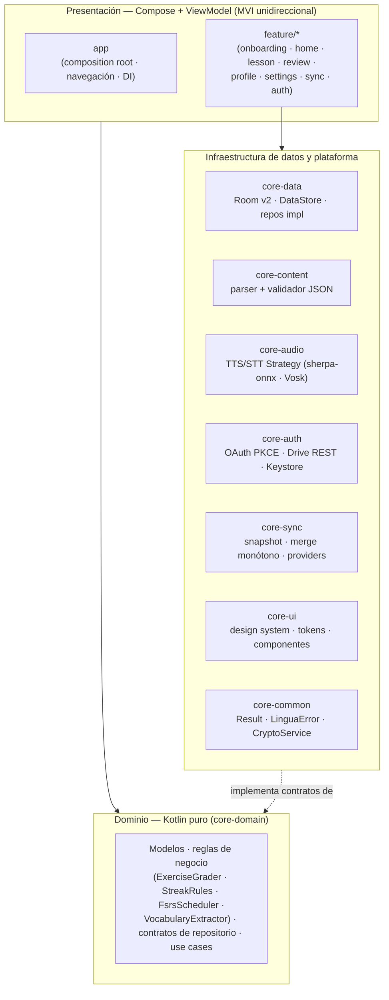
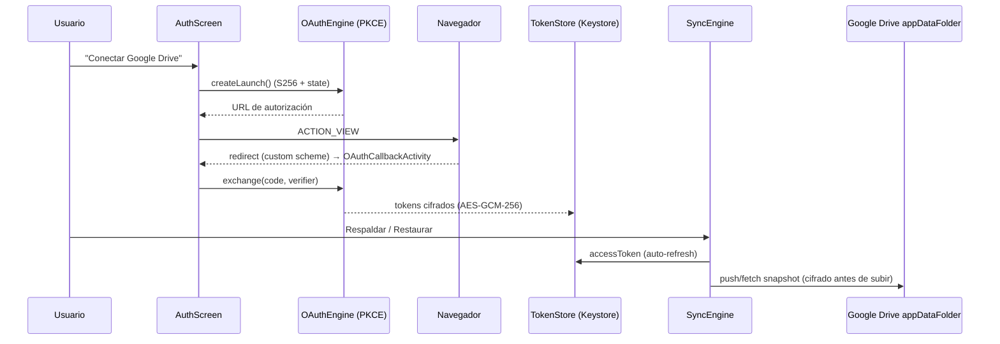
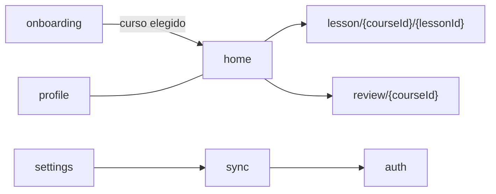

# Arquitectura — LinguaGo

> Documento de referencia técnica. Toda decisión debe trazarse a este documento
> o a un ADR en `docs/DECISIONS.md`. Estado: **v0.2.0** (Fases 0–7 completas).

## 1. Estilo

**Clean Architecture** con modularización por features y separación estricta
de capas. La regla de dependencia apunta siempre hacia el dominio.



**Regla de dependencia:** las capas externas dependen de las internas, nunca
al revés. El dominio no conoce Compose, Room, Drive ni JNI.

## 2. Módulos Gradle (21 + build-logic)

```
app/                       → Composition root: MainActivity, navegación, DI de app, OAuthCallbackActivity
core/
  core-common/             → Result, LinguaError, DispatcherProvider, CryptoService (contrato)
  core-domain/             → Entidades, reglas puras, contratos de repositorio y use cases (Kotlin puro)
  core-ui/                 → Design system: tokens, tema, componentes atómicos (+ tests instrumentados)
  core-data/               → Room v2, DataStore, repositorios concretos y use cases impl
  core-content/            → Loader y validador del contenido JSON empaquetado
  core-audio/              → Contratos TtsEngine/SttEngine + System/Piper/Vosk + integridad SHA-256
  core-auth/               → OAuth 2.0 PKCE, TokenStore cifrado, Google Drive REST, Keystore
  core-sync/               → CloudProvider (Strategy), selector, SyncEngine, SnapshotCodec
feature/
  feature-onboarding/      → Selección de curso
  feature-home/            → Ruta de aprendizaje + entrada al repaso
  feature-lesson/          → Motor de lección (FSM en UI) con audio y SpeakRepeat
  feature-review/          → Repaso espaciado FSRS (tarjeta → 4 ratings)
  feature-profile/         → Estadísticas de progreso
  feature-settings/        → Tema, curso activo, acceso a cuenta/sync
  feature-sync/            → Respaldo y restauración manual
  feature-auth/            → Vinculación/desvinculación de cuentas (Google Drive / laboratorio)
content/
  content-es-en/           → Assets del curso ES→EN (course.json + manifest.json)
  content-es-pt/  content-es-fr/  content-es-ja/
build-logic/               → Convention plugins (included build)
```

### Reglas de dependencia entre módulos

| Origen | Puede depender de | No puede depender de |
|---|---|---|
| `feature/*` | `core/*` | otro `feature/*` |
| `core/*` | otros `core/*` según capa | `feature/*` |
| `app` | todos | — |
| `content/*` | — (assets puros) | nada |
| `core-domain` | `core-common` | Android, Compose, Room, Drive |
| `core-sync` | `core-domain` (api), `core-common` | `core-auth` (evita ciclo) |

### Convention plugins (`build-logic`)

| Plugin id | Aplica |
|---|---|
| `linguago.android.library` | `com.android.library` + config base (minSdk 26, compileSdk 37, JVM 17) + quality |
| `linguago.android.library.compose` | lo anterior + Compose compiler |
| `linguago.android.application` | `com.android.application` + config base |
| `linguago.android.feature` | library compose + Hilt + dependencias comunes de feature |
| `linguago.kotlin.library` | `org.jetbrains.kotlin.jvm` para módulos puros |
| `linguago.hilt` | KSP + Hilt compiler (sin kapt) |
| `linguago.quality` | ktlint + detekt |
| `linguago.content.module` | library + assets del curso |

## 3. Patrones aplicados

| Patrón | Dónde | Justificación |
|---|---|---|
| MVVM + MVI | Presentación | Estado unidireccional (`StateFlow`), predecible y testeable |
| Repository | Data | Abstrae origen local (Room/DataStore/assets) vs cloud |
| Strategy | Audio, Sync | Intercambiar motores TTS/STT y proveedores cloud sin tocar consumidores |
| FSM | Motor de lección | La sesión de lección tiene estados finitos (feedback → avance → cierre) |
| Result-as-error | Todo el código | `Result<T>` + `LinguaError` en vez de excepciones entre capas (I7) |
| Scheduler puro | FSRS | `FsrsScheduler` sin Android: testeable en JVM |
| Delegating provider | Sync | `DelegatingCloudProvider` elige el proveedor vinculado en runtime |
| DI | Todo | Hilt (KSP); bindings por módulo; variantes debug/release |

## 4. Stack

| Componente | Versión | Rol |
|---|---|---|
| Kotlin | 2.4.21 | Lenguaje |
| AGP / Gradle | 9.4.1 / 9.8.1 | Build system (config cache activo) |
| Jetpack Compose | BOM 2026.09.00 | UI declarativa (Material 3, design system propio) |
| Hilt | 2.60.1 | DI (KSP) |
| Room | 2.8.5 | Persistencia estructurada (v2) |
| DataStore | 1.2.1 | Preferencias + tokens OAuth cifrados |
| Navigation Compose | 2.10.2 | Navegación |
| kotlinx-coroutines / serialization | 1.11.0 / 1.11.0 | Concurrencia / JSON |
| OkHttp | 4.12.0 | OAuth y Google Drive REST (core-auth) |
| sherpa-onnx | v1.13.5 (JitPack) | Runtime TTS Piper offline |
| Vosk | 0.3.47 | STT offline (usa JNA) |
| JUnit4 / androidx.test / Espresso | 4.13.2 / 1.2.1+1.6.2 / 3.7.0 | Tests unitarios e instrumentados |
| ktlint / detekt | 14.2.0 / 1.23.8 | Calidad (en CI) |

## 5. Capa de datos (Room v2 · ADR-005/014/016)

`linguago.db` (versión 2, migración 1→2 sin pérdida):

| Tabla | Clave | Contenido |
|---|---|---|
| `streak_progress` | singleton `id=1` | racha actual/máxima, último día, XP total |
| `lesson_progress` | `lessonId` | completado, XP de la lección, intentos |
| `word_progress` | (`word`, `courseId`) | estado FSRS: reviewCount, stability, difficulty, lastReview, nextReview, traducción |

DataStore (privado de la app):

- `linguago_user_preferences` — curso activo, tema.
- `linguago_auth.preferences_pb` — tokens OAuth **cifrados** (hex de AES-GCM, ADR-014) con migración de tokens en claro preexistentes.

## 6. Contenido (ADR-006/009/012)

- El contenido vive como **assets** en `content/*/src/main/assets/courses/<id>/`:
  `manifest.json` (tarjeta ligera) + `course.json` (curso completo).
- El contrato formal es `docs/schemas/course-v1.json` (draft-07) y su guía de autoría está en `CONTENT_FORMAT.md`.
- `core-content` decodifica con kotlinx-serialization directo sobre el dominio (sin DTOs) y valida estructura al cargar; un contenido inválido produce `InvalidContent` visible, nunca una sesión rota (I9).
- **Gates**: `./gradlew validateContent` valida los 4 cursos contra el schema; corre en CI antes de los tests.
- Regla de oro de autoría: **UTF-8 sin BOM** (un BOM rompe el parseo).

## 7. Audio offline (ADR-003/006/010)

- Contratos `TtsEngine` / `SttEngine` en `core-audio`; implementaciones intercambiables y selección por idioma:
  - **TTS**: `SystemTtsEngine` (base universal) → `PiperTtsEngine` (sherpa-onnx) cuando hay voz verificada. Voces: `en_US-amy-medium`, `pt_BR-faber-medium`, `fr_FR-siwis-medium`; `ja` queda en TTS del sistema.
  - **STT**: `VoskSttEngine` (modelos small por idioma) para SpeakRepeat; usa **JNA**.
- Los modelos **no se commitean**: se descargan con `./gradlew fetchVoiceModels` (fuera de CI) y se verifican por **SHA-256** contra `models/manifest.json` antes de cargar (`ModelIntegrity`). Hash inválido ⇒ modelo desactivado.
- Sin modelos/permiso, los ejercicios degradan sin bloquear (I3): audio deshabilitado y "No puedo hablar ahora".
- R8: `app/proguard-rules.pro` mantiene serializers, sherpa-onnx, Vosk y **JNA** (sin keeps, el STT revienta con `UnsatisfiedLinkError`).

## 8. Autenticación y sincronización (ADR-011/013/014/016)



- **OAuth 2.0 + PKCE** (RFC 7636, sin secretos ni Play Services); redirect custom configurable por properties (`googleClientId`, `oauthRedirectScheme`, `oauthRedirectUri`).
- **Snapshot v1** (`SyncSnapshot`): JSON (`schemaVersion=1`, racha, XP, lecciones) **cifrado AES-GCM-256 con clave en Android Keystore** antes de subir (ADR-014). Versión desconocida ⇒ `InvalidContent`.
- **Merge monótono**: `max` por campo; lecciones por id (`completed` = OR). Nunca elimina progreso (I4). Sin timestamps que reconciliar.
- **Proveedores** (Strategy): `google_drive` (real), `dev_local` (laboratorio, **solo debug**), `NoopCloudProvider` (fallback). `DelegatingCloudProvider` re-evalúa el mapa en cada operación.
- El estado FSRS (`word_progress`) **no se sincroniza** en v1 (ADR-016): el merge monótono no aplica a estabilidad/dificultad.
- OneDrive (`appfolder` vía MSAL) está **diferido** en ADR-015.

## 9. Navegación



Rutas en `app/.../Routes.kt`. La barra inferior muestra Inicio/Progreso/Ajustes; las pantallas de flujo (lección, repaso, sync, auth) no la muestran.

## 10. Testing y calidad

| Nivel | Dónde | Qué cubre |
|---|---|---|
| Unit tests (JVM) | `core-domain`, `core-sync`, `core-auth` | graders, reglas de racha, FSRS, merge de snapshots, codec, OAuth/Drive con MockWebServer, cifrado |
| Instrumented | `core-ui` (`src/androidTest`) | contrato de accesibilidad I8: roles TalkBack, live regions, touch targets ≥48dp, fontScale 2x |
| Contenido | tarea `validateContent` | los 4 `course.json` contra el schema v1 |

CI (`.github/workflows/ci.yml`), dos jobs por push/PR:

1. **Build · ktlint · detekt · tests · release**: `ktlintCheck detekt validateContent test` + `assembleFullDebug` + `assembleFullRelease` + `assembleEnRelease` (R8) + artefactos.
2. **Instrumented · core-ui (API 34)**: emulador con KVM + `:core:core-ui:connectedDebugAndroidTest`.

Comandos locales:

```bash
./gradlew ktlintCheck detekt validateContent test   # gate completo
./gradlew ktlintFormat                              # autofix de estilo
./gradlew :core:core-ui:connectedDebugAndroidTest   # instrumentados (emulador/dispositivo)
```

## 11. Nombres de paquetes

Raíz `dev.linguago.*` — refleja la ruta del módulo:

| Módulo | Paquete |
|---|---|
| `core/core-domain` | `dev.linguago.core.domain` |
| `core/core-ui` | `dev.linguago.core.ui` |
| `core/core-auth` | `dev.linguago.core.auth` |
| `feature/feature-lesson` | `dev.linguago.feature.lesson` |
| `content/content-es-en` | `dev.linguago.content.es_en` |

## 12. Invariantes (resumen)

| # | Invariante | Dónde se garantiza |
|---|---|---|
| I1 | Offline-first estricto | todo el contenido y modelos son assets; sync es opcional |
| I2 | Sin backend propio | Drive/OneDrive solo como respaldo del usuario |
| I3 | Sin fricción | degradación limpia (audio/STT/sync deshabilitados sin bloquear) |
| I4 | Progreso intocable | merge monótono, upserts acumulativos, XP nunca decrece |
| I5 | Identidad original | tokens/íconos propios en `core-ui` |
| I6 | Código abierto | MIT + CC BY-SA 4.0 |
| I7 | Testabilidad | dominio puro + inyección de dispatchers/tiempo |
| I8 | Accesibilidad | semántica de componentes + tests instrumentados |
| I9 | Contenido validado | schema v1 + `validateContent` en CI |
