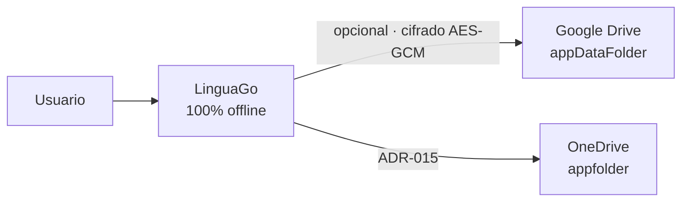

# LinguaGo

<div align="center">

**Aprende idiomas offline, sin fricción, con todo el contenido desde la instalación.**

ES → EN · ES → PT · ES → FR · ES → JA — A1 a B2 (y N5–N3 para japonés)

Código abierto · Sin anuncios · Sin vidas · Sin backend · 100% offline

[](https://github.com/MREmmanuel09/LinguaGo/actions/workflows/ci.yml)


[](./LICENSE-CONTENT)

</div>

---

LinguaGo es una app Android nativa de aprendizaje de idiomas estructurada sobre
Clean Architecture, con módulos Gradle por feature, motor de lecciones basado en
máquina de estados, racha diaria progresiva, **repaso espaciado FSRS** y modelos
de voz ligeros integrados localmente (TTS Piper + STT Vosk).



## Documentación

| Documento | Contenido |
|---|---|
| [ARCHITECTURE.md](ARCHITECTURE.md) | Mapa técnico: capas, módulos, patrones, stack, datos, sync, testing |
| [docs/DECISIONS.md](docs/DECISIONS.md) | ADRs 000–016 con índice y registro de pendientes |
| [CONTENT_FORMAT.md](CONTENT_FORMAT.md) | Contrato del contenido v1: cómo escribir lecciones y ejercicios |
| [docs/MODELS.md](docs/MODELS.md) | Política y estado de los modelos TTS/STT |
| [docs/schemas/course-v1.json](docs/schemas/course-v1.json) | JSON Schema formal del contenido |
| [CHANGELOG.md](CHANGELOG.md) | Historial de versiones (Keep a Changelog) |
| [SECURITY.md](SECURITY.md) | Política de seguridad y reporte de vulnerabilidades |
| [AGENTS.md](AGENTS.md) | Guía para agentes IA y contribuidores automatizados |
| [llms.txt](llms.txt) | Índice compacto para consumo por IA (llmstxt.org) |
| [CONTRIBUTING.md](CONTRIBUTING.md) · [CODE_OF_CONDUCT.md](CODE_OF_CONDUCT.md) | Cómo contribuir |

## Principios (invariantes)

1. **Offline-first estricto** — ninguna ruta crítica de aprendizaje necesita red.
2. **Sin backend propio** — la nube es opcional y solo como respaldo (Google Drive).
3. **Sin fricción** — no hay login obligatorio, ni vidas, ni anuncios, ni esperas.
4. **Progreso intocable** — la sincronización nunca elimina avances del usuario.
5. **Identidad original** — cero elementos de terceros en marca, arte o contenido.
6. **Código abierto real** — MIT para código, CC BY-SA 4.0 para contenido.
7. **Testabilidad** — toda lógica de negocio es testeable en aislamiento.
8. **Accesibilidad** — TalkBack, contraste y tamaños dinámicos desde el día uno.

## Estado

| Fase | Contenido | Estado |
|---|---|---|
| 0 | Repositorio, CI, convenciones | ✅ |
| 1 | Dominio, datos, UI base, onboarding | ✅ |
| 2 | Lecciones, TTS (Piper), STT (Vosk) | ✅ |
| 3 | Contenido v1 validado + sync snapshot (ADR-012/013) | ✅ |
| 4.1 | OAuth 2.0 + PKCE con Google Drive (ADR-011) | ✅ |
| 4.2 | Cifrado AES-GCM-256 con Keystore (ADR-014) | ✅ |
| 4.3 | Release config (R8) + documentación | ✅ |
| 5 | Repaso espaciado FSRS (ADR-016) | ✅ |
| 6 | Accesibilidad I8 + tests instrumentados | ✅ |
| 7 | Pulido: stats de progreso y versión 0.2.0 | ✅ |
| Pendiente | OneDrive (ADR-015), validación de voz pt/fr/ja en hardware | ⏳ |

## Módulos

| Módulo | Rol |
|---|---|
| `app` | Composition root, navegación, DI |
| `core/core-domain` | Entidades, contratos y reglas (Kotlin puro) |
| `core/core-ui` | Design system y componentes atómicos |
| `core/core-data` | Room, DataStore, repositorios |
| `core/core-content` | Parser y validador de contenido JSON |
| `core/core-audio` | Estrategias TTS/STT (Piper + Vosk + sistema) |
| `core/core-auth` | OAuth 2.0/PKCE, tokens, Google Drive REST, Keystore |
| `core/core-sync` | Snapshot v1, merge monótono, proveedores cloud |
| `core/core-common` | Utilidades transversales (Result, errores, cifrado) |
| `feature/*` | Pantallas por feature |
| `content/*` | Assets del contenido pedagógico |

Las decisiones de arquitectura están registradas en
[docs/DECISIONS.md](docs/DECISIONS.md) (ADRs 000–016).

## Compilar y ejecutar

```bash
git clone https://github.com/MREmmanuel09/LinguaGo.git
cd LinguaGo

# Requisitos: JDK 17+ (o el JBR de Android Studio) y Android SDK.
# Si el SDK no está en la ruta por defecto, crea local.properties:
#   sdk.dir=C\:\\Users\\TU_USUARIO\\AppData\\Local\\Android\\Sdk

./gradlew assembleFullDebug
# APK debug con los 4 idiomas en app/build/outputs/apk/full/debug/
./gradlew assembleEnDebug
# APK solo inglés (flavors en/pt/fr/ja); universal + arm64-v8a en
# app/build/outputs/apk/en/debug/
```

### Modelos de voz (TTS Piper / STT Vosk)

Los modelos de voz **no se commitean** (ADR-006). Se descargan y verifican por
SHA-256 contra `models/manifest.json`; ver `docs/MODELS.md`. Sin modelos, los
ejercicios de escucha/pronunciación se degradan sin bloquear la app (I3).

## Sincronización con Google Drive (opcional)

La app funciona 100% sin cuenta. Para habilitar el respaldo real en Google
Drive (carpeta privada `appDataFolder`, cifrado en el dispositivo con
AES-GCM-256 antes de subir):

1. En [Google Cloud Console](https://console.cloud.google.com/) crea un
   proyecto y habilita **Google Drive API**.
2. Crea un **OAuth client ID** de tipo **iOS** (es el tipo que admite
   redirect por esquema custom en apps nativas). Usa un bundle ID propio,
   p. ej. `dev.linguago.app`.
3. Google deriva el redirect:
   `com.googleusercontent.apps.<CLIENT_ID>:/oauth2redirect`.
4. Compila con las properties (o escríbelas en `local.properties`):

```properties
googleClientId=TU_CLIENT_ID.apps.googleusercontent.com
oauthRedirectScheme=com.googleusercontent.apps.TU_CLIENT_ID
oauthRedirectUri=com.googleusercontent.apps.TU_CLIENT_ID:/oauth2redirect
```

Sin `googleClientId`, la pantalla de cuenta muestra el proveedor como
"Sin configurar" y el resto de la app no cambia.

### Proveedor de laboratorio (solo debug)

En builds debug existe el proveedor `dev_local`: vincula una "cuenta" local
y permite probar el flujo completo Auth → Backup → Restore sin credenciales
ni red. No se compila en release.

## Release y firma

```bash
# Build release con R8 + resource shrinker (todos los idiomas)
./gradlew assembleFullRelease
# Por idioma (ADR-017): en/pt/fr/ja → app/build/outputs/apk/<flavor>/release/
./gradlew assembleEnRelease
```

Sin keystore configurado, el release se firma con la clave **debug** solo
para smoke tests locales (nunca distribuir ese APK). Para distribuir, genera
un keystore y pásalo por properties (no las commitees):

```properties
linguago.storeFile=ruta/a/linguago-release.jks
linguago.storePassword=…
linguago.keyAlias=linguago
linguago.keyPassword=…
```

```bash
./gradlew assembleEnRelease
# APK firmado en app/build/outputs/apk/en/release/
```

El CI valida `assembleFullRelease` + `assembleEnRelease` (R8/shrink) en cada push.

## Calidad y CI

```bash
./gradlew ktlintCheck detekt validateContent test   # gate completo
./gradlew ktlintFormat                              # autofix de estilo
```

- GitHub Actions (`.github/workflows/ci.yml`): gate de calidad, `assembleFullDebug`,
  `assembleFullRelease` + `assembleEnRelease` (R8) y tests instrumentados
  (emulador API 34) en cada push/PR.
- `validateContent` valida los 4 cursos contra `docs/schemas/course-v1.json`
  (ADR-012) antes de testear.

### Tests instrumentados (accesibilidad)

`ash
# Con un emulador/dispositivo conectado (API 34+):
./gradlew :core:core-ui:connectedDebugAndroidTest
`

Cubren el contrato del design system (invariante I8): roles de TalkBack
(Button/RadioButton), estado de selección, live region del feedback,
ProgressBarRangeInfo de la barra, descripción de racha, touch targets
≥ 48dp y supervivencia a ontScale = 2x.

## Licencias

- Código: [MIT](./LICENSE)
- Contenido pedagógico: [CC BY-SA 4.0](./LICENSE-CONTENT)

## Contribuir

Lee [CONTRIBUTING.md](./CONTRIBUTING.md). Las decisiones de diseño quedan
registradas en [docs/DECISIONS.md](docs/DECISIONS.md) como ADRs.
