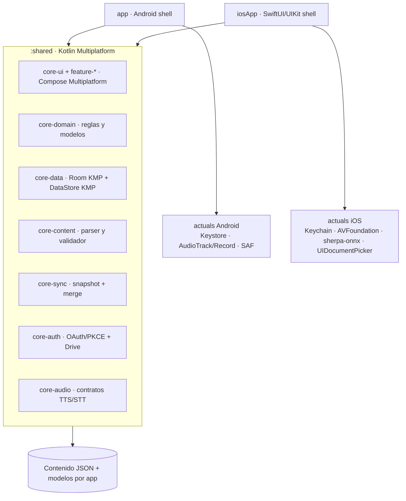

# Plan de migración a Kotlin Multiplatform (Android + iOS)

> **Estado:** propuesta para aprobación · **Fecha:** 2026-11-20
> **ADRs relacionados:** ADR-060 (arquitectura KMP), ADR-061 (UI compartida),
> ADR-062 (respaldo cifrado portable).
> **Alcance:** llevar LinguaGo a Android e iOS sobre una base compartida y
> dejar un flujo de trabajo que permita seguir añadiendo features a ambas
> plataformas sin duplicar lógica, datos, diseño ni pruebas.
>
> Este documento **no autoriza cambios de producción** hasta que se aprueben
> las decisiones de la §3. La Fase 0 es precisamente la validación técnica de
> esas decisiones.

---

## 1. Resumen ejecutivo

LinguaGo es hoy una app Android de 23 módulos Gradle, ~38.500 líneas Kotlin
(main + test) y 273 archivos. La arquitectura ya está separada en dominio,
datos, contenido, audio, auth, sync, UI y features, lo que permite migrar por
capas. El objetivo es **una sola base Kotlin Multiplatform (KMP)** que compile
para Android e iOS, con:

- **UI compartida** en Compose Multiplatform (CMP), porque el 100 % de la UI
  actual ya es Compose y reescribirla en SwiftUI duplicaría el trabajo.
- **Dominio, datos, contenido, sync, auth y audio** en `commonMain`, con
  implementaciones de plataforma en `androidMain`/`iosMain`.
- **Shells nativos delgados**: `app` en Android y `iosApp` en SwiftUI/UIKit
  para ciclo de vida, permisos, OAuth, selector de archivos, sesión de audio,
  Keychain y poco más.
- **Migración incremental**: Android sigue publicando en cada fase; no hay
  reescritura big-bang ni congelación total del producto.
- **Paridad funcional** antes de considerar la base “compatible”: lecciones,
  repaso FSRS, examen de nivelación, audio offline, progreso, sync, ajustes,
  accesibilidad y modo oscuro.

La migración es viable, pero **no es un port mecánico**. Los bloqueadores
reales son: audio nativo en iOS, tamaño de app, Hilt (Android-only), APIs de
UI específicas de Android y un hallazgo crítico de sync: el respaldo cifrado
actual usa una clave de Android Keystore no exportable, por lo que no se puede
restaurar en otro dispositivo ni en iOS (ver §4.5, H1). Ese punto se corrige
con ADR-062 antes de prometer sincronización multiplataforma.

**Esfuerzo estimado:** 26–37 semanas de una persona a tiempo completo
(≈6–9 meses), con apoyo de IA y sin contar esperas de Apple. A tiempo parcial,
multiplicar por 1,5–2. El camino crítico es Fase 0 → 1 → 2 → 4 → 5 → 6; la
Fase 3 (audio/auth) puede solaparse con la 4 después de la Fase 2.

**Condiciones externas imprescindibles:** Mac con Xcode, iPhone real para
audio y TestFlight, Apple Developer Program y un cliente OAuth de iOS en
Google Cloud. Sin ellas se puede avanzar en código compartido y CI, pero no
cerrar la paridad ni publicar.

---

## 2. Objetivos, alcance y no objetivos

### 2.1 Objetivos

1. Compartir la lógica de negocio, persistencia, contenido, sync, auth y
   contratos de audio entre Android e iOS.
2. Compartir la UI y el design system con CMP, manteniendo la identidad
   visual y la accesibilidad.
3. Mantener Android funcionando y publicando durante toda la migración.
4. Alcanzar paridad funcional en iOS con audio 100 % offline y degradación
   elegante (I3).
5. Dejar una base que permita añadir una feature nueva una sola vez y
   publicarla en ambas plataformas.
6. Conservar los invariantes I1–I9 y el progreso del usuario (I4).
7. Automatizar build, test y release de ambas plataformas desde el mismo
   repositorio y la misma etiqueta.

### 2.2 Criterios de éxito (“base compatible”)

La migración se considera cerrada cuando:

- [ ] Android e iOS compilan desde el mismo commit y la misma etiqueta.
- [ ] Al menos el 90 % del código de dominio, datos, contenido, sync y UI
      vive en `commonMain`; el resto son `actual`/shells justificados.
- [ ] Room usa el mismo schema y las mismas migraciones en ambas plataformas;
      una base Android v5 se abre en iOS sin pérdida y viceversa.
- [ ] Un snapshot de progreso creado en Android se restaura en iOS y
      viceversa, con merge monótono y sin degradar datos (I4).
- [ ] TTS y STT funcionan offline en iOS con modelos empaquetados; si faltan,
      degradan al TTS del sistema o a dictado escrito sin bloquear (I3).
- [ ] OAuth con Google Drive y el respaldo cifrado funcionan en iPhone.
- [ ] La app completa (onboarding, lección, repaso, nivelación, perfil,
      ajustes y sync) funciona en un iPhone real.
- [ ] VoiceOver, modo oscuro, tamaño de texto y touch targets pasan la
      auditoría de accesibilidad.
- [ ] CI tiene jobs Android y macOS/iOS en verde.
- [ ] Existe Runbook de release para Android y para iOS/TestFlight/App Store.
- [ ] Una feature nueva de prueba se implementa una vez y se ve en ambas
      plataformas sin código duplicado.

### 2.3 No objetivos de la primera versión iOS

- iPad con layout específico (se puede publicar iPhone-only y añadir iPad
  después; decisión pendiente D6).
- Reloj, widgets, Live Activities, CarPlay o extensiones.
- OneDrive (ADR-015 sigue diferido).
- Backend propio, cuentas propias, analítica de terceros o publicidad.
- Compras integradas o suscripciones (el producto es propietario, pero no
  hay IAP en el alcance actual).
- Unificar Android de Vosk a sherpa-onnx en la primera entrega; se evalúa
  después de la paridad.
- Traducción completa de la interfaz a inglés; la UI sigue en español y el
  contenido conserva sus cuatro cursos.

### 2.4 Invariantes y cómo se preservan

| Invariante | Riesgo en la migración | Medida |
|---|---|---|
| I1 offline-first | Un pack descargable o un motor que consulta red | Modelos y contenido empaquetados; la nube solo respalda; sin red en la ruta de lección |
| I2 sin backend propio | Introducir un servidor para packs o sync | Google Drive directo; si se usan Background Assets, es CDN de Apple, no backend propio |
| I3 sin fricción | Pedir contraseña de respaldo, permisos o modelos | Solo se pide al activar respaldo o usar micrófono; siempre hay fallback y se puede avanzar |
| I4 progreso intocable | Migración Room/KMP o merge distinto | Mismas migraciones y tests en ambas plataformas; merge monótono intacto; backup previo y rollback |
| I5 identidad original | Rehacer la UI “como iOS” | Mismos tokens, tipografía y componentes; shell nativo solo para servicios |
| I6 software propietario | Nuevas dependencias o modelos con licencia incompatible | Auditoría de licencias; avisos de terceros; modelos con uso comercial permitido |
| I7 testabilidad | Lógica enterrada en `actual` o en Swift | Contratos en `commonMain`, tests comunes y tests de plataforma solo para integración |
| I8 accesibilidad | VoiceOver, dynamic type o contraste en CMP | Auditoría y tests; roles semánticos; tamaños y contraste equivalentes |
| I9 contenido validado | Copia de assets a iOS desincronizada | Una sola fuente de JSON; `validateContent` en CI; hash/tarea de copia a iOS |

---

## 3. Decisiones que requieren aprobación

| ID | Decisión | Recomendación | Alternativas | Impacto si se cambia |
|---|---|---|---|---|
| **D1** | Estrategia de UI | **Compose Multiplatform** para todas las pantallas y el design system; SwiftUI solo como shell | KMP de lógica + SwiftUI nativo; UIKit | SwiftUI duplica ~15.500 líneas de UI y crea dos equipos de diseño para siempre |
| **D2** | Versión mínima de iOS | **iOS 16.0** | iOS 15 (más cobertura, menos APIs modernas); iOS 17 (menos cobertura, más simple) | Cambia el mínimo de Xcode, Background Assets y la matriz de dispositivos |
| **D3** | Distribución y tamaño | **Beta: app universal** para validar paridad. **Release: decidir con medidas** entre (A) apps por idioma o (B) app única con Background Assets. **No usar On-Demand Resources**: están deprecados en iOS 27 | App universal de ~400 MB; apps por idioma de ~120–180 MB; app única con packs | Afecta I2, conversión de App Store, número de listados y esfuerzo de release |
| **D4** | Audio iOS | **sherpa-onnx para TTS y STT** en iOS (SPM/xcframework) + `AVSpeechSynthesizer` como fallback; Android conserva sus motores actuales | Vosk iOS (soporte limitado, librería no empaquetada); Apple Speech (no garantiza offline ni modelos propios); WhisperKit (más peso) | Cambia tamaño, latencia, licencias y pipeline de modelos |
| **D5** | Respaldo multiplataforma | **Envelope v2 con secreto de recuperación** (ADR-062) como prerrequisito de sync en iOS | Solo mismo dispositivo (rompe la promesa); nube sin cifrar (inaceptable); clave en Drive (riesgo) | Sin esto, el respaldo Android no se restaura en iOS ni tras reinstalar |
| **D6** | iPad | **iPhone-only en v1**; layout adaptativo después | Universal desde el inicio | Añade pruebas, capturas y diseño adaptativo; no bloquea Android |
| **D7** | Versión de paridad | **4.0.0** para el primer release dual; Android 3.x recibe mantenimiento mientras tanto | iOS 1.0.0 separado de Android 4.0.0 | Simplifica el discurso de producto y las etiquetas; requiere plan de migración de versión |

Las decisiones D1–D5 se ratifican con los ADR-060/061/062. D6 y D7 pueden
cerrarse en la Fase 0 sin bloquear el resto.

---

## 4. Estado actual y hallazgos

### 4.1 Inventario de módulos

Líneas `src/main` (no incluye tests); la columna “Acoplamiento Android” indica
cuántos archivos main importan `android.*`/`androidx.*` y si hay Hilt.

| Módulo | Líneas main | Archivos main | Acoplamiento Android | Complejidad KMP |
|---|---:|---:|---|---|
| `core-common` | 115 | 4 | Ninguno | Baja |
| `core-domain` | 2.937 | 31 | Ninguno; `java.time` en 5 archivos | Baja-media |
| `core-data` | 1.381 | 13 | Room, DataStore, `Context`, Hilt | Alta |
| `core-content` | 709 | 5 | `Context.assets`, Hilt | Media |
| `core-sync` | 217 | 7 | Hilt; dependencia WorkManager | Media |
| `core-auth` | 1.034 | 14 | Keystore, DataStore, OkHttp, Hilt | Alta |
| `core-audio` | 1.326 | 15 | `AudioTrack`, `AudioRecord`, `TextToSpeech`, JNA/Vosk, AAR sherpa-onnx, Hilt | Muy alta |
| `core-ui` | 6.457 | 57 | 50 archivos con imports Android/AndroidX; `LocalContext`, recursos, sonido | Alta |
| `feature-onboarding` | 332 | 2 | Compose, Hilt, `Context` | Media |
| `feature-auth` | 374 | 2 | Compose, Hilt, `Context` | Media |
| `feature-home` | 969 | 6 | Compose, Hilt, `Context` | Media |
| `feature-lesson` | 3.127 | 8 | Compose, Hilt, permisos, IME, `ActivityResult` | Alta |
| `feature-placement` | 1.196 | 2 | Compose, Hilt, audio | Media-alta |
| `feature-profile` | 836 | 3 | Compose, Hilt | Media |
| `feature-review` | 654 | 3 | Compose, Hilt, audio | Media |
| `feature-settings` | 482 | 2 | Compose, Hilt, audio | Media |
| `feature-sync` | 508 | 2 | Compose, Hilt, `ActivityResult`/SAF | Media |
| `app` | 596 | 8 | Hilt, Activity, Navigation, OAuth callback | Media |
| `qa` | 1.892 | 7 | `com.android.test`, UIAutomator | Se queda Android-only |
| `baselineprofile` | 163 | 1 | Macrobenchmark | Se queda Android-only |
| `content-*` (4) | assets | — | Assets Android | Copiar a iOS |

Totales: ~25.000 líneas main (38.500 con tests), 191 archivos main y 95 con
imports Android/AndroidX. Muchos de esos imports son Compose portable; el
trabajo real de UI es menor de lo que sugiere el número, pero sigue siendo
amplio.

### 4.2 Puntos de acoplamiento Android

1. **Hilt** en 21 archivos: `@HiltAndroidApp`, `@AndroidEntryPoint`,
   `@Inject`, `@Singleton`, `@Module`, `@Binds`, `@Named` y `hiltViewModel`.
   Hilt no existe en iOS.
2. **Context/recursos**: `Context.assets`, `LocalContext`, `painterResource`,
   `stringResource`, `ContextCompat`, `Uri`, `Intent`, `PackageManager`.
3. **Room/DataStore**: `Room.databaseBuilder(context, ...)`,
   `preferencesDataStore` delegate, `SupportSQLiteDatabase` en migraciones.
4. **Audio**: `AudioTrack`, `AudioRecord`, `MediaRecorder`, `TextToSpeech`,
   `org.vosk.**`, JNA y el AAR de sherpa-onnx.
5. **Auth**: Android Keystore, `java.security`, `java.net.URLEncoder`,
   `OkHttp`, DataStore.
6. **UI Android**: `BackHandler`, `rememberLauncherForActivityResult`,
   `ActivityResultContracts`, `isImeVisible`, `hiltViewModel`,
   `collectAsStateWithLifecycle`.
7. **Ciclo de vida**: `Activity`, `Application`, `OAuthCallbackActivity`,
   `SavedStateHandle`, Navigation Android.
8. **Archivos**: SAF (`CreateDocument`/`OpenDocument`), `java.io.File`.
9. **Concurrencia JVM**: `java.util.concurrent.ConcurrentHashMap`,
   `java.nio.ByteBuffer`, `java.text.Normalizer`.
10. **Build**: `com.android.library`/`application`, flavors por idioma,
    Baseline Profiles y QA instrumentado.

### 4.3 Activos, contenido y tamaño

- **Modelos:** 522,6 MB totales (STT Vosk 278,3 MB + TTS Piper 244,3 MB).
  Por idioma, ~120–180 MB.
- **APK 3.5.4:** ~400 MB universal, ~360 MB arm64. La release usa flavors por
  idioma para no empaquetar los cuatro cursos siempre.
- **Contenido:** 417 lecciones y 4.087 ejercicios; JSON schema v2 validado.
- **iOS:** el límite de descarga celular de App Store es 200 MB por variante
  (aviso, no rechazo). Un binario universal de ~400 MB obligaría a Wi-Fi.
  On-Demand Resources está deprecado desde iOS 27; la alternativa moderna es
  Background Assets (iOS 16+), con packs esenciales y descargables.
- **Modelos en iOS:** sherpa-onnx publica xcframework vía SPM (iOS 15+);
  Vosk iOS no tiene un paquete oficial mantenido equivalente. Los modelos
  STT de sherpa-onnx para en/pt/fr/ja deben seleccionarse por tamaño,
  latencia y licencia comercial.

### 4.4 Versiones ya compatibles

El catálogo actual ya está en versiones que admiten KMP o tienen equivalente:

| Componente | Actual | Destino KMP |
|---|---|---|
| Kotlin | 2.4.21 | 2.4.21 |
| AGP / Gradle | 9.4.1 / 9.8.1 | 9.4.1 / 9.8.1 |
| Compose BOM | 2026.09.00 | Compose Multiplatform 1.12.2 |
| Room | 2.8.5 | Room KMP 2.8.5 + `sqlite-bundled` 2.7.x |
| DataStore | 1.2.1 | DataStore KMP 1.3.0 |
| Lifecycle / ViewModel | 2.11.0 | Lifecycle KMP 2.11.0 |
| Navigation | 2.10.2 (AndroidX) | Navigation Compose KMP 2.9.2 |
| Coroutines / Serialization | 1.11.0 / 1.11.0 | Igual |
| KSP | 2.3.12 | Igual, con tareas por target |
| Hilt | 2.60.1 | Koin 4.2.x |
| OkHttp | 4.12.0 | Ktor Client 3.6.1 |
| `java.time` | JDK | `kotlinx-datetime` 0.8.0 / `kotlin.time.Instant` |

No se propone actualizar todo a la vez: se pinchan las versiones KMP y se
valida cada una en la Fase 0.

### 4.5 Hallazgos críticos

**H1 — El respaldo cifrado actual no es portable (P0).**
`KeystoreCryptoService` genera una clave AES aleatoria en AndroidKeyStore y
`SyncEngine` cifra el snapshot con ella. La clave no es exportable y no se
respalda. Por tanto, una copia en Google Drive solo se puede descifrar en la
misma instalación/dispositivo; tras reinstalar, cambiar de teléfono o usar
iOS, `restore()` falla. Es un bug latente de la app actual y un bloqueador
directo de la paridad. Se corrige con ADR-062 (envelope v2 + secreto de
recuperación) **antes** de prometer sync en iOS.

**H2 — Tamaño de app (P1).**
Los modelos son el 90 % del tamaño. La estrategia de flavors de Android no
se traduce automáticamente a App Store. Hay que medir el IPA real y elegir
entre apps por idioma o Background Assets; no se puede decidir solo con el
APK.

**H3 — Audio iOS (P1).**
Vosk no tiene un paquete iOS oficial mantenido; sherpa-onnx sí (SPM,
xcframework, iOS 15+). Hay que validar en iPhone real: primera latencia,
memoria, precisión en en/pt/fr/ja, comportamiento con Bluetooth, interrupciones
y modo silencioso. El fallback `AVSpeechSynthesizer` y el dictado escrito son
obligatorios para I3.

**H4 — Hilt no es KMP (P1).**
La migración a Koin toca 21 archivos y todos los ViewModels. Es mecánica pero
transversal; si se hace tarde, bloquea la UI compartida.

**H5 — UI con APIs Android (P1).**
50 archivos de `core-ui` y varios por feature usan `LocalContext`, recursos
Android, `ActivityResult`, `Intent`, `Uri`, `BackHandler`, IME o
`hiltViewModel`. La mayoría son cambios mecánicos a CMP o a interfaces
`expect/actual`; los casos de teclado/IME y permisos requieren prueba en
dispositivo.

**H6 — Contenido y assets (P2).**
`CourseLoader` lee `Context.assets`; iOS necesita `NSBundle` o una copia de
los JSON al bundle. Una sola fuente de verdad y una tarea de build evitan
desincronización.

**H7 — CI y toolchain (P1).**
El CI actual es Ubuntu-only. iOS necesita runner macOS, Xcode, firma y
TestFlight. El desarrollo en Windows no puede compilar iOS localmente; el
gate de iOS será el CI + un Mac de desarrollo.

---

## 5. Arquitectura objetivo

### 5.1 Vista general

La app Android conserva su entrada, flavors, firma y Baseline Profiles. La
app iOS es un proyecto Xcode que enlaza el framework de `:shared` y hospeda
un `ComposeUIViewController`.

### 5.2 Módulos y source sets

| Módulo | Destino | `commonMain` | `androidMain` | `iosMain` |
|---|---|---|---|---|
| `core-common` | KMP library | `Result`, errores, contratos base | — | — |
| `core-domain` | KMP library | Modelos, FSRS, grader, racha, repositorios | — | — |
| `core-data` | KMP library | Entidades, DAOs, DB, migraciones, repos | Driver Android, rutas, Keystore/DataStore | Driver iOS, rutas, DataStore |
| `core-content` | KMP library | Parser, validador, catálogo | `AssetManager` | `NSBundle` |
| `core-sync` | KMP library | Snapshot, codec, merge, motor | Proveedor local Android | Proveedor local iOS |
| `core-auth` | KMP library | OAuth/PKCE, modelos, contratos | Keystore, Custom Tabs, DataStore | Keychain, `ASWebAuthenticationSession` |
| `core-audio` | KMP library | `TtsEngine`, `SttEngine`, estados, integridad | Piper/sherpa-onnx, Vosk, AudioTrack/Record | sherpa-onnx, AVSpeechSynthesizer, AVAudioSession |
| `core-ui` | KMP + CMP | Tokens, tema, componentes, recursos | Recursos Android/preview | Recursos iOS |
| `feature-*` | KMP + CMP | Pantallas, ViewModels, estados | Actuals de permisos/SAF/IME | Actuals iOS |
| `app` | Android application | — | Shell Android | — |
| `iosApp` | Xcode project | — | — | SwiftUI shell |
| `content-*` | Resource-only | JSON compartido | Assets Android | Copia al bundle iOS |
| `qa` / `baselineprofile` | Android-only | — | Tests/macrobenchmark | — |
| `:shared` (nuevo) | KMP umbrella | `App()` + módulos Koin + framework | Framework Android | Framework iOS |

**Reglas de dependencia:** se mantienen las actuales. `feature-*` no depende
de otra `feature-*`; `core-*` no depende de `feature-*`; `content-*` no
depende de nada; `app`/`iosApp` son composition roots. `:shared` solo
agrega y exporta; no contiene lógica de negocio.

### 5.3 Stack objetivo

| Área | Elección | Motivo |
|---|---|---|
| Lenguaje | Kotlin 2.4.21 | Ya en el repo; KMP estable |
| UI | Compose Multiplatform 1.12.2 | Reutiliza la UI Compose actual; iOS estable desde 1.8 |
| Navegación | `org.jetbrains.androidx.navigation:navigation-compose:2.9.2` | API cercana a Navigation actual; back gesture iOS |
| ViewModel/Lifecycle | `org.jetbrains.androidx.lifecycle:lifecycle-*:2.11.0` | ViewModel y `collectAsStateWithLifecycle` en común |
| DI | Koin 4.2.x | KMP, Compose ViewModel, curvas de migración |
| Persistencia | Room KMP 2.8.5 + `sqlite-bundled` | Mismo schema/migraciones; SQLite consistente |
| Preferencias | DataStore KMP 1.3.0 + Okio | Reemplaza el delegate Android |
| HTTP | Ktor Client 3.6.1 (Darwin/OkHttp) | Reemplaza OkHttp; engines por plataforma |
| Fechas | `kotlinx-datetime` 0.8.0 / `kotlin.time.Instant` | Reemplaza `java.time` |
| Serialización | `kotlinx-serialization-json` 1.11.0 | Ya usado; formato estable |
| Imágenes/fuentes | Compose Resources | Reemplaza `R.drawable`/`R.font` |
| Tests comunes | `kotlin.test` + `kotlinx-coroutines-test` | Unit tests en JVM/Android/iOS |
| Tests UI | Compose UI Test multiplataforma + instrumentados Android | Flujos críticos en ambas |
| Audio iOS | sherpa-onnx 2.0.x (SPM) + AVFoundation | TTS/STT offline; Swift API |
| Auth iOS | `ASWebAuthenticationSession` + Keychain | Sin SDK pesado; PKCE existente |
| Firma iOS | Xcode + App Store Connect API key / Fastlane | CI reproducible |

### 5.4 Estrategia de migración incremental

1. **Convertir en el sitio**, no mover carpetas: se preserva el historial y
   los paths de Gradle.
2. **Primero lo puro** (`core-common`, `core-domain`), luego datos, luego
   plataforma, luego UI. Cada fase deja Android compilando y con tests.
3. **Un módulo, un PR**: cambios pequeños, con test común y gate Android.
   Los cambios de UI se hacen feature por feature.
4. **Fachadas primero**: antes de tocar una implementación Android, se define
   la interfaz común y se envuelve la implementación actual como `actual`.
5. **Koin entra por los core** en la Fase 2; las features siguen con Hilt
   hasta la Fase 4. Así se evita un big-bang de DI.
6. **Sin `fallbackToDestructiveMigration`** ni cambios de schema silenciosos:
   cada migración se prueba en Android y iOS.
7. **Feature freeze selectivo** durante las Fases 2–4: solo bugfixes y
   contenido; las features nuevas esperan a que la base esté estable.
8. **Dual-run**: hasta la paridad, Android es la referencia funcional; iOS
   se compara contra ella con una matriz de aceptación.

### 5.5 Cómo se añade una feature después de la migración

- La pantalla y el ViewModel van en `feature-<nombre>/commonMain`.
- Los tokens/componentes van en `core-ui/commonMain`.
- La lógica de negocio y los contratos van en `core-domain`; la persistencia
  en `core-data`; el contenido en `core-content`.
- Solo se crea un `expect/actual` si hay una API de plataforma real
  (permiso, archivo, audio, Keychain, notificación).
- Se añaden tests en `commonTest`; si toca UI, un test Compose y una prueba
  manual en ambos sistemas.
- Se actualiza `docs/DECISIONS.md` si la feature introduce una dependencia,
  un schema, una licencia o un comportamiento de plataforma.
- El release sale para Android e iOS desde la misma etiqueta; Android puede
  hotfixear aparte, iOS respeta el lead time de revisión.

---

## 6. Fases

### Fase 0 — Preparación, decisiones y spikes (2–3 semanas)

**Objetivo:** reducir la incertidumbre antes de tocar producción.

**Tareas**

- Ratificar D1–D5; escribir/actualizar ADR-060, ADR-061 y ADR-062.
- Preparar Mac con Xcode 26.x, JDK 17, Android Studio + plugin KMP, iPhone
  real, Apple Developer Program y cliente OAuth iOS en Google Cloud.
- Crear una rama de spikes desechable; no mergear código de producción.
- **Spike 1 (KMP):** `core-common` + `core-domain` con targets Android/iOS,
  `kotlinx-datetime` y tests en simulador. Medir tiempo de build.
- **Spike 2 (Room KMP):** schema v5, `BundledSQLiteDriver`, migración
  v4→v5 con `SQLiteConnection`, apertura en iOS. Medir tamaño y tiempo.
- **Spike 3 (CMP):** renderizar el tema y una pantalla de lección en iPhone;
  medir arranque, scroll, teclado/IME, modo oscuro y VoiceOver.
- **Spike 4 (audio):** sherpa-onnx SPM en iPhone para TTS y STT; medir
  primera latencia, memoria, tamaño y precisión; probar
  `AVSpeechSynthesizer` como fallback.
- **Spike 5 (auth/sync):** `ASWebAuthenticationSession` + PKCE + Google Drive
  appDataFolder; Keychain; prototipo de envelope v2 con secreto de
  recuperación; restore iOS→JVM.
- **Spike 6 (CI):** job macOS con link del framework y `xcodebuild test`.
- Escribir `docs/KMP_SPIKE_REPORT.md` con medidas, semáforos y estimaciones
  revisadas.

**Entregables:** ADRs propuestos, informe de spikes, matriz de riesgos
actualizada, CI macOS verde, presupuesto de tamaño/latencia.

**Criterios de aceptación**

- [ ] Los spikes de audio y auth corren en iPhone real, no solo simulador.
- [ ] Room KMP abre una base v5 y ejecuta una migración sin pérdida.
- [ ] CMP renderiza una pantalla real con el tema y la tipografía.
- [ ] El job macOS compila y ejecuta al menos un test de iOS.
- [ ] No se modificó código de producción fuera de la rama de spikes.
- [ ] D1–D5 aprobadas y estimaciones revisadas.

**Riesgo de salida:** si el audio o el tamaño no cumplen, se replantea D3/D4
antes de seguir; no se fuerza la arquitectura.

---

### Fase 1 — Núcleo compartido (3–4 semanas)

**Objetivo:** dominio y utilidades en KMP, sin cambiar comportamiento.

**Tareas**

- Crear convention plugins `linguago.kmp.library` y `linguago.kmp.compose`
  (targets `androidTarget`, `iosX64`, `iosArm64`, `iosSimulatorArm64`,
  `commonTest`, `explicitApi`, calidad).
- Convertir `core-common` y `core-domain` a KMP; mover código a
  `commonMain`; dejar `androidMain`/`iosMain` vacíos o mínimos.
- Sustituir `java.time` por `kotlinx-datetime`/`kotlin.time.Instant` en
  `Progress`, `FsrsScheduler`, `StreakRules`, repositorios y lógica de racha.
- Introducir `Clock`/`TimeProvider` inyectable para tests deterministas.
- Portar tests a `commonTest` con `kotlin.test`; conservar fixtures de
  serialización.
- Añadir Koin core y el módulo `sharedModule` (aún sin quitar Hilt de la app).
- Verificar que Android sigue compilando y que el APK no cambia de tamaño
  de forma material.

**Entregables:** `core-common` y `core-domain` KMP; tests comunes; guía de
convenciones KMP en `AGENTS.md` (pendiente de commit al final de la fase).

**Criterios de aceptación**

- [ ] `core-domain` no importa `java.*`, `javax.*` ni `android.*`.
- [ ] Tests de dominio pasan en JVM, Android e iOS simulator.
- [ ] Los snapshots existentes se serializan/deserializan igual (fixtures).
- [ ] Gate Android (`ktlintCheck detekt test`) verde.
- [ ] Sin cambios funcionales ni de schema.

---

### Fase 2 — Datos, contenido y sync (5–7 semanas)

**Objetivo:** que la persistencia y el respaldo sean idénticos en ambas
plataformas, incluido el progreso existente.

**Tareas**

- Convertir `core-data` a KMP:
  - Entidades/DAOs/DB en `commonMain`; builder `expect/actual`.
  - `BundledSQLiteDriver` en Android e iOS.
  - Convertir las 4 migraciones de `SupportSQLiteDatabase` a
    `SQLiteConnection` (`execSQL`), manteniendo el SQL y los defaults.
  - Exportar schema JSON y configurar KSP por target.
  - Tests de migración v1→v5 en JVM/Android y iOS simulator.
- DataStore KMP para ajustes y gemas; conservar el nombre/ruta del archivo
  Android para que la actualización no pierda datos.
- Convertir `core-content`: parser/validador en común; `AssetReader`
  `expect/actual` (Android `AssetManager`, iOS `NSBundle`); una sola copia
  de JSON y tarea de build para iOS.
- Convertir `core-sync`: codec y merge en común; Ktor Client; proveedor local
  y Google Drive; quitar la dependencia WorkManager si no se usa.
- Implementar ADR-062: envelope v2, `SnapshotCrypto` común, secreto de
  recuperación, migración de respaldos v1 y tests con vectores conocidos.
- Migrar `core-auth` a KMP: OAuth/PKCE común, Ktor, `OAuthBrowser`
  `expect/actual`, `TokenStore` común, Android Keystore e iOS Keychain.
  Crear el cliente OAuth iOS y el redirect scheme.
- Introducir Koin en data/content/sync/auth; la app Android arranca Koin y
  deja de usar Hilt en estos módulos.
- Tests de restore cruzado: snapshot Android → iOS y iOS → Android.

**Entregables:** capa de datos KMP, contenido KMP, sync portable, auth KMP,
tests de migración y restore cruzado.

**Criterios de aceptación**

- [ ] La app Android actualiza desde 3.5.4 sin perder progreso, racha, FSRS,
      vidas, gemas ni actividad.
- [ ] La misma base v5 se abre en iOS y devuelve los mismos datos.
- [ ] Un backup v2 creado en Android se restaura en iOS (y viceversa) con el
      secreto de recuperación; el merge no degrada nada (I4).
- [ ] Los backups v1 siguen funcionando en el mismo dispositivo Android.
- [ ] `validateContent` pasa y el contenido es idéntico en ambas apps.
- [ ] OAuth + Drive funciona en Android e iOS con PKCE.
- [ ] Tests comunes y de plataforma verdes; sin `fallbackToDestructiveMigration`.

**Nota:** si ADR-062 no se aprueba, la Fase 2 puede terminar con sync
“mismo dispositivo” y se bloquea la paridad de respaldo; no se debe declarar
la base como compatible.

---

### Fase 3 — Audio, permisos y capacidades de plataforma (4–6 semanas)

**Objetivo:** que las capacidades nativas tengan contratos comunes y una
implementación iOS real.

**Tareas**

- Reforzar los contratos `TtsEngine`/`SttEngine` en `commonMain` (estados,
  errores, cancelación, velocidad 0.5x/0.75x/1x).
- Android: conservar Piper/sherpa-onnx, Vosk, AudioTrack/AudioRecord y
  `SystemTtsEngine`; envolverlos como `actual` sin cambiar comportamiento.
- iOS TTS: sherpa-onnx (mismos modelos Piper en ONNX) + fallback
  `AVSpeechSynthesizer`; `AVAudioSession` para playback, interrupciones,
  ruta Bluetooth y modo silencioso.
- iOS STT: sherpa-onnx con modelos streaming por idioma; `AVAudioEngine` o
  `AVAudioRecorder` para micrófono; permisos y degradación a dictado escrito.
- Verificar modelos y licencias: en/pt/fr/ja, tamaño, SHA-256, uso comercial;
  actualizar `models/manifest.json`, `docs/MODELS.md` y avisos de terceros.
- Abstracciones de plataforma: `PermissionController`, `DocumentPicker`,
  `ShareSheet`, `Haptics`, `UiSoundPlayer`, `UrlOpener`, `AppInfo`,
  `Logger`, `FileSystem` (Okio), `NetworkStatus`.
- Pruebas en iPhone real: TTS, STT, Bluetooth, interrupciones, negación de
  permiso, modo avión y batería.

**Entregables:** audio iOS offline con fallback; contratos comunes;
inventario de `expect/actual`; modelos y licencias aprobados.

**Criterios de aceptación**

- [ ] TTS offline reproduce en/pt/fr y ja degrada al sistema sin bloquear.
- [ ] STT offline reconoce frases de prueba en los cuatro idiomas o degrada
      a dictado escrito; nunca bloquea la lección.
- [ ] `AudioRecord`/`AVAudioEngine` liberan recursos al cancelar o salir.
- [ ] Integridad SHA-256 verificada antes de cargar modelos.
- [ ] Permiso de micrófono denegado no rompe ningún flujo (I3).
- [ ] Android conserva el comportamiento y los tests actuales.

---

### Fase 4 — UI compartida y features (7–9 semanas)

**Objetivo:** mover el design system y todas las pantallas a CMP, feature por
feature, manteniendo Android funcionando.

**Tareas**

- Convertir `core-ui` a KMP+CMP:
  - Tokens, tema claro/oscuro, tipografía Nunito y componentes.
  - Recursos a `composeResources` (fuentes, drawables, strings).
  - Sustituir `LocalContext`, `ContextCompat`, `painterResource`,
    `stringResource`, `Preview` y sonidos por APIs comunes/actuals.
  - Mantener semántica de accesibilidad y tests de contraste.
- Convertir features en orden de riesgo:
  1. `feature-onboarding` y `feature-auth` (flujo simple).
  2. `feature-home`, `feature-profile`, `feature-settings`.
  3. `feature-review` y `feature-placement`.
  4. `feature-lesson` (la más compleja: IME, permisos, audio, teclado).
  5. `feature-sync` (SAF/document picker).
- Migrar `hiltViewModel()` a `koinViewModel()`; `ViewModel` y
  `SavedStateHandle` a Lifecycle KMP; `collectAsStateWithLifecycle` KMP.
- Migrar `BackHandler` a Navigation/BackHandler multiplataforma; conservar
  el gesto de vuelta en iOS.
- Sustituir `rememberLauncherForActivityResult` por interfaces
  `PermissionController`/`DocumentPicker`/`OAuthBrowser`.
- Revisar `imePadding`, `WindowInsets`, `isImeVisible`, dictado y teclados
  japonés/español en iOS.
- Añadir tests Compose de flujos críticos y mantener los instrumentados
  Android de accesibilidad.
- Medir rendimiento en iPhone: arranque, scroll, animaciones, memoria.

**Entregables:** `core-ui` y `feature-*` en CMP; Android con paridad;
iOS con el flujo completo en simulador y iPhone.

**Criterios de aceptación**

- [ ] Android no pierde ninguna pantalla, animación ni comportamiento.
- [ ] iOS completa onboarding → lección → repaso → nivelación → perfil →
      ajustes → sync.
- [ ] Modo oscuro, tipografía 17sp, contraste y touch targets equivalentes.
- [ ] VoiceOver recorre las pantallas críticas con etiquetas útiles.
- [ ] Teclado/IME y dictado funcionan en iOS; no hay campos tapados.
- [ ] Tests Compose y Android instrumentados verdes.
- [ ] Presupuesto de rendimiento cumplido o desviación documentada.

---

### Fase 5 — App iOS, paridad y beta (3–5 semanas)

**Objetivo:** convertir el código compartido en una app iOS instalable y
probarla con usuarios.

**Tareas**

- Crear `iosApp` Xcode:
  - `@main` App + `UIViewControllerRepresentable` con
    `ComposeUIViewController { App() }`.
  - Info.plist: micrófono, OAuth redirect, orientación, idioma, cifrado.
  - Privacy manifest (`PrivacyInfo.xcprivacy`), iconos, launch screen,
    asset catalog y localización española.
  - Deep link de OAuth y ciclo de vida (background/foreground).
- Implementar la estrategia de tamaño elegida (D3): app universal para beta
  y luego apps por idioma o Background Assets. Medir IPA thinned.
- Configurar firma, provisioning, TestFlight interno y externo.
- Matriz de dispositivos: iPhone SE/pequeño, iPhone estándar, iPhone Pro,
  iOS mínimo y iOS actual; altavoz, auriculares y Bluetooth.
- Pruebas de aceptación contra Android: progreso, sync, audio, accesibilidad,
  modo oscuro, rendimiento, batería y tamaño.
- Corregir blockers de App Store: permisos, privacidad, export compliance,
  licencias y metadata.

**Entregables:** build de TestFlight, informe de paridad, lista de blockers
cerrada, metadata y capturas.

**Criterios de aceptación**

- [ ] TestFlight instala en iPhone real sin pasos manuales.
- [ ] Todo el curso ES→EN funciona offline; los otros cursos también si se
      empaquetan en la variante elegida.
- [ ] Progreso y sync sobreviven a reinstalación con el secreto de recuperación.
- [ ] VoiceOver y dynamic type pasan la auditoría.
- [ ] Sin crashes bloqueantes en la matriz; rendimiento dentro del presupuesto.
- [ ] App Store pre-review checklist completo.

---

### Fase 6 — Release dual y operación (2–3 semanas + continuo)

**Objetivo:** publicar y dejar el flujo de trabajo para las siguientes
features.

**Tareas**

- CI:
  - Job Android actual + job macOS/iOS con path filters.
  - `linkDebugFrameworkIosSimulatorArm64`, tests iOS, `xcodebuild test`,
    archivo Release y export IPA.
  - Fastlane/App Store Connect API key; secretos fuera del repo.
- Release:
  - Versión compartida (D7), `versionCode` Android y `CFBundleVersion` iOS.
  - Tag `v4.0.0`; GitHub Release con APK/checksums; TestFlight/App Store
    para iOS.
  - Runbook `docs/IOS_RELEASE.md` y actualización de `README`,
    `ARCHITECTURE`, `AGENTS`, `MODELS` y `THIRD_PARTY_NOTICES`.
- Operación:
  - Sin analítica de terceros; crashes vía App Store Connect/Google Play y
    reportes de usuarios.
  - Canal de beta, rollback Android y phased release iOS.
  - Revisión trimestral de versiones Kotlin/Xcode/CMP.
- Formación: documentar el flujo “feature KMP-first” y la matriz de
  dependencias permitidas.

**Entregables:** release 4.0.0 en ambas plataformas, CI macOS estable,
runbooks y documentación actualizada.

**Criterios de aceptación**

- [ ] Un tag produce APK Android e IPA iOS desde el mismo commit.
- [ ] Android e iOS están publicados (o en revisión) con notas coherentes.
- [ ] Rollback documentado y probado en Android; iOS con phased release.
- [ ] `AGENTS.md` explica cómo añadir una feature KMP y cómo correr el gate
      iOS.
- [ ] No hay secretos, keystores ni modelos en el repo.

---

## 7. Plan de pruebas

| Nivel | Qué cubre | Dónde |
|---|---|---|
| Unit common | Dominio, FSRS, grader, racha, snapshot, merge, crypto envelope | `commonTest` JVM/Android/iOS |
| Data | DAOs, migraciones v1→v5, DataStore, contenido | JVM + Android instrumentado + iOS simulator |
| Sync | Codec v1–v4, envelope v2, restore cruzado, merge monótono | Common + integración Android/iOS |
| Auth | PKCE, token store, OAuth (mock), Keychain/Keystore | Unit + instrumentado/manual |
| Audio | Integridad, carga, fallback, permisos, cancelación | Unit + iPhone real |
| UI | Flujos críticos, navegación, back stack, estado | Compose UI Test + Android instrumentado |
| Accesibilidad | Semántica, contraste, fontScale, VoiceOver/TalkBack | Tests + auditoría manual |
| Rendimiento | Arranque, scroll, audio, memoria | Macrobenchmark Android + Instruments iOS |
| Release | Instalación, upgrade, offline, sync, tamaño | TestFlight + APK release |

**Matriz mínima de dispositivos iOS:** iPhone SE (3.ª gen o similar),
iPhone 13/14, iPhone 16/17, iOS mínimo y iOS actual. **Android:** emulador
API 34 del CI + un dispositivo físico API 26–36 si es posible.

**Definition of Done de un PR de migración**

- [ ] Compila Android e iOS.
- [ ] Tests comunes y de plataforma relevantes verdes.
- [ ] Sin cambios de comportamiento no documentados.
- [ ] `ktlintCheck`, `detekt`, `validateContent` y `validateVoiceLicenses`.
- [ ] Si toca schema: migración + JSON + test de preservación.
- [ ] Si toca UI: prueba en claro/oscuro, fontScale y VoiceOver/TalkBack.
- [ ] Si toca audio: prueba en dispositivo real y fallback.
- [ ] ADR si hay decisión nueva o cambio de invariante.

---

## 8. Distribución, seguridad y cumplimiento

### 8.1 Android

Se mantiene el flujo actual: flavors por idioma, APK universal + arm64,
firma v2/v3, GitHub Releases y checksums. La migración KMP no debe cambiar
`applicationId`, `versionCode`, firma ni ruta de datos.

### 8.2 iOS

- **Apple Developer Program** y App Store Connect.
- Bundle IDs: `dev.linguago.app` para la app única o
  `dev.linguago.app.<idioma>` para apps por idioma.
- **TestFlight** para beta interna/externa; **App Store** para release.
- **Firma:** App Store Connect API key + `xcodebuild -authenticationKeyPath`
  o Fastlane match; certificados y perfiles fuera del repo.
- **Tamaño:** medir IPA thinned; presupuesto objetivo < 200 MB comprimido
  por variante. Si no se cumple, aplicar D3.
- **Privacidad:** `PrivacyInfo.xcprivacy`, `NSMicrophoneUsageDescription`,
  política de privacidad, declaración de datos (sin analítica; solo backup
  iniciado por el usuario).
- **Cifrado:** `ITSAppUsesNonExemptEncryption` según corresponda; revisar
  export compliance con el uso de AES-GCM estándar.
- **Licencias:** incluir avisos de terceros en Ajustes; auditar modelos y
  librerías KMP.
- **Revisión:** revisar App Store Review Guidelines 4.2, 5.1.1, 5.1.2 y
  2.5.1 antes de enviar.

### 8.3 Secretos

- `googleClientId` Android/iOS, redirect schemes, keystore y claves de
  App Store Connect van por `local.properties`/secrets del CI.
- Nunca se commitean keystores, certificados, perfiles, modelos ni tokens.
- El secreto de recuperación de backup no se registra en logs ni se envía a
  ningún servidor.

### 8.4 Versionado y releases

- Una sola `versionName` compartida (D7: 4.0.0 para la paridad).
- Android: `versionCode` incremental; iOS: `CFBundleVersion` incremental.
- Tag `vX.Y.Z`; GitHub Release para Android; TestFlight/App Store para iOS.
- Android puede hotfixear sin esperar a iOS; iOS puede usar phased release.
- El contenido pedagógico se versiona aparte y se valida con
  `validateContent` antes de ambos releases.

---

## 9. Riesgos y mitigaciones

| # | Riesgo | Prob. | Impacto | Mitigación |
|---|---|---|---|---|
| R1 | No hay Mac/Xcode/iPhone/Apple Developer | Media | Crítico | Conseguirlo antes de la Fase 0; CI macOS; Mac mini o cloud Mac; iPhone de pruebas |
| R2 | El IPA supera 200 MB y la conversión cae | Alta | Alto | Medir en Fase 0/5; apps por idioma o Background Assets; int8; limpiar recursos |
| R3 | Audio iOS con latencia/calidad insuficiente | Media | Alto | Spike temprano; sherpa-onnx; fallback sistema; probar en iPhone SE/11 |
| R4 | Pérdida de progreso en migración Room | Baja | Crítico | Copia de seguridad, tests v1→v5, migración explícita, staged rollout |
| R5 | Sync cifrado incompatible | Alta | Crítico | ADR-062 antes de iOS; envelope v2; tests cruzados; aviso a usuarios |
| R6 | Hilt→Koin rompe inyección o ViewModels | Media | Alto | Migración por módulos; tests; Koin verification; feature freeze |
| R7 | CMP falla en teclado/IME/VoiceOver | Media | Alto | Spike de lección; pruebas en dispositivo; fallback nativo puntual |
| R8 | Navegación/back stack distinto en iOS | Media | Medio | Navigation KMP; tests de flujos; gesto de vuelta; deep links |
| R9 | Modelos iOS sin licencia comercial | Media | Alto | Auditoría antes de empaquetar; alternativas Apache/CC; avisos |
| R10 | Rechazo de App Store | Media | Alto | Privacy manifest, permisos, export compliance, TestFlight previo |
| R11 | CI macOS caro/inestable | Media | Medio | Path filters, caché, self-hosted Mac mini si escala |
| R12 | Scope creep y doble mantenimiento | Alta | Alto | Feature freeze selectivo; releases Android; merges semanales |
| R13 | Incompatibilidad Kotlin/Xcode | Media | Medio | Versiones pinneadas; matriz de compatibilidad; actualización trimestral |
| R14 | Contenido/asset desincronizado | Media | Medio | Una fuente de verdad; tarea de copia; hashes; `validateContent` |
| R15 | OAuth iOS mal configurado | Media | Medio | Spike; cliente iOS; redirect scheme; cuenta de prueba |
| R16 | Dependencia KMP sin soporte iOS | Media | Medio | Política de dependencias; `klibs.io`; plan B por módulo |
| R17 | Fatiga del usuario por backup con contraseña | Media | Medio | Solo al activar backup; recordar en Keychain; código de recuperación claro |
| R18 | AGP/KMP plugin cambio de API | Baja | Medio | Convention plugins aislados; versión pinneada; migración guiada |

---

## 10. Estimación y calendario

| Fase | Duración | Hito | Depende de |
|---|---:|---|---|
| 0. Preparación y spikes | 2–3 sem | M0: decisiones + informe | Acceso a Mac/iPhone |
| 1. Núcleo KMP | 3–4 sem | M1: dominio/common tests | M0 |
| 2. Datos, contenido y sync | 5–7 sem | M2: DB y backup portables | M1 |
| 3. Audio, auth y plataforma | 4–6 sem | M3: audio/auth iOS | M2 (puede solaparse con 4) |
| 4. UI y features CMP | 7–9 sem | M4: paridad de pantallas | M2; M3 para lección |
| 5. App iOS y beta | 3–5 sem | M5: TestFlight | M3 + M4 |
| 6. Release dual | 2–3 sem | M6: 4.0.0 | M5 |
| **Total** | **26–37 sem** | **6–9 meses** | |

**Supuestos:** una persona, dedicación completa, con IA como apoyo; no
incluye revisión de Apple ni compras de hardware. A tiempo parcial,
multiplicar por 1,5–2. El solape de Fase 3 con Fase 4 puede recortar 2–4
semanas del calendario, pero no del esfuerzo.

**Hitos de decisión (go/no-go):**

- **M0:** los spikes demuestran audio, Room, CMP y CI; se ratifican D1–D5.
- **M2:** restore Android↔iOS funciona; si no, no se avanza a UI.
- **M4:** la lección completa funciona en iPhone; si no, se replantea el
  alcance de la beta.
- **M5:** TestFlight sin blockers; si no, se retrasa el release, no se baja
  la calidad.

---

## 11. Gobierno y seguimiento

- **ADR obligatorio** para: KMP/CMP, DI, Room KMP, sync envelope, audio iOS,
  distribución/tamaño, versión mínima y cualquier cambio de invariante.
- **Revisión semanal** de: fase, riesgos, tamaño, latencia, deuda y bloqueos.
- **Rama de migración** con merges pequeños a `main`; Android siempre verde.
- **Feature freeze selectivo** en Fases 2–4; bugfixes y contenido permitidos.
- **Métricas de progreso:** módulos convertidos, % de código en
  `commonMain`, tests comunes, tamaño IPA/APK, latencia de audio, crashes.
- **Change control:** si una decisión cambia, se actualiza el ADR y el plan;
  no se improvisa en un PR.

---

## 12. Anexos

### A. Orden de migración recomendado

1. `core-common` → `core-domain`
2. `core-data` → `core-content` → `core-sync` → `core-auth`
3. `core-audio` (contratos + Android actual + iOS actual)
4. `core-ui`
5. `feature-onboarding` → `feature-auth` → `feature-home` →
   `feature-profile` → `feature-settings` → `feature-review` →
   `feature-placement` → `feature-lesson` → `feature-sync`
6. `app` (Koin, shell) y `iosApp`
7. `:shared` umbrella + CI/release

### B. Inventario inicial de `expect/actual`

| Capacidad | Android | iOS |
|---|---|---|
| Rutas de DB/DataStore | `Context.filesDir` | `NSApplicationSupportDirectory` |
| Driver SQLite | `BundledSQLiteDriver` | `BundledSQLiteDriver` |
| Assets de contenido | `AssetManager` | `NSBundle` |
| Token store | Keystore + DataStore | Keychain |
| Snapshot crypto | JCE + Keystore/DEK | CryptoKit/CommonCrypto + Keychain |
| OAuth browser | Custom Tabs/Intent | `ASWebAuthenticationSession` |
| Document picker | SAF | `UIDocumentPickerViewController` |
| Share sheet | `Intent.ACTION_SEND` | `UIActivityViewController` |
| Micrófono | `AudioRecord` | `AVAudioEngine`/`AVAudioRecorder` |
| TTS | Piper/sherpa-onnx + `TextToSpeech` | sherpa-onnx + `AVSpeechSynthesizer` |
| STT | Vosk | sherpa-onnx |
| Haptics | `Vibrator`/Compose | `UIImpactFeedbackGenerator` |
| Sonidos UI | `SoundPool` | `AVAudioPlayer`/AudioServices |
| Info de app | `BuildConfig`/`PackageManager` | `Bundle` |
| Red | `ConnectivityManager` | `NWPathMonitor` |
| Log | `Log` | `os_log` |
| Archivos | SAF/`File` | `FileManager`/`UIDocumentPicker` |

### C. Checklist de Info.plist / iOS

- [ ] `NSMicrophoneUsageDescription` con texto claro en español.
- [ ] URL scheme del cliente OAuth inverso.
- [ ] `ITSAppUsesNonExemptEncryption` revisado.
- [ ] Orientaciones soportadas (iPhone portrait; landscape si aplica).
- [ ] `CFBundleDisplayName`, `CFBundleIdentifier`, versión/build.
- [ ] Iconos 1024, launch screen, asset catalog.
- [ ] `PrivacyInfo.xcprivacy` con APIs de razón requerida.
- [ ] `LSApplicationQueriesSchemes` solo si se abre una app externa.
- [ ] Background modes solo si se usa BGTaskScheduler (no en v1).
- [ ] Document types solo si se importa/exporta JSON.

### D. Dependencias a añadir / retirar

**Añadir:** Compose Multiplatform, Navigation KMP, Lifecycle KMP, Koin,
Ktor Client, Okio, `kotlinx-datetime`, `sqlite-bundled`, Room KMP, Compose
Resources, sherpa-onnx iOS (SPM), Fastlane (CI).

**Retirar del código compartido:** Hilt, Dagger, OkHttp, `javax.inject`,
`java.time`, `java.util.concurrent`, `java.nio` (o aislar en `actual`),
`preferencesDataStore` delegate, `SupportSQLiteDatabase` en migraciones,
`hiltViewModel`, `LocalContext` en pantallas comunes.

**Mantener Android-only:** Baseline Profiles, macrobenchmark, QA
instrumentado, `com.android.test`, firma y flavors.

### E. Preguntas abiertas

1. ¿CMP para toda la UI o SwiftUI nativo? (D1)
2. ¿iOS 16, 15 o 17? (D2)
3. ¿Apps por idioma, app única o Background Assets para el release? (D3)
4. ¿sherpa-onnx para TTS/STT en iOS, o Vosk/Apple Speech? (D4)
5. ¿Se aprueba el envelope v2 con secreto de recuperación? (D5)
6. ¿iPhone-only o iPad también en v1? (D6)
7. ¿Mac/Xcode/iPhone/Apple Developer disponibles y cuándo?
8. ¿Se unifica Android STT en sherpa-onnx después de la paridad?
9. ¿Nombre “LinguaGo” disponible en App Store? ¿Metadata en español o
   español + inglés?
10. ¿Revisión legal de licencias, privacidad y export compliance antes del
    envío?

### F. Referencias

- JetBrains, *Compose Multiplatform 1.12.2* y *Compatibility and versions*.
- Android Developers, *Kotlin Multiplatform*, *Room KMP*, *DataStore KMP*.
- Kotlin, *Multiplatform ViewModel*, *Navigation and routing*, *Lifecycle*.
- Koin 4.2, *Compose Multiplatform* y *ViewModel in Compose*.
- Ktor 3.6.1, *Client releases*.
- k2-fsa, *sherpa-onnx iOS SwiftUI/SPM* y modelos ASR/TTS.
- Apple, *Maximum build file sizes*, *On-Demand Resources* (deprecado),
  *Background Assets*, *App Store Review Guidelines*.
- ADR-003/006/010/014/016/050/057/058/059 del repositorio.

---

## 13. Recomendación final

Aprobar **KMP + Compose Multiplatform** con migración incremental y
**ADR-062 como prerrequisito de sync**. Empezar por la Fase 0 y no tocar
producción hasta tener los spikes de audio, Room y CI macOS medidos. La
decisión de distribución iOS (apps por idioma vs Background Assets) puede
esperar a la Fase 5, pero el presupuesto de tamaño debe fijarse ya: **< 200 MB
comprimidos por variante** y **< 400 MB instalados** como límite duro.

Si el usuario confirma Mac + iPhone + Apple Developer, el camino crítico es
realista en **6–9 meses a tiempo completo**. Si falta alguno, el plan puede
avanzar hasta la Fase 2 (datos/sync) y la Fase 3 en simulador, pero la
paridad y el release quedarán bloqueados.
