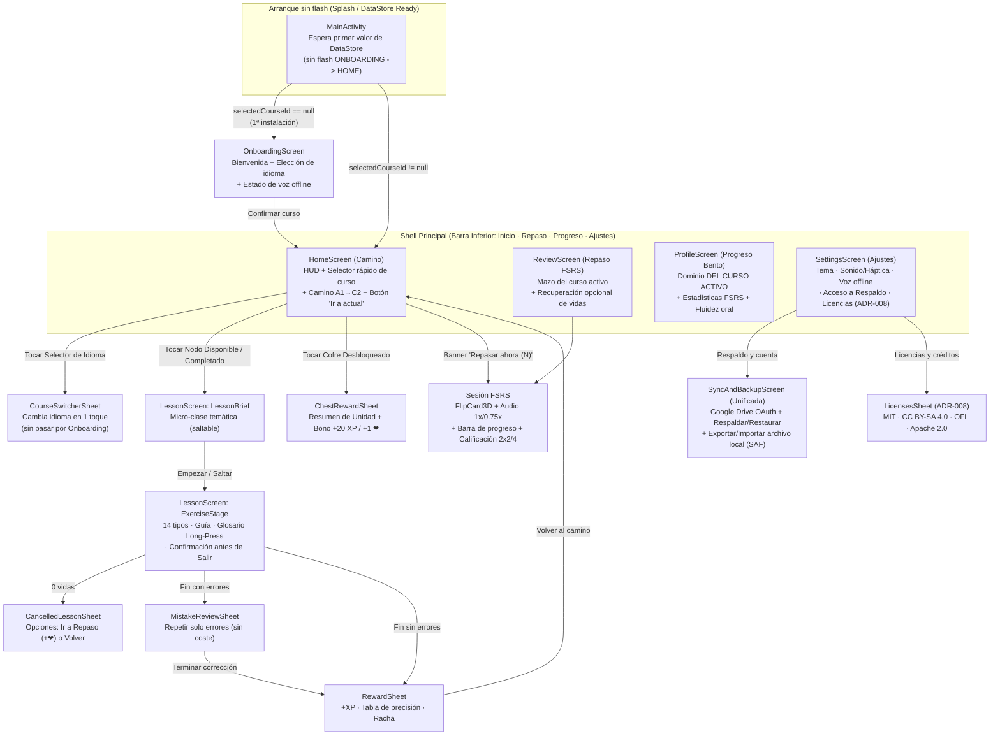

# Plan Profesional de Evolución de LinguaGo (Producto, UX/UI, Calidad y Releases)

> **Estado del documento:** Propuesta ejecutiva y técnica de evolución (Solo lectura sobre `v2.4.0`, `versionCode = 12`).  
> **Autores:** Equipo Senior de Estrategia de Producto, Diseño UX/UI y Arquitectura Android.  
> **Fecha:** 8 de noviembre de 2026.  
> **Invariantes protegidos:** I1 (Offline-first estricto), I2 (Sin backend propio), I3 (Sin fricción), I4 (Progreso intocable), I5 (Identidad original), I6 (Código abierto MIT / CC BY-SA 4.0), I7 (Testabilidad), I8 (Accesibilidad AA), I9 (Contenido validado).

---

## 1. Resumen ejecutivo

**LinguaGo (`v2.4.0`)** ha alcanzado un hito técnico y editorial extraordinario para un proyecto abierto y 100 % offline: cuenta con **23 módulos Gradle** bajo Clean Architecture (`settings.gradle.kts`), **417 lecciones y 4.087 ejercicios** (A1 a C2 completos en ES→EN, ES→PT, ES→FR y ES→JA validados por `validateContent` y `ContentRampTest`), **14 variantes de ejercicio** (incluyendo comprensión auditiva pura y producción oral libre sin LLMs), síntesis y reconocimiento de voz on-device (**Piper TTS + Vosk STT**), repaso espaciado **FSRS-4.5**, sistema de diseño propio flat-3D (**Feather 2.0**) con efectos sonoros sintetizados y háptica, y respaldo opcional cifrado (**AES-GCM-256** con Android Keystore) en Google Drive vía OAuth 2.0 + PKCE.

Sin embargo, la auditoría profunda del código fuente revela una brecha clara entre **la potencia de su arquitectura interna** y **la madurez percibida como producto profesional**. Hoy, LinguaGo sufre de:
1. **Fricciones críticas de experiencia y pérdida de estado en sesión:** salir de una lección por toque accidental en `"Salir"` o gesto *Back* descarta el 100 % del progreso y XP de la lección sin confirmación (`LessonScreen.kt:399-405`); además, rotar la pantalla o recrear `MainActivity` reinicia el `NavHost` hacia `HOME` porque `selectedCourseId` arranca en `null` en el primer frame de composición (`MainActivity.kt:44, 57-61`), expulsando al alumno de la lección activa (fallo documentado como síntoma en `docs/qa/ReleaseGateF4Test.md:158`).
2. **Defectos funcionales silenciosos en el motor pedagógico multi-idioma:**
   - El evaluador oral `FreeSpeakingHeuristicGrader` (`core/core-domain/.../FreeSpeakingHeuristicGrader.kt:231-281`) utiliza expresiones regulares **exclusivamente en inglés** (`\bif\b`, `\bmore\b`, `\bit is said\b`). Cuando una lección de **francés (`es-fr`)** o **portugués (`es-pt`)** declara focos con etiquetas como `"Comparatifs"`, `"Passive reportative"`, `"Inversion"` o `"Cleft sentences"`, el grader exige palabras inglesas al audio en francés/portugués, haciendo imposible aprobar el ejercicio oral incluso pronunciando el `modelAnswer` exacto.
   - El tablero de palabras (`LessonViewModel.kt:563-579`) identifica fichas por valor de `String` (`if (token in state.chosenTokens)`) en vez de por índice, impidiendo seleccionar la segunda ocurrencia de cualquier palabra repetida en una frase.
   - El extractor FSRS (`VocabularyExtractor.kt:23-45`) mezcla direcciones de idioma (`left=español, right=meta` en `MatchPairs` frente a `source=meta, target=español` en `culturalNotes` y `source=kana, target=romaji` en japonés), causando que en `ReviewScreen` (`ReviewViewModel.kt:102`) el motor TTS del idioma meta lea traducciones en español o cadenas romaji.
   - El cálculo de dominio en `ProfileViewModel.kt:68` suma las lecciones completadas de **todos los cursos** en Room (`observeLessonProgress()`) contra el total de lecciones del **curso activo**, distorsionando el anillo de dominio al cambiar de idioma.
3. **Inconsistencias de Design System y Accesibilidad AA:** `LinguaTypography` (`Type.kt:49-100`) omite 4 estilos de Material 3 (`headlineSmall`, `bodyLarge`, `labelMedium`, `labelSmall`) que sí se invocan en 10 pantallas, cayendo a la fuente del sistema (Roboto) en lugar de Nunito; `SettingsScreen.kt:135-153` usa `OptionCard` (`Role.RadioButton`) para botones de navegación; el token `Warning` (`#FDCB6E`) se usa como color de texto sobre fondo claro con ratio **1.45:1** (`ProfileScreen.kt:128, 356`); y `LearningPath` mantiene **15+ `InfiniteTransition` simultáneas** corriendo incluso en nodos bloqueados (`PathNode.kt:149`, `LearningPath.kt:155`).
4. **Fricción de distribución y almacenamiento (~1 GB en dispositivo):** el APK `full` pesa ~509 MB (~392 MB arm64) porque duplica `espeak-ng-data` tres veces y, al iniciar una lección, copia los modelos de `assets/` a `filesDir` (`PiperTtsEngine.kt:160`, `VoskSttEngine.kt:161`), duplicando el espacio consumido en la memoria interna del usuario.

Este plan establece la hoja de ruta accionable en dos entregas SemVer: **`v2.5.0` (`versionCode = 13`)** enfocada en corrección de bugs críticos, paridad pedagógica multilingüe, cierre de brechas WCAG AA, desbloqueo de CI y limpieza documental; y **`v3.0.0` (`versionCode = 14`)** enfocada en el rediseño UX/UI de flujo continuo ("Feather 3.0"), FSRS enriquecido y sincronizable (`SyncSnapshot v3`), arquitectura de voz optimizada y analítica de aprendizaje 100 % local.

---

## 2. Diagnóstico con evidencias y severidad

### 2.1 Inventario real de pantallas, flujos y estados

Verificado contra `app/src/main/kotlin/dev/linguago/app/Routes.kt` y `LinguaApp.kt`:

| Ruta (`Routes.kt`) | Módulo / Composable | Barra inferior | Estados implementados en UI (`UiState`) | Estados ausentes o incompletos |
|---|---|---|---|---|
| `onboarding` | `feature-onboarding` (`OnboardingScreen.kt`) | Oculta (`LinguaApp.kt:73`) | `loading`, lista de `tiles` (`es-en`, `es-pt`, `es-fr`, `es-ja`), `selectedId`, tarjeta de confirmación animada, `saving`. | Sin estado de error si `getAvailableCoursesUseCase()` devuelve `Result.Error` (`OnboardingViewModel.kt:80` solo apaga `loading` y deja lista vacía). No informa qué cursos tienen voz HD instalada según el flavor. |
| `home` | `feature-home` (`HomeScreen.kt`) | Visible (`Inicio`) | `loading`, `hasCourse`, `PathHomeContent` (HUD racha + `HeartsCounter` + `LiquidXpBar` + `ReviewCard` condicional + `LearningPath` en zigzag + diálogo `ChestRewardSheet`), fallback `HomeContent` (`UnitCard`). | Sin selector rápido de idioma en la cabecera (obliga a ir a Ajustes → Cambiar de curso → Onboarding). Sin botón flotante "Volver al nodo actual" tras hacer scroll por 100+ nodos (A1–C2). |
| `lesson/{courseId}/{lessonId}` | `feature-lesson` (`LessonScreen.kt`) | Oculta | `Loading`, `Invalid`, `LessonBriefScreen` (micro-clase previa/reabrible con `"Guía"`), `ExerciseStage` (14 tipos de ejercicio + `ComboBadge` + `InfoBanner` de warmup de voz + `FeedbackPanel` deslizante), `MistakeReviewSheet` (corrección de fallos sin coste), `RewardSheet` (victoria + tabla de aciertos/nota), `CancelledLessonSheet` (0 vidas). | **Sin diálogo de confirmación al salir** (`"Salir"` o botón Back del sistema descarta toda la sesión). **Sin persistencia de cursor de ejercicio** ante recreación de Activity/rotación. En `SpeakRepeat` no se desactiva el botón si `speechAvailable == false` ni hay botón para detener grabación antes de 10 s. |
| `review/{courseId}` | `feature-review` (`ReviewScreen.kt`) | Oculta | `loading`, `empty` (`FinishPanel`), `finished` (`FinishPanel`), tarjeta activa (`FlipCard3D` + `AudioPlayerCard` en reverso + `RatingRow` FSRS de 4 botones). | **Sin botón de salir/volver en la cabecera** durante la sesión (solo al terminar o mediante gesto Back del sistema). Sin barra de progreso visual (solo texto `"Tarjeta X de Y"`). Sin aviso cuando se deniega o falta voz hasta voltear la tarjeta. |
| `profile` | `feature-profile` (`ProfileScreen.kt`) | Visible (`Progreso`) | `MasteryRing` animado + nivel/barra XP + cuadrícula Bento 2×2 (`StatCard`: XP, Lecciones, Tarjetas, Pendientes hoy) + `StreakCard` (actual vs mejor marca). | **Sin estado de carga ni estado vacío** (un usuario nuevo ve todo a 0 sin llamada a la acción). No muestra las métricas de producción oral ni errores frecuentes que ya existen en el esquema de Room v3 (`Entities.kt:30-36, 72-74`). |
| `settings` | `feature-settings` (`SettingsScreen.kt`) | Visible (`Ajustes`) | Selector de `ThemeMode` (3 `OptionCard`), switches de `Efectos de sonido` y `Vibración` (`SettingsToggleRow`), `OptionCard` `"Cambiar de curso"`, `OptionCard` `"Sincronización y cuenta"`. | **Falta la sección de Licencias y atribuciones de terceros** exigida por **ADR-008** (`docs/DECISIONS.md:251`). No muestra qué curso está activo actualmente en el texto del botón `"Cambiar de curso"`. |
| `sync` | `feature-sync` (`SyncScreen.kt`) | Oculta | Tarjeta de proveedor (`providerId`, `linked`), botones `"Respaldar ahora"` y `"Restaurar copia"`, enlace a `auth`, texto plano `state.message`. | Sin barra superior de navegación (Back). Muestra el ID técnico crudo (`"none"`, `"google_drive"`, `"dev_local"`). No muestra la fecha de la última copia ni qué datos incluye/excluye (p. ej. que `word_progress` FSRS no se respalda en `SyncSnapshot v2`). |
| `auth` | `feature-auth` (`AuthScreen.kt`) | Oculta | Lista de proveedores (`Google Drive` y `Laboratorio` en debug), estados `"Vinculada"` / `"No vinculada"` / `"Sin configurar"`, lanzamiento de navegador OAuth (`launchUrl`), `state.message`. | Sin barra superior de navegación (Back). Si el usuario cierra la pestaña del navegador sin completar OAuth, `OAuthSession.awaitRedirect()` queda suspendido indefinidamente dejando `busy = true` hasta matar el ViewModel. |

---

### 2.2 Evaluación heurística de Nielsen por pantalla y flujo

Escala de severidad: **S4 (Catastrófica / Pérdida de datos o bloqueo)** · **S3 (Mayor / Fricción severa)** · **S2 (Media / Inconsistencia notable)** · **S1 (Menor / Cosmética)**.

| # | Heurística de Nielsen | Pantalla / Flujo | Hallazgo y Evidencia en el repositorio | Severidad |
|---|---|---|---|---|
| **H1** | **Prevención de errores** | `LessonScreen` (Salida y Back) | Pulsar `"Salir"` (`LessonScreen.kt:399-405`) o el gesto Back del sistema ejecuta `onExit()` inmediatamente sin diálogo de confirmación. Como el XP es diferido hasta `CompleteLessonUseCase` (ADR-025), un toque accidental en el ejercicio 11/12 destruye todo el avance de la lección. | **S4** |
| **H2** | **Visibilidad del estado del sistema** | `MainActivity` + `LessonScreen` (Rotación / Recreación) | `MainActivity.kt:44` colecta `settingsRepository.selectedCourseId.collectAsState(initial = null)`. Al rotar el dispositivo o recrear la Activity, el primer frame evalúa `selectedCourseId == null` y pasa `startDestination = Routes.ONBOARDING` al `NavHost` (`MainActivity.kt:58-61`), y en el segundo frame pasa `Routes.HOME`, reiniciando la pila de navegación y expulsando al usuario de la lección (documentado como bug en `docs/qa/ReleaseGateF4Test.md:158`). | **S4** |
| **H3** | **Correspondencia con el mundo real** | `FreeSpeakingHeuristicGrader` (Francés y Portugués) | `FreeSpeakingHeuristicGrader.kt:231-281` busca substrings en `point.label.lowercase()` (`"compar"`, `"passive"`, `"inversion"`, `"cleft"`) y les aplica regex exclusivas del inglés (`\bmore\b`, `\b(?:am|is|are...)\s+[\w'-]+ed\b`). En `content-es-fr/course.json:5541, 10709, 11029, 11034` y `content-es-pt/course.json:5525, 11019, 14540`, las etiquetas activan esas regex inglesas sobre respuestas en francés/portugués, provocando fallo sistemático (`MISSING_GRAMMAR`). | **S4** |
| **H4** | **Control y libertad del usuario** | `LessonViewModel` (`Translate` y `OrderWords`) | `LessonViewModel.kt:563-579` implementa `toggleToken(token: String)` comprobando `if (token in state.chosenTokens)` sobre listas de `String`. Si una oración contiene dos palabras iguales (ej. `"the ... the"`), tocar la segunda ficha disponible en el banco desmarca la primera en vez de agregar la segunda, contradiciendo el diseño aprobado en **ADR-029**. | **S4** |
| **H5** | **Coherencia y estándares** | `VocabularyExtractor` + `ReviewViewModel` (FSRS) | `VocabularyExtractor.kt:25-45` guarda en `source` (`word`) el idioma origen para `MatchPairs` (`"adiós" → "Au revoir"`), pero guarda el idioma **meta** en `source` para `culturalNotes` (`"break the ice" → "romper el hielo"`) y el kana en `source` con romaji en `target` para japonés (`"あ" → "a"`). En `ReviewScreen.kt:135-190`, el anverso siempre dice `"Palabra"` y `ReviewViewModel.kt:102` pronuncia siempre `card.translation` con la voz del idioma meta, leyendo español con voz inglesa en los modismos y leyendo romaji en japonés. | **S3** |
| **H6** | **Visibilidad del estado del sistema** | `ProfileViewModel` (Dominio multi-curso) | `ProfileViewModel.kt:68` calcula `lessonsCompleted = lessonProgress.count { it.completed }` sobre `observeLessonProgress()`, que devuelve todas las filas de `lesson_progress` sin filtrar por el curso activo (`Daos.kt:28`). Al cambiar de curso, el porcentaje y conteo de lecciones mezclan todos los idiomas estudiados. | **S3** |
| **H7** | **Control y libertad del usuario** | `SettingsViewModel` (`Cambiar de curso`) | Al tocar `"Cambiar de curso"`, `SettingsViewModel.kt:70-75` borra primero `selectedCourseId` en DataStore (`updateSelectedCourse(null)`) y luego navega a `Routes.ONBOARDING`. Si el usuario pulsa Back o cierra la app sin confirmar nuevo curso, pierde su curso activo. Además, cambiar de curso requiere 3 pantallas en lugar de un selector directo en Home/Ajustes. | **S3** |
| **H8** | **Diagnóstico y recuperación de errores** | `LessonScreen` (`SpeakRepeat` y Permisos) | En `SpeechPanel` (`LessonScreen.kt:1058`), el botón `"Toca para grabar"` sigue habilitado aunque `uiState.speechAvailable == false`, y al pulsarlo `LessonViewModel.kt:439` hace `return` silencioso sin informar al usuario. Si el usuario niega el permiso `RECORD_AUDIO` (`LessonScreen.kt:120, 133`), no se muestra ningún aviso ni explicación de cómo activarlo. Además, `SpeakRepeat` no ofrece botón para detener la grabación antes del tope de 10 s. | **S3** |
| **H9** | **Reconocimiento antes que recuerdo** | `HomeScreen` (`ChestRewardSheet` y Camino) | Al completar una unidad se desbloquea el nodo `Chest`, pero abrirlo (`ChestRewardSheet.kt:35-89`) solo muestra el texto *"Has desbloqueado el cofre de la unidad"* sin otorgar XP extra, recarga de vidas ni insignia/resumen de unidad, rompiendo la expectativa creada por la metáfora del cofre. | **S2** |
| **H10** | **Correspondencia con el mundo real** | `SyncScreen` y `AuthScreen` | `SyncScreen.kt:90` expone `state.providerId` literal (`"none"`, `"google_drive"`, `"dev_local"`). Ninguna de las dos pantallas (`SyncScreen`, `AuthScreen`) ni `ReviewScreen` incluye botón de retroceso visible en la cabecera. En `AuthViewModel.kt:148`, el mensaje de error al usuario cita `"Falta configurar el Client ID (docs/DECISIONS.md, ADR-011)"`, jerga de desarrollador inapropiada para el usuario final. | **S2** |

---

### 2.3 Resumen de deuda técnica, funcional y documental

| ID | Categoría | Descripción | Evidencia exacta en el repositorio | Severidad |
|---|---|---|---|---|
| **D-01** | Funcional / Audio | Regex solo en inglés en `FreeSpeakingHeuristicGrader` bloquean ejercicios B1–C2 de `es-fr` y `es-pt` cuyas etiquetas coinciden con substrings ingleses (`compar`, `passive`, `inversion`, `cleft`). | `core/core-domain/.../FreeSpeakingHeuristicGrader.kt:231-281` · `content/content-es-fr/.../course.json:5541, 10709, 11029, 11034` | **Crítica** |
| **D-02** | Funcional / UI | Recreación de `MainActivity` (rotación) reinicia `NavHost` a `HOME` porque `selectedCourseId` emite `null` inicialmente y cambia `startDestination` en caliente. | `app/src/main/kotlin/dev/linguago/app/MainActivity.kt:44, 57-61` · `docs/qa/ReleaseGateF4Test.md:158` | **Crítica** |
| **D-03** | Funcional / Lección | `toggleToken(token: String)` opera por valor de texto y no por índice de ficha, impidiendo construir frases con palabras repetidas. | `feature/feature-lesson/.../LessonViewModel.kt:563-579` · `LessonScreen.kt:1256-1291` | **Crítica** |
| **D-04** | Funcional / FSRS | Dirección invertida de tarjetas entre `MatchPairs` (ES→Meta), `culturalNotes` (Meta→ES) y `KanaChoose` (Kana→Romaji), causando TTS erróneo en `ReviewViewModel.speakTranslation()`. Además, `VocabularyPair.culturalNote` se descarta al guardar. | `core/core-domain/.../VocabularyExtractor.kt:23-45` · `core/core-data/.../ReviewRepositoryImpl.kt:50-56` · `feature/feature-review/.../ReviewViewModel.kt:102` | **Alta** |
| **D-05** | Funcional / Perfil | `ProfileViewModel` cuenta lecciones completadas de todos los cursos contra el total del curso activo. | `feature/feature-profile/.../ProfileViewModel.kt:68-74` | **Alta** |
| **D-06** | Persistencia (Room v3) | Las columnas `speakingAttempts`, `speakingBestWpm`, `speakingLastScore` (`lesson_progress`) y `errorCount`, `lastErrorType` (`word_progress`) añadidas en `MIGRATION_2_3` (ADR-021) **nunca se escriben ni se leen**; cada `upsert` las sobrescribe con `0` / `null`. | `core/core-data/.../Entities.kt:30-36, 72-74` · `ProgressRepositoryImpl.kt:83-88` · `ReviewRepositoryImpl.kt:112` | **Alta** |
| **D-07** | Sync / FSRS | `word_progress` (tarjetas FSRS) no se incluye en `SyncSnapshot v2`. Un usuario que restaura su respaldo en otro dispositivo conserva sus lecciones completadas pero **pierde todo su mazo FSRS y su historial de repaso**. | `core/core-domain/.../SyncSnapshot.kt:13-34` · `ARCHITECTURE.md:187` | **Alta** |
| **D-08** | Distribución / Peso | Triplicación de `espeak-ng-data` (~65 MB redundantes en `models/tts/*`) + copia completa de `assets/` a `filesDir` duplicando ~500 MB en el almacenamiento interno del usuario. | `models/tts/*/espeak-ng-data` · `core/core-audio/.../PiperTtsEngine.kt:160` · `VoskSttEngine.kt:161` | **Alta** |
| **D-09** | CI / Infraestructura | El job `instrumented` falla en GitHub Actions por usar `reactivecircus/android-emulator-runner@v2` sin configuración estable de imagen/cache en runners actuales. | `.github/workflows/ci.yml:118-125` | **Alta** |
| **D-10** | Legal / ADR-008 | La pantalla ` Ajustes → Licencias` y el archivo `THIRD_PARTY_NOTICES.md` aprobados en **ADR-008** no existen en el repositorio ni en `SettingsScreen`. | `docs/DECISIONS.md:249-253` · `feature/feature-settings/.../SettingsScreen.kt` | **Media** |
| **D-11** | Código muerto | `SemanticMatchBoard.kt` (`core-ui`), `ChestNode` (`PathNode.kt:232`) y `UnitCard`/`HomeContent` (`HomeScreen.kt:78, 244`) no se usan en el flujo real de producción (`LEARNING_PATH_V2 = true`). | `core/core-ui/.../SemanticMatchBoard.kt` · `feature/feature-lesson/.../LessonScreen.kt:727-748` · `app/build.gradle.kts:91, 94` | **Media** |
| **D-12** | Documentación | Desfase severo en `README.md` (dice 249 lecciones / A1–B2 / ADR 000–041), `ARCHITECTURE.md` (dice `Estado: v0.2.0` y `Room v2` cuando es `v2.4.0` y `Room v4`) y `docs/DECISIONS.md` (ADRs 017–024 figuran como `Propuesto` pese a estar implementados). | `README.md:7, 28-32, 56` · `ARCHITECTURE.md:4, 23, 49, 125` · `docs/DECISIONS.md:29-36` | **Media** |

---

### 2.4 Hallazgos de la auditoría visual y sensorial en vivo (Emulador `Medium_Phone_API_37.0`)

Al levantar `app-full-universal-release.apk` (`v2.4.0`) en el emulador Android Studio (`Medium_Phone_API_37.0`) y recorrer en vivo Onboarding, Camino, Lección (los 7 ejercicios de `Saludos` y `Presentarse`), Repaso FSRS, Progreso, Ajustes, Sincronización, Modo Oscuro, Rotación y `fontScale = 2.0x`, se detectaron **11 defectos visuales y sensoriales reales** que no eran evidentes solo leyendo tests unitarios:

| # | Pantalla / Componente | Qué ocurre visualmente en el emulador (Evidencia en vivo) | Causa raíz exacta en el código | Severidad |
|---|---|---|---|---|
| **V-01** | `OptionCard` seleccionada (`Onboarding`, `Ajustes`, `MultipleChoice`) | Al seleccionar una opción (`"Español → Inglés"`, `"Seguir al sistema"`, `"Hello"`), la tarjeta entera se tiñe de **morado oscuro sólido (`#5B4CD2`)** con **texto morado oscuro (`#4A3DB8`)** en modo claro, volviendo el texto casi invisible (**ratio real 1.15:1**). | En `OptionCard.kt:78, 138-154`, la `Row` superior pinta `colors.primary.copy(alpha = 0.06f)` (94 % transparente) directamente encima de la `Box` del borde inferior (`.matchParentSize().background(PrimaryEdge)` opaco `#5A4BD1`) **sin pintar antes una capa opaca `colors.surface`**. El color del borde 3D atraviesa todo el cuerpo de la tarjeta. | **S4 (Crítica)** |
| **V-02** | `"No puedo hablar ahora"` en `SpeakRepeat` / `FreeSpeakingPrompt` | Al pulsar `"No puedo hablar ahora"`, la app muestra el banner rojo de **Error (`✕ Revisa la respuesta y sigue`)**, rompe la racha de `combo`, baja la nota final de la lección e incluye el ejercicio de voz dentro de `"Corrige tus errores"` (`MistakeReviewSheet`). | `LessonViewModel.kt:353-362, 449-452` envía `SpokenText("")` con `consumeHeart = false`, pero el grader lo evalúa como `isCorrect = false` y lo suma a `mistakes` y a `incorrectCount`. Castiga al usuario que no puede hablar en público, violando **I3**. | **S4 (Crítica)** |
| **V-03** | Modo Oscuro: Barra de estado e iluminación `topHighlight()` | En Modo Oscuro (`#17161F`), los iconos del sistema (hora, Wi-Fi, batería) quedan **negros sobre fondo casi negro** (invisibles). Además, todas las tarjetas (`OptionCard`, `UnitHeader`) muestran una **neblina gris blanquecina** en su mitad superior. | `themes.xml:7` fija `windowLightStatusBar = true` y `MainActivity.kt` no actualiza `WindowInsetsControllerCompat.isAppearanceLightStatusBars = !darkTheme`. Por su parte, `Tactile.kt:14-19` aplica `Color.White.copy(alpha = 0.18f)` sobre superficies oscuras `#17161F`/`#221F30`. | **S3 (Alta)** |
| **V-04** | `AudioPlayerCard`, `SpeechPanel` y `FreeSpeakingPanel` | Los paneles de audio y voz se ven en un **lila pastel ajeno a la paleta (`#E8DEF8`)** y cambian a **rosa pastel (`#FFD8E4`)** al escuchar. | `LinguaColors.kt:11-51` no define `secondaryContainer`, `onSecondaryContainer`, `tertiaryContainer`, `onTertiaryContainer` ni `outlineVariant`, por lo que Compose aplica los colores pastel por defecto del baseline de Material 3. | **S3 (Alta)** |
| **V-05** | `TokenChip` en `Translate` y `OrderWords` | En modo claro, las fichas disponibles (`"Goodbye"`, `"night"`, `"morning"`, `"Good"`) no tienen contorno superior ni lateral: su fondo blanco `#FFFFFF` se funde con el fondo blanco de la pantalla y parecen texto flotando sobre una línea gris. | `TokenChip.kt:124-128` usa `colors.surface` sin `.border(1.5.dp, colors.outline, shape)` (a diferencia de `OptionCard`). | **S3 (Alta)** |
| **V-06** | `PuzzleMatchBoard` (`MatchPairs` y `SemanticMatch`) | 1) Las piezas tienen **esquinas rectas a 90°** (0 dp de radio), rompiendo toda la estética redondeada Feather.<br>2) En `"Piezas disponibles"`, cada palabra suelta (`"Goodbye"`, `"Thank you"`) se estira al **100 % del ancho de la pantalla**.<br>3) El texto queda pegado arriba en vez de centrarse con la pestaña del puzzle. | `PuzzleMatchBoard.kt:271-318` traza `Path` con esquinas sin redondear; la línea `389` usa `Row(Modifier.fillMaxWidth())` dentro de un `FlowRow`, forzando ancho completo; y la `Column` (`line 368`) carece de `verticalArrangement = Arrangement.Center`. | **S3 (Alta)** |
| **V-07** | `FeedbackPanel` al pie de `LessonScreen` | Lumi (`30.dp`) queda colgada en la esquina superior izquierda dejando una columna vacía debajo, y empuja tanto el `FeedbackBanner` como el botón `"Continuar"` `40 dp` hacia la derecha (descentrado). Además, al acertar muestra `"Respuesta correcta: Hello"`, redundante con el acierto. | `LessonScreen.kt:881-934` coloca a Lumi fuera del banner como hermana de toda la columna derecha; `LessonViewModel.kt:891-896` puebla `correctAnswer` incluso cuando `grading.isCorrect == true`. | **S2 (Media)** |
| **V-08** | `LearningPath` en `HomeScreen` | 1) La cabeza de Lumi aparece **recortada** en el primer nodo.<br>2) El conector gris/verde muerde el borde inferior 3D del círculo.<br>3) Al completar la Lección 1, el auto-scroll oculta la cabecera `"Primeros pasos"`. | 1) `LearningPath.kt:117` aplica `offset(y = -14.dp)` saliéndose del ítem del `LazyColumn`.<br>2) `PathNode.kt:171` mide `72.dp` pero desplaza su borde `+4.dp` sin añadir padding inferior.<br>3) `LearningPath.kt:65` hace `scrollToItem(activeIndex - 1)` saltándose el `Header` de la unidad 1. | **S2 (Media)** |
| **V-09** | `LinguaBottomBar` (`Inicio · Progreso · Ajustes`) | El icono de la pestaña activa es **púrpura (`#6C5CE7`)**, pero el texto debajo (`"Inicio"`, `"Progreso"`, `"Ajustes"`) se pinta en **verde (`#00B894`)**. | `LinguaApp.kt:241-244` solo configura `indicatorColor` en `NavigationBarItemDefaults.colors()`, dejando el texto seleccionado en el default de Material 3 (`secondary` = `Accent`). | **S2 (Media)** |
| **V-10** | `ProfileScreen` con `fontScale = 2.0x` y pluralización | 1) Con `fontScale = 2.0x`, la palabra `"dominio"` choca y se superpone con el arco de `MasteryRing(104.dp)`, y las tarjetas Bento de una misma fila tienen alturas desiguales.<br>2) Con 1 día de racha muestra **`"1 días"`** (error gramatical). | 1) `ProfileScreen.kt:192` fija `ringSize = 104.dp` sin escalar con `LocalDensity.current.fontScale`, y las `Row`s (`lines 140, 160`) no usan `IntrinsicSize.Min` + `fillMaxHeight()`.<br>2) `ProfileScreen.kt:342, 354` y `StreakIndicator.kt:53` no distinguen singular `"1 día"` vs plural `"N días"`. | **S2 (Media)** |
| **V-11** | Verificación empírica en vivo de `D-02`, `D-05` y `H7` | 1) Rotar en la Lección 2 expulsó inmediatamente a `HomeScreen`.<br>2) Cambiar al curso de Francés (0 lecciones hechas) mostró `1% dominio · 1 de 102 lecciones`.<br>3) Tocar `"Cambiar de curso"` y pulsar Back cerró la app al escritorio de Android y borró el curso activo. | Confirmados empíricamente en el emulador `Medium_Phone_API_37.0` los hallazgos estáticos `D-02`, `D-05` y `H7`. | **S4 (Crítica)** |

---

## 3. Estrategia de producto

### 3.1 Usuario objetivo y Jobs-to-be-Done (JTBD)

LinguaGo no compite por el usuario casual que busca entretenimiento gamificado con anuncios y ligas sociales; su océano azul es el **estudiante autodidacta comprometido y consciente de su privacidad**.

#### Arquetipos de usuario (Personas)
1. **Clara — La viajera y estudiante en tránsito (A1–B1):** estudia 10–15 minutos diarios en el metro, en vuelos o en zonas sin cobertura móvil o con datos limitados. Necesita que la app arranque al instante, funcione en modo avión con audio y pronunciación reales, y no la castigue con bloqueos de 24 horas ni anuncios de 30 segundos por equivocarse.
2. **Mateo — El profesional hispanohablante (B1–C2):** ya conoce las bases del inglés, francés o portugués y quiere dominar matices de registro, negociación, *hedging*, condicionales mixtas y discurso formal (exactamente el currículo B1–C2 de LinguaGo). Las apps comerciales lo aburren con frases artificiales de nivel A1; necesita explicaciones gramaticales claras (`microLesson`), diagnóstico preciso de por qué falló (`feedbackOnError`) y práctica oral realista (`FreeSpeakingPrompt`).
3. **Sora — El entusiasta de la privacidad y el software libre (A1–C2, especialmente ES→JA / ES→EN):** descarga apps desde GitHub Releases o F-Droid, rechaza crear cuentas obligatorias o enviar su voz a servidores en la nube, y valora el repaso espaciado científico (**FSRS-4.5**) integrado directamente con las lecciones sin tener que configurar mazos manuales en Anki.

#### Jobs-to-be-Done (JTBD)
- **JTBD Funcional 1 (Aprender sin red):** *"Cuando estoy en el transporte público o sin conexión estable, quiero completar una lección completa (incluyendo escuchar y hablar), para aprovechar mis tiempos muertos sin consumir datos ni depender de cobertura."*
- **JTBD Funcional 2 (Entender el porqué):** *"Cuando cometo un error gramatical o de registro en un nivel intermedio/avanzado (B1–C2), quiero entender inmediatamente la regla exacta que violé y reintentar los fallos al final, para interiorizar el idioma en lugar de memorizar respuestas por ensayo y error."*
- **JTBD Funcional 3 (Retener a largo plazo):** *"Cuando termino una lección nueva, quiero que el vocabulario y los modismos clave se programen automáticamente según mi curva de olvido (FSRS), para consolidar mi memoria en sesiones de 3 minutos sin gestionar tarjetas manualmente."*
- **JTBD Emocional / Privacidad:** *"Cuando practico mi pronunciación en otro idioma, quiero tener la certeza absoluta de que mi voz se procesa en mi teléfono y nunca se sube a ningún servidor, para practicar sin vergüenza ni vigilancia comercial."*

---

### 3.2 Propuesta de valor y posicionamiento competitivo

| Dimensión | Apps comerciales (Duolingo, Babbel, Busuu) | Herramientas SRS (AnkiDroid) | **LinguaGo (Propuesta Profesional)** |
|---|---|---|---|
| **Conectividad** | Requieren red constante; modo offline de pago o recortado. | Offline, pero sin curso estructurado. | **100 % Offline-first real (I1):** curso A1–C2 + TTS Piper + STT Vosk incluidos desde la instalación. |
| **Fricción y monetización** | Login obligatorio, anuncios, paywalls de vidas, dark patterns. | Sin anuncios, pero curva de entrada técnica y árida. | **Cero fricción (I3):** sin cuenta, sin anuncios, vidas que se regeneran en 1 min/vida (≤10 min total). |
| **Profundidad pedagógica** | Fuerte en A1–A2; aplanamiento pedagógico en B2–C2. | Solo flashcards; sin lecciones ni producción oral guiada. | **Rampa verificada A1→C2 (ADR-018/042):** escenarios, *can-do*, registro pragmático, micro-clases y glosario táctil. |
| **Repaso espaciado** | Repaso propietario opaco orientado al engagement. | FSRS potente, pero exige crear o importar mazos. | **FSRS-4.5 automático (ADR-016):** las lecciones alimentan el mazo solas al completarse. |
| **Privacidad y propiedad** | Telemetría intensiva, voz procesada en la nube, código cerrado. | Open source (GPLv3), sync en servidor propio/AnkiWeb. | **Privacidad radical (I2/I6):** MIT + CC BY-SA 4.0, voz 100 % on-device, backup opcional cifrado AES-GCM-256 en el Drive del usuario. |

---

### 3.3 Métricas de éxito compatibles con la privacidad (100 % locales)

En cumplimiento estricto de **I1** (offline-first) e **I2** (sin backend propio), **queda prohibido cualquier SDK de analítica o crash reporting en la nube** (Firebase, Sentry, Amplitude, etc.). Todas las métricas se calculan y persisten **exclusivamente en la base de datos local Room (`linguago.db`)**, con dos propósitos:
1. **Valor directo para el estudiante:** mostrarle su evolución real en la pantalla `Progreso` (`feature-profile`) y adaptar su repaso.
2. **Diagnóstico voluntario (*opt-in*):** permitir al usuario exportar manualmente un archivo JSON/Markdown anónimo desde `Ajustes → Diagnóstico local` si desea adjuntarlo en un issue de GitHub.

| Métrica de producto / calidad | Definición exacta | Cómo medirla localmente en `core-data` (Room) | Meta objetivo |
|---|---|---|---|
| **TTFL (Time to First Lesson)** | Segundos desde el primer arranque hasta completar el ejercicio 1 de la primera lección. | Diferencia entre timestamp de primera selección de curso (`DataStore`) y primer `CompleteLessonUseCase`. | **< 180 s** en primera sesión. |
| **Tasa de finalización de lección** | `lecciones_completadas / lecciones_iniciadas` por curso. | Contabilizar inicios reales vs cierres en `lesson_progress` (distinguiendo abandono vs cancelación por 0 vidas). | **≥ 85 %** (subirá al añadir confirmación de salida). |
| **Precisión en primer intento** | Promedio de `LessonScore.percentage` (`aciertos_1er_intento / total_ejercicios`). | Persistir `lastScorePercent` y `bestScorePercent` en `lesson_progress` al ejecutar `CompleteLessonUseCase`. | **70 % – 90 %** (si < 60 % indica salto brusco de rampa; si > 95 % indica lección trivial). |
| **Salud de producción oral (`Speaking Pass Rate`)** | `intentos_orales_aprobados / intentos_orales_totales` (excluyendo `SKIP`) y fluidez media (`speakingBestWpm`). | Conectar las columnas ya creadas en Room v3 (`speakingAttempts`, `speakingBestWpm`, `speakingLastScore` en `Entities.kt:30-36`). | **≥ 75 %** de aprobación con pronunciación válida; **0 %** de falsos negativos por regex de otro idioma. |
| **Adherencia al repaso FSRS** | Porcentaje de días activos en los que el usuario deja `dueReviews == 0` y retención real (`GOOD + EASY / total_reviews`). | Derivado de `word_progress` (`lastReviewEpochMillis`, `errorCount` en `Entities.kt:66-72`). | **85 % – 92 %** de retención (alineado con el target 90 % de `FsrsScheduler`). |
| **Consistencia semanal** | Días con actividad en los últimos 7 y 28 días (calendario de calor local). | Nueva tabla ligera `daily_activity(epochDay, xpEarned, lessonsCompleted, reviewsCompleted)` en Room v5. | **≥ 4 días/semana** en usuarios recurrentes. |

---

### 3.4 Principios de producto y de diseño (con criterios de decisión)

1. **Aprendizaje en el primer minuto (Cero burocracia):**
   - *Criterio de decisión:* Ninguna pantalla previa a la lección puede exigir registro, test de nivel obligatorio ni descarga bloqueante. Si una mejora añade un paso obligatorio antes del primer ejercicio, se descarta o se mueve a configuración progresiva.
2. **Pedagogía explícita sobre gamificación vacía:**
   - *Criterio de decisión:* Cada elemento de juego (vidas, combos, cofres, XP) debe reforzar una acción cognitiva real. Un cofre de unidad debe entregar un resumen de logros y bonificación real; un fallo debe explicar siempre la regla gramatical o pragmática (`feedbackOnError`).
3. **Fricción honesta, nunca punitiva:**
   - *Criterio de decisión:* Las vidas existen para evitar respuestas al azar (ADR-025), pero nunca para vender recargas ni expulsar al usuario por error de interfaz. Salir de una lección requiere confirmación; quedarse sin vidas ofrece ir al repaso FSRS para recuperar vidas practicando.
4. **Voz offline digna y transparente:**
   - *Criterio de decisión:* El usuario siempre sabe qué motor de voz está usando (Voz neuronal Piper HD vs Voz del sistema), cuándo está calentando (`voiceWarmingUp`), qué escuchó el micrófono y cómo saltar sin penalización (`"No puedo hablar ahora"`, I3).
5. **Tactilidad física con presupuesto energético ("Feather Consciente"):**
   - *Criterio de decisión:* Todo control interactivo responde con hundimiento físico de `4 dp`, bisel de luz, sonido cálido y háptica, pero **ninguna pantalla en reposo puede mantener más de 2 animaciones infinitas activas**. Si un nodo está bloqueado o completado, su animación es cero.
6. **Accesibilidad AA y Modo Oscuro de primera clase:**
   - *Criterio de decisión:* Ningún texto o icono semántico entra a `main` con contraste `< 4.5:1` en claro u oscuro (verificado por `LinguaContrastTest`), ningún botón usa un `Role` semántico ajeno a su función, y toda pantalla sobrevive a `fontScale = 2.0x` y `reducedMotion`.
7. **Soberanía total de los datos del alumno:**
   - *Criterio de decisión:* El progreso (lecciones, racha, vidas y tarjetas FSRS) pertenece al usuario. Debe poder respaldarse cifrado en la nube (Drive) **y también exportarse/importarse como archivo local** (SAF) con merge monótono (I4), sin perder nunca un solo avance.

---

### 3.5 Qué se mantiene intocable y qué debe cambiar

| Se mantiene intocable (Invariantes y ADRs base) | Debe cambiar para alcanzar nivel profesional |
|---|---|
| **I1 / I2:** 100 % offline en rutas críticas; cero backend propio; cero LLMs en la nube u on-device (ADR-019). | **Estabilidad de sesión:** eliminar el reinicio de `NavHost` en rotación (`MainActivity`) y proteger la salida de lección con confirmación. |
| **I3 / ADR-025:** Sin cuentas obligatorias ni anuncios; 10 vidas con regeneración de 1/min y `SKIP` de voz sin penalización. | **Recuperación activa de vidas:** permitir recuperar vidas completando tarjetas de repaso FSRS además de esperar 1 min/vida. |
| **I4 / ADR-013:** Progreso intocable con merge monótono (`max` / `OR`) e IDs históricos inmutables de las 417 lecciones y 4.087 ejercicios. | **Respaldo completo:** incluir el mazo FSRS (`word_progress`) en el snapshot de sincronización (`SyncSnapshot v3`) y añadir exportación/importación a archivo local. |
| **I5 / I6:** Identidad visual/sonora 100 % original ("Feather", Lumi, Nunito, SFX sintetizados); código MIT y contenido CC BY-SA 4.0. | **Coherencia visual y tipográfica:** completar los 4 estilos faltantes en `Type.kt` (100 % Nunito), unificar `CancelledLessonSheet` y `ChestRewardSheet` con `LinguaCard3D` + Lumi, y corregir los contrastes de `Warning` y `Primary`. |
| **I7 / I9:** Dominio puro en Kotlin, validación estática `validateContent` + `ContentRampTest` para A1–C2. | **Paridad multilingüe real:** localizar los patrones gramaticales de `FreeSpeakingHeuristicGrader` para FR/PT/JA y añadir un test de contrato que verifique que todo `modelAnswer` aprueba el grader. |

---

## 4. Auditoría UX/UI y accesibilidad

### 4.1 Auditoría de Accesibilidad WCAG 2.1 AA (Invariante I8)

#### A. Auditoría de contraste cromático (cálculo exacto de luminancia sRGB)
Gracias a **ADR-037** (`LinguaContrastTest.kt`), los estados correctos/incorrectos en `OptionCard` y `FeedbackBanner` usan tintas AA (`primaryInk`, `accentInk`, `destructiveInk`). Sin embargo, la inspección del resto de pantallas revela **5 incumplimientos de contraste WCAG AA (< 4.5:1 para texto normal, < 3.0:1 para componentes gráficos)**:

| Pantalla / Archivo | Elemento | Color de frente | Color de fondo | Ratio real calculado | Estado WCAG AA | Solución requerida |
|---|---|---|---|---|---|---|
| `ProfileScreen.kt:128` y `ProfileScreen.kt:356` | Texto `"Nivel X"` (`labelLarge` 14sp) y `"X días"` de mejor racha (`titleMedium` 17sp) | `LinguaTokens.Warning` (`#FDCB6E`, lum = `0.638`) | `BgSecondary` en modo claro (`#F8F9FA`, lum = `0.945`) | **1.45 : 1** | ❌ **Fallo crítico** (< 4.5:1) | Crear token `WARNING_INK_HEX` (`#8A5A00` en claro → **5.78:1**; `#FDCB6E` en oscuro sobre `#221F30` → **10.6:1**) en `LinguaExtendedColors`. |
| `LessonBriefScreen.kt:93, 164` | Subtítulo `"Micro-clase de gramática y reglas"` (`labelLarge`) y ejemplos bilingües (`bodyMedium`) | `colors.primary` (`#6C5CE7`, lum = `0.158`) | `DARK_BG_SECONDARY` (`#221F30`, lum = `0.018`) y `DARK_BG` (`#17161F`, lum = `0.009`) | **3.06 : 1** (sobre tarjeta oscura) / **3.51 : 1** (sobre fondo oscuro) | ❌ **Fallo en modo oscuro** (< 4.5:1) | Sustituir `colors.primary` por `linguaExtendedColors().primaryInk` (`#B8AEF5` en oscuro → **7.9:1**, `#4A3DB8` en claro → **7.2:1**). |
| `ReviewScreen.kt:174` | Texto de traducción en el reverso de `FlipCard3D` (`headlineSmall`) | `colors.primary` (`#6C5CE7`) | `DARK_BG_SECONDARY` (`#221F30`) | **3.06 : 1** en modo oscuro | ❌ **Fallo en modo oscuro** (< 4.5:1) | Usar `linguaExtendedColors().primaryInk`. |
| `AuthScreen.kt:129, 168` | Etiqueta `"Vinculada"` (`labelMedium`) y mensaje de estado (`bodyMedium`) | `colors.primary` (`#6C5CE7`) | `DARK_BG_SECONDARY` (`#221F30`) / `DARK_BG` (`#17161F`) | **3.06 : 1** / **3.51 : 1** en modo oscuro | ❌ **Fallo en modo oscuro** (< 4.5:1) | Usar `linguaExtendedColors().primaryInk`. |
| `PathStage.kt:29, 37` (citado en `UnitHeader`) | Insignia circular de etapa `A2` (texto blanco sobre círculo `Info`) | `Color.White` (`#FFFFFF`, lum = `1.0`) | `LinguaTokens.Info` (`#74B9FF`, lum = `0.465`) | **2.05 : 1** | ❌ **Fallo AA** (< 4.5:1) | En `PathStage.onAccent` (`PathStage.kt:37`), incluir `this == A2` junto a `B2` y `C2` para usar `LinguaTokens.Fg` (`#2D3436` sobre `#74B9FF` → **6.12:1**). |

#### B. Semántica TalkBack, roles y navegación por foco
1. **Roles semánticos incorrectos en `SettingsScreen.kt:135-153`:**
   - `"Cambiar de curso"` y `"Sincronización y cuenta"` reutilizan `OptionCard(selected = false, ...)`. Como `OptionCard.kt:176` fija `role = Role.RadioButton` y `this.selected = selected`, TalkBack lee *"Cambiar de curso, botón de opción, no seleccionado, doble toque para seleccionar"*, confundiendo una acción de navegación con una opción excluyente.
2. **Falta de rol y acción en `ReviewCard` (`HomeScreen.kt:213-241`) y `SpeechPanel` (`LessonScreen.kt:1051-1060`):**
   - Ambos usan `Modifier.feedbackClickable(...)` sin declarar `semantics { role = Role.Button }`.
3. **Ausencia de navegación hacia atrás accesible en pantallas secundarias:**
   - `ReviewScreen.kt`, `SyncScreen.kt` y `AuthScreen.kt` no tienen botón `"Volver"` en su cabecera; usuarios con accesibilidad por interruptores (*Switch Access*) o control por voz que dependen de controles en pantalla deben recurrir a acciones globales del sistema.
4. **Orden de foco y exploración en `LearningPath.kt`:**
   - En `PathNode.kt:177-186`, la semántica de los nodos e insignias es limpia (`"Lección: <título>. <estado>"`), pero los nodos `COMPLETED` y `AVAILABLE` solo muestran un icono (`✓` o `▶`) en pantalla sin etiqueta de texto visible debajo del círculo; un usuario vidente no sabe cómo se llama la lección hasta que la abre (a diferencia de un usuario de TalkBack, que sí escucha el título).

#### C. Tamaños táctiles, `fontScale = 2.0x` y `reducedMotion`
- **Aciertos:** Todos los botones (`PrimaryButton3D`, `OptionCard`, `TokenChip`, `PathNode`, `ClozeBlankSlot`, `SpeedSegment`, `LevelChip`) respetan `heightIn(min = 48.dp)` o `size(72.dp)`. El soporte de `rememberAnimationsEnabled()` (`Motion.kt:13`) está aplicado en `ConfettiBurst`, `LumiMascot`, `FlipCard3D` y transiciones de `LinguaApp`.
- **Brechas detectadas:**
  - En `Motion.kt:13`, `remember { ValueAnimator.areAnimatorsEnabled() }` se memoriza una sola vez sin observar cambios de configuración ni recrearse si el usuario cambia la preferencia en segundo plano.
  - En `ProfileScreen.kt:100-137`, la tarjeta héroe coloca `MasteryRing(104.dp)` + `Column(weight(1f))` + `LumiMascot(34.dp)` en un `Row` horizontal fijo; con `fontScale = 2.0x` en pantallas de `360 dp` de ancho, la columna central queda comprimida a `< 140 dp`, truncando `"Dominio del curso"` en 3–4 líneas apretadas.
  - En `ReviewScreen.kt:222-263`, `RatingRow` coloca 4 `PrimaryButton3D(compact = true)` en una sola `Row` horizontal; con `fontScale = 2.0x`, `"Otra vez"` y `"Difícil"` parten línea de forma desigual. Con `fontScale >= 1.5f` debería cambiar a una cuadrícula `2×2`.

---

### 4.2 Auditoría del Sistema de Diseño ("Feather 2.0")

#### A. Tipografía (`core/core-ui/src/main/kotlin/dev/linguago/core/ui/theme/Type.kt`)
- **Hallazgo crítico:** `LinguaTypography` define solo **7 de los 15 estilos** de `androidx.compose.material3.Typography`:
  - Definidos con `Nunito`: `headlineLarge` (32sp), `headlineMedium` (26sp), `titleLarge` (20sp), `titleMedium` (17sp), `bodyMedium` (16sp), `bodySmall` (14sp), `labelLarge` (14sp).
  - **No definidos (caen a `Roboto` por defecto de Material 3):** `headlineSmall`, `titleSmall`, `bodyLarge`, `labelMedium`, `labelSmall`.
  - **Impacto real en pantallas:** `LessonBriefScreen.kt:86`, `ReviewScreen.kt:173`, `ProfileScreen.kt:239, 244, 350`, `FreeSpeakingPanel.kt:97`, `AudioOnlyPromptPanel.kt:58`, `ClozeDragDropBoard.kt:106, 228`, `PuzzleMatchBoard.kt:414`, `SemanticMatchBoard.kt:172` y `AuthScreen.kt:126` renderizan texto en **Roboto**, mezclando dos familias tipográficas en la misma pantalla.

#### B. Tokens de color, radios y modo oscuro (`LinguaTokens.kt`, `themes.xml`)
- **Flash blanco en arranque oscuro (`app/src/main/res/values/themes.xml:3-8`):**
  El tema XML base declara `parent="android:Theme.Material.Light.NoActionBar"`, `android:windowBackground="@android:color/white"` y `android:windowLightStatusBar="true"`, sin archivo `values-night/themes.xml` ni actualización dinámica de los iconos de la barra de estado (`WindowInsetsControllerCompat.isAppearanceLightStatusBars`) cuando el usuario elige `ThemeMode.DARK` o `ThemeMode.LIGHT` dentro de la app (`MainActivity.kt:41-66`). En modo oscuro, los iconos del reloj y batería del sistema quedan oscuros sobre el fondo `#17161F` (ilegibles) si el sistema está en claro y la app en oscuro, y el arranque en frío da un destello blanco.
- **Inconsistencia de radios:**
  - `LinguaTokens` define `RADIUS_CARD_DP = 12`, `RADIUS_BUTTON_DP = 16`, `RADIUS_CARD_LARGE_DP = 20`, `RADIUS_NODE_DP = 24`, `RADIUS_PILL_DP = 999`.
  - Sin embargo, `SyncScreen.kt:79` hardcodea `RoundedCornerShape(24.dp)`, `RewardSheet.kt:126` hardcodea `RoundedCornerShape(12.dp)` sin token, `TokenChip.kt:107` y `ClozeDragDropBoard.kt:271` hardcodean `12.dp`, y `FreeSpeakingPanel.kt:355, 491` hardcodea `8.dp`.

#### C. Física Flat-3D y componentes duplicados / huérfanos
- **Tres implementaciones distintas del borde 3D:**
  1. `PrimaryButton3D.kt:87-104`, `OptionCard.kt:138-154`, `TokenChip.kt:110-128` y `UnitHeader` (`PathNode.kt:279-294`) usan dos `Box` superpuestas con `.offset(y = 4.dp)` + `.topHighlight()`.
  2. `LinguaCard3D.kt:32-53` usa un `Column` con una franja inferior de `4.dp` *dentro* del mismo shape recortado y **sin** `.topHighlight()`, por lo que las esquinas inferiores cortan el borde de forma distinta a `UnitHeader`.
  3. `AudioPlayerCard.kt:61-68`, `AudioOnlyPromptPanel.kt:63-71`, `FreeSpeakingPanel.kt:188-220`, `SettingsToggleRow` (`SettingsScreen.kt:168-174`) y `ReviewCard` (`HomeScreen.kt:220-227`) son contenedores completamente planos (2D), sin borde inferior 3D ni `.topHighlight()`.
- **Hojas de fin de flujo dispares:**
  - `RewardSheet.kt` y `MistakeReviewSheet.kt` envuelven su contenido en `LinguaCard3D` con `LumiMascot` en la cabecera.
  - `CancelledLessonSheet.kt` y `ChestRewardSheet.kt` pintan texto suelto sobre `Modifier.fillMaxSize().background(background)` sin tarjeta 3D ni mascota Lumi.

---

## 5. Propuesta de arquitectura de información y pantallas (wireframes)

### 5.1 Decisiones sobre el inventario de pantallas (Eliminar, Fusionar, Crear)

1. **ELIMINAR (código muerto):**
   - `SemanticMatchBoard.kt` (`core-ui`): duplicado inactivo, ya reemplazado en producción por `PuzzleMatchBoard` con `rightBadge`/`rightDetail` (`LessonScreen.kt:727-748`).
   - `ChestNode` en `PathNode.kt:232-250`: duplicado inactivo; `LearningPath.kt` usa `PathNode` directamente.
   - `HomeContent` y `UnitCard` en `HomeScreen.kt:78-105, 244-278` junto con el flag `BuildConfig.LEARNING_PATH_V2`: el camino lineal v2 ya es el estándar en debug y release (ADR-026).
2. **FUSIONAR (reducir saltos de navegación y fricción):**
   - **Fusionar `AuthScreen` (`feature-auth`) + `SyncScreen` (`feature-sync`) en una única pantalla `Respaldo y datos` (`Routes.SYNC`):** hoy el usuario navega `Ajustes → Sincronización → Conectar cuenta → Cuenta`, vuelve atrás manualmente a `Sincronización`, y recién ahí pulsa `"Respaldar ahora"`. Unificar el estado de vinculación de Google Drive, los botones de respaldar/restaurar y la exportación local en una sola pantalla elimina un salto completo de navegación y un módulo de UI redundante (manteniendo `AuthViewModel` o integrando sus casos de uso sin romper dependencias).
   - **Reemplazar el salto `Ajustes → Cambiar de curso → OnboardingScreen` por un `CourseSwitcherSheet` (ModalBottomSheet) accesible desde la cabecera de `HomeScreen` y desde `SettingsScreen`:** cambiar de idioma entre cursos ya instalados no debe expulsar al usuario al onboarding inicial ni borrar `selectedCourseId` antes de elegir el nuevo curso.
3. **CREAR (dentro de módulos existentes, sin inflar el grafo Gradle):**
   - **`ExitLessonConfirmDialog` en `feature-lesson`:** modal flat-3D con Lumi `ENCOURAGING` al pulsar `"Salir"` o Back durante una lección con avance (`index > 0`), evitando la pérdida accidental de progreso.
   - **`VoiceModelsSheet` en `feature-settings` y `CourseSwitcherSheet`:** tarjeta informativa del estado de voz por idioma (Piper HD listo / Voz del sistema / Espacio ocupado en `filesDir` con opción de liberar caché de idiomas no usados).
   - **`LicensesScreen` (o hoja modal) en `feature-settings`:** cumplimiento de **ADR-008** listando las licencias MIT, CC BY-SA 4.0, Nunito (OFL), sherpa-onnx/Piper y Vosk/JNA (Apache 2.0).

---

### 5.2 Mapa de navegación propuesto (Mermaid)



> **Nota sobre la barra inferior (decisión de producto):** Elevar **Repaso** como 2.ª pestaña de la barra inferior (`Inicio · Repaso · Progreso · Ajustes`) o mantener 3 pestañas con acceso fijo en la cabecera de `Home`. Recomendamos **4 pestañas** con badge numérico de tarjetas vencidas en `Repaso`: libera espacio vertical en la cabecera de `HomeScreen` (donde hoy `ReviewCard` empuja el camino hacia abajo) y convierte el repaso FSRS en un hábito diario de primer nivel, incluso cuando el usuario quiere repasar sin hacer una lección nueva.

---

### 5.3 Flujo de Onboarding y Primera Sesión (sin fricción, permisos en contexto)

1. **Arranque determinista (`MainActivity.kt`):**
   - Mientras `settingsRepository.selectedCourseId` aún no ha emitido su primer valor desde DataStore (< 30 ms), se mantiene una superficie neutra del color de fondo del tema (`LinguaTokens.Bg` / `DARK_BG_HEX`), nunca `Routes.ONBOARDING` por defecto.
2. **Selección de idioma enriquecida (`OnboardingScreen.kt`):**
   - Cada tarjeta de curso muestra: insignia de color (`EN`, `PT`, `FR`, `JA`), título (`"Español → Inglés"`), alcance real (`"111 lecciones · A1 a C2 · Voz HD offline"`) y confirmación con Lumi.
3. **Permiso de micrófono 100 % en contexto (Invariante I3):**
   - **Nunca** se pide `RECORD_AUDIO` en el onboarding ni al abrir la app.
   - La primera vez que el alumno llega a un ejercicio `SpeakRepeat` o `FreeSpeakingPrompt` y toca `"Grabar"`, si aún no concedió el permiso, se lanza el diálogo del sistema.
   - **Nuevo manejo de denegación:** si el usuario rechaza el permiso, `LessonScreen` muestra un `InfoBanner` empático: *"Sin permiso de micrófono. Puedes activar el micrófono en Ajustes del sistema o pulsar «No puedo hablar ahora» para continuar sin perder vidas."*

---

### 5.4 Rediseño de pantallas clave y Wireframes ASCII

#### A. Pantalla 1: Camino de Aprendizaje (`HomeScreen`)
- **Problemas actuales que resuelve:**
  1. No se puede cambiar de idioma desde `Home` (obliga a ir a Ajustes y resetear el onboarding).
  2. Los nodos del camino solo tienen un icono (`▶` o `✓`), ocultando el título de la lección a usuarios videntes.
  3. Con 102–111 lecciones (A1–C2), al desplazarse hacia arriba o hacia C2 no hay forma rápida de regresar al nodo activo.
  4. El cofre de unidad (`ChestRewardSheet`) no otorga ninguna recompensa tangible.
- **Wireframe propuesto:**

```text
+-------------------------------------------------------------------+
|  [EN v] Español → Inglés              🔥 12    ⭐ Nv.4   ❤ 8/10  |  <- HUD compacto (1 sola fila + selector de curso)
|  [====================~~~~~~~~~~ 40/100 XP =====================] |  <- LiquidXpBar
+-------------------------------------------------------------------+
|  +-------------------------------------------------------------+  |
|  | (A1)  Unidad 1 · Primeros pasos                             |  |  <- UnitHeader 3D (PathStage con contraste AA)
|  |       2 de 3 lecciones                                      |  |
|  |       [========================------------]                |  |
|  +-------------------------------------------------------------+  |
|                                                                   |
|                    ( ✓ )                                          |
|                   Saludos                                         |  <- Etiqueta corta visible bajo cada nodo (máx 2 líneas)
|                      \                                            |
|                       \                                           |
|                        ( ✓ )                                      |
|                     Presentarse                                   |
|                        /                                          |
|                       /  •  (punto animado SOLO en tramo activo)  |
|              🐦 Lumi ( ▶ )                                        |  <- Único nodo con pulso activo
|                   La familia                                      |
|                      \                                            |
|                       \                                           |
|                      ( 🎁 )                                       |
|                   Cofre U1 (+20 XP)                               |  <- Cofre otorga +20 XP (1ª vez) + resumen de unidad
|                                                                   |
|                                         [ ⬇ Ir a mi lección ]    |  <- Pill flotante (aparece solo al alejarse del nodo activo)
+-------------------------------------------------------------------+
|   [ 🏠 Inicio ]    [ 🗂 Repaso (5) ]   [ 📊 Progreso ]  [ ⚙ Ajustes ] |
+-------------------------------------------------------------------+
```

- **Estados:**
  - *Cargando:* Esqueleto flat-3D suave (sin texto suelto `"Preparando tu ruta…"`).
  - *Cambio de curso (`[EN v]`):* Abre `CourseSwitcherSheet` mostrando los 4 cursos con el progreso individual de cada uno (`"Inglés · A2 · 18/111 lecciones"`).

---

#### B. Pantalla 2: Lección, Micro-clase, Feedback y Salida segura (`LessonScreen`)
- **Problemas actuales que resuelve:**
  1. Toque accidental en `"Salir"` pierde toda la sesión sin preguntar.
  2. La barra superior usa `LiquidXpBar` (que semánticamente representa XP en `Home` y `Profile`) para mostrar el avance de ejercicios `(index + 1) / total`.
  3. El botón `"Guía"` no destaca que contiene las reglas y ejemplos necesarios para responder.
- **Wireframe propuesto (Ejercicio + Panel de Feedback + Diálogo de Salida):**

```text
+-------------------------------------------------------------------+
|  [✕]   [================-------- 7/10 --------]   [📖 Guía] ❤ 8/10 |  <- Cabecera unificada: Cerrar, Progreso de lección, Guía y Vidas
|  🔥 3 seguidas                                                    |  <- ComboBadge (solo si combo >= 2)
+-------------------------------------------------------------------+
|  Ordena la frase                                                  |
|  «Si estrechamos el alcance ahora, tendremos más tiempo.»         |  <- WordGlossaryText (subrayado punteado sutil en palabras con glosario)
|                                                                   |
|  +-------------------------------------------------------------+  |
|  | ( ▶ )  Escucha la frase          |||||·······  [1x | 0.75x] |  |  <- AudioPlayerCard con borde 3D
|  +-------------------------------------------------------------+  |
|                                                                   |
|  Tu respuesta                                                     |
|  +-------------------------------------------------------------+  |
|  |  [ If ]  [ we ]  [ narrow ]  [ the ]                        |  |  <- Tira horizontal (soporta tokens repetidos por ID único)
|  +-------------------------------------------------------------+  |
|                                                                   |
|  Palabras disponibles                                             |
|  [ scope ]   [ now ]   [ we ]   [ would ]   [ have ]              |  <- Segunda ficha "we" seleccionable independientemente
|                                                                   |
|  💡 Mantén pulsada cualquier palabra para ver su traducción.      |  <- Microcopy de descubribilidad (solo en primeras 3 lecciones A1)
+-------------------------------------------------------------------+
|  +-------------------------------------------------------------+  |
|  | 🐦  ✓ ¡Correcto!                                            |  |  <- FeedbackPanel 3D deslizante
|  |     La condicional mixta conecta condición presente con...  |  |
|  |     [ Ver nota cultural: "play it by ear" ▾ ]               |  |
|  |     +-----------------------------------------------------+ |  |
|  |     |                      Continuar                      | |  |
|  |     +-----------------------------------------------------+ |  |
|  +-------------------------------------------------------------+  |
+-------------------------------------------------------------------+

--- Modal de Confirmación al pulsar [✕] o Back (ExitLessonConfirmDialog) ---
+-------------------------------------------------------------------+
|                        🐦 (Lumi Encouraging)                      |
|                     ¿Salir de la lección?                         |
|     Si sales ahora, perderás el avance y los 60 XP ganados        |
|                       en esta sesión.                             |
|                                                                   |
|            [       Seguir practicando (Primario)       ]          |
|                        Salir de todos modos                       |
+-------------------------------------------------------------------+
```

---

#### C. Pantalla 3: Ejercicios de Voz (`SpeakRepeat` y `FreeSpeakingPrompt`)
- **Problemas actuales que resuelve:**
  1. En `SpeakRepeat` (`SpeechPanel`), no hay botón para detener la grabación antes de que se cumpla el timeout/endpoint, ni estado deshabilitado claro cuando `speechAvailable == false`.
  2. Cuando el usuario deniega el permiso de micrófono, no hay feedback explicativo.
  3. En `FreeSpeakingPrompt`, si la respuesta no aprueba (`NeedsWork`), `HeuristicBreakdown` muestra los conteos (`Palabras: 14`, `Ideas clave: 1/2`), pero **no explica en español claro cuál fue el motivo exacto del fallo** (`TOO_SHORT`, `LOW_COVERAGE`, `MISSING_GRAMMAR`, `WPM_OUT_OF_RANGE`).
- **Wireframe propuesto (`FreeSpeakingPanel` en revisión con diagnóstico accionable):**

```text
+-------------------------------------------------------------------+
|  Producción oral · Tiempo sugerido: ≤ 10 s (2–3 frases)           |
|  Responde al cliente: rechaza adelantar la entrega con cortesía   |
|  y propón dividir el envío en dos fases.                          |
|                                                                   |
|  +-------------------------------------------------------------+  |
|  | Lo que entendimos (8 s · 112 palabras/min)                  |  |
|  | "We cannot bring the deadline forward, so we split phases." |  |
|  +-------------------------------------------------------------+  |
|                                                                   |
|  +-------------------------------------------------------------+  |
|  | Tu resultado: Casi listo                                    |  |
|  |  ✓ Longitud suficiente (10/10 palabras)                     |  |
|  |  ✓ Ideas clave cubiertas (2/2: deadline, split/phases)      |  |
|  |  ✕ Estructura pedida pendiente: Atenuador (Hedging)         |  |  <- Traduce FreeSpeakingReason a microcopy accionable
|  |    Pista: incluye una expresión como «I'm afraid» o «perhaps»|  |
|  +-------------------------------------------------------------+  |
|                                                                   |
|  +-------------------------------------------------------------+  |
|  | Respuesta modelo                                   [🔊 1x]  |  |
|  | "I'm afraid we can't bring the deadline forward, but if we  |  |
|  |  split the delivery into two phases..."                     |  |
|  +-------------------------------------------------------------+  |
|                                                                   |
|  Autoevaluación rápida (informativa)                              |
|  1. ¿Rechacé el plazo con cortesía?    [ Aún no ] [ Casi ] [ Sí ] |
+-------------------------------------------------------------------+
|  [ Reintentar grabación ]         [ Comprobar / Continuar ]       |
+-------------------------------------------------------------------+
```

---

#### D. Pantalla 4: Repaso Espaciado FSRS (`ReviewScreen`)
- **Problemas actuales que resuelve:**
  1. Sin botón `"Salir"` ni barra de progreso en la cabecera.
  2. Dirección inconsistente en las tarjetas (español en el frente para `MatchPairs`, pero inglés/francés en el frente para `culturalNotes`) y TTS pronunciando el idioma equivocado.
  3. Sin opción de reproducción lenta (`0.75x`) en la tarjeta.
  4. En `fontScale = 2.0x`, la fila de 4 botones se estrecha demasiado.
- **Wireframe propuesto:**

```text
+-------------------------------------------------------------------+
|  [✕ Salir]        [==========---------- 8/15 ----------]   ❤ 7/10 |
|  Curso: Español → Inglés                                          |
+-------------------------------------------------------------------+
|  +-------------------------------------------------------------+  |
|  |  [ Vocabulario ] / [ Modismo cultural ]                     |  |  <- Etiqueta de tipo de tarjeta
|  |                                                             |  |
|  |                   "romper el hielo"                         |  |  <- Frente SIEMPRE en idioma origen (ES) o consigna clara
|  |                                                             |  |
|  |  ---------------------------------------------------------  |  |
|  |  Traducción (Inglés)                                        |  |
|  |                    "break the ice"                          |  |  <- Reverso SIEMPRE en idioma meta (EN/PT/FR/JA)
|  |                                                             |  |
|  |  💡 Nota cultural: Se usa para aliviar la tensión inicial   |  |  <- Muestra culturalNote preservada desde VocabularyExtractor
|  |     en una conversación difícil.                            |  |
|  |                                                             |  |
|  |  +-------------------------------------------------------+  |  |
|  |  | ( ▶ )  Escuchar en inglés       |||||···  [1x | 0.75x]|  |  |  <- TTS garantizado sobre el término en idioma meta
|  |  +-------------------------------------------------------+  |  |
|  +-------------------------------------------------------------+  |
|                                                                   |
|  ¿Qué tal lo recordaste? (Cada 5 aciertos recuperas +1 ❤)         |
|  +---------------+ +---------------+ +---------------+ +-------+  |
|  |   Otra vez    | |    Difícil    | |     Bien      | | Fácil |  |  <- En fontScale >= 1.5x pasa automáticamente a cuadrícula 2x2
|  |    (-1 ❤)     | |               | |               | |       |  |
|  +---------------+ +---------------+ +---------------+ +-------+  |
+-------------------------------------------------------------------+
```

---

#### E. Pantalla 5: Progreso / Perfil (`ProfileScreen`)
- **Problemas actuales que resuelve:**
  1. El anillo de dominio mezcla lecciones completadas de otros idiomas (`ProfileViewModel.kt:68`).
  2. El texto amarillo `Warning` (`#FDCB6E`) sobre fondo claro es ilegible (ratio `1.45:1`).
  3. No desglosa el avance por etapa CEFR (A1, A2, B1, B2, C1, C2) ni aprovecha las métricas de producción oral de Room v3.
- **Wireframe propuesto:**

```text
+-------------------------------------------------------------------+
|  Tu progreso · Español → Inglés                            [EN v] |
+-------------------------------------------------------------------+
|  +-------------------------------------------------------------+  |
|  |   (  42%  )   Dominio de Inglés                  🐦 Lumi    |  |
|  |   (dominio)   47 de 111 lecciones completadas               |  |  <- Filtrado estrictamente por courseId activo
|  |               Nivel 14 (WarningInk AA)                      |  |
|  |               [===================---------]                |  |
|  +-------------------------------------------------------------+  |
|                                                                   |
|  Avance por etapa CEFR                                            |
|  +-------------------------------------------------------------+  |
|  | [A1 10/10 ✓] [A2 17/17 ✓] [B1 20/20 ✓] [B2 0/22] [C1] [C2]  |  |  <- Píldoras CEFR con progreso real por nivel del curso
|  +-------------------------------------------------------------+  |
|                                                                   |
|  +-----------------------------+ +-----------------------------+  |
|  | ⭐ 1.340                    | | 🗂 142 tarjetas             |  |
|  | XP acumulados (Global)      | | En tu mazo FSRS (5 hoy)     |  |
|  +-----------------------------+ +-----------------------------+  |
|  +-----------------------------+ +-----------------------------+  |
|  | 🎙 118 palabras/min         | | 🎯 86 % precisión           |  |  <- Conectado a las columnas de Room v3
|  | Mejor fluidez oral          | | Media en primer intento     |  |
|  +-----------------------------+ +-----------------------------+  |
|  +-------------------------------------------------------------+  |
|  | 🔥 Racha actual: 7 días              Mejor racha: 14 días   |  |
|  | [=========================-------------------------]        |  |
|  +-------------------------------------------------------------+  |
+-------------------------------------------------------------------+
```

---

#### F. Pantalla 6: Ajustes y Respaldo Unificado (`SettingsScreen` + `SyncScreen`)
- **Problemas actuales que resuelve:**
  1. `OptionCard` (`Role.RadioButton`) mal usada para botones de navegación.
  2. `SyncScreen` y `AuthScreen` separadas, sin botón Back, exponiendo `"none"` / `"google_drive"` crudos.
  3. Falta la pantalla de Licencias (ADR-008) y el respaldo en archivo local para usuarios sin Google Drive (F-Droid / de-Googled).
- **Wireframe propuesto (`SyncScreen` unificada):**

```text
+-------------------------------------------------------------------+
|  [← Volver]             Respaldo y datos                          |
+-------------------------------------------------------------------+
|  Tu progreso vive 100 % en este dispositivo. Puedes respaldarlo   |
|  cifrado en tu Google Drive o guardarlo en un archivo local.      |
|                                                                   |
|  +-------------------------------------------------------------+  |
|  | ☁ Respaldo en Google Drive (Cifrado AES-GCM-256)            |  |
|  | Estado: Cuenta vinculada · Carpeta privada appDataFolder    |  |  <- Nombre legible, nunca "google_drive" o "none"
|  | Incluye: Racha, XP, vidas, 47 lecciones y 142 tarjetas FSRS |  |
|  |                                                             |  |
|  | [              Respaldar en Drive ahora              ]      |  |
|  | [           Restaurar desde Drive (seguro)           ]      |  |
|  |                    Desvincular cuenta                       |  |
|  +-------------------------------------------------------------+  |
|                                                                   |
|  +-------------------------------------------------------------+  |
|  | 📁 Copia de seguridad en archivo local (Sin nube)           |  |  <- Funciona 100% sin GoogleClientId ni cuenta Google
|  | Exporta o importa tu progreso en un archivo (.json) usando  |  |
|  | la fusión segura de LinguaGo (nunca borra avances).         |  |
|  |                                                             |  |
|  | [ Exportar a archivo… ]        [ Importar desde archivo… ]  |  |
|  +-------------------------------------------------------------+  |
+-------------------------------------------------------------------+
```

---

## 6. Sistema de diseño propuesto (con evolución de tokens)

Cualquier evolución sobre `LinguaTokens.kt` es **estrictamente aditiva**, respeta la paleta e identidad original (I5) y se respalda mediante el **ADR-045** (ver sección 9).

### 6.1 Escala tipográfica completa (`Type.kt` — 100 % Nunito)

Para erradicar la caída silenciosa a `Roboto` en las 10 pantallas detectadas, `LinguaTypography` completará todos los slots utilizados en el código con `Nunito`:

| Estilo Material 3 | Estado actual en `Type.kt` | Propuesta en `LinguaTypography` (Nunito) | Uso canónico en LinguaGo |
|---|---|---|---|
| `headlineLarge` | ✅ 32sp / 40sp · ExtraBold (800) | Sin cambios | Palabra frontal en `FlipCard3D`, XP ganado en `RewardSheet` |
| `headlineMedium` | ✅ 26sp / 34sp · ExtraBold (800) | Sin cambios | Títulos principales de pantalla (`Home`, `Progreso`, `Ajustes`) |
| `headlineSmall` | ❌ **Ausente (cae a Roboto)** | **22sp / 30sp · Bold (700)** | Título de `LessonBriefScreen`, traducción en `FlipCard3D`, `%` en `MasteryRing` |
| `titleLarge` | ✅ 20sp / 28sp · Bold (700) | Sin cambios | Enunciado principal de ejercicio, título de unidad en `UnitHeader` |
| `titleMedium` | ✅ 17sp / 24sp · Bold (700) | Sin cambios | Botones `PrimaryButton3D`, cabeceras de tarjeta |
| `titleSmall` | ❌ **Ausente (cae a Roboto)** | **15sp / 22sp · SemiBold (600)** | Subtítulos de sección y cabeceras secundarias |
| `bodyLarge` | ❌ **Ausente (cae a Roboto)** | **18sp / 26sp · Medium (500)** | Pasajes de `ClozeDragDropBoard`, consignas de `FreeSpeakingPanel` y `AudioOnlyPromptPanel` |
| `bodyMedium` | ✅ 16sp / 24sp · Medium (500) | Sin cambios | Texto de opciones (`OptionCard`), fichas (`TokenChip`), explicaciones |
| `bodySmall` | ✅ 14sp / 20sp · Medium (500) | Sin cambios | Metadatos secundarios, notas al pie |
| `labelLarge` | ✅ 14sp / 20sp · Bold (700) | Sin cambios | Insignias CEFR, contadores (`HeartsCounter`, `ComboBadge`), botones compactos |
| `labelMedium` | ❌ **Ausente (cae a Roboto)** | **12sp / 16sp · Bold (700)** | Estados de vinculación (`AuthScreen`), etiquetas de nodo en el camino |
| `labelSmall` | ❌ **Ausente (cae a Roboto)** | **11sp / 16sp · Bold (700)** | Chips de registro (`PuzzleMatchBoard`), etiqueta `"dominio"` (`ProfileScreen`) |

> **Soporte tipográfico japonés (`es-ja`):** Se mantiene el fallback CJK del sistema Android para no añadir ~4 MB de fuente al APK base, pero en ejercicios `KanaChoose` y `KanjiReading` se aplicará un estilo dedicado con `fontSize = 40.sp` y `lineHeight = 48.sp` para que los trazos de kanji complejos (nivel B1–C2) sean perfectamente legibles sin zoom.

---

### 6.2 Evolución aditiva de tokens de color y accesibilidad (`LinguaTokens.kt` + `LinguaExtendedColors.kt`)

Se conservan intactos los 11 hex originales del RFC §7.1, los 8 hex de modo oscuro/camino (ADR-026) y las 6 tintas de ADR-037. Se añaden únicamente **4 tokens de tinta semántica** para cerrar el 100 % de los fallos de contraste AA detectados:

```kotlin
// Adición propuesta en LinguaTokens.kt (requiere ADR-045):
const val WARNING_INK_HEX = 0xFF8A5A00      // Ratio 5.78:1 sobre BG_SECONDARY (#F8F9FA) y 6.10:1 sobre BG (#FFFFFF)
const val DARK_WARNING_INK_HEX = 0xFFFDCB6E // Ratio 10.6:1 sobre DARK_BG_SECONDARY (#221F30)
const val INFO_INK_HEX = 0xFF0B5CAD         // Ratio 6.45:1 sobre tinte Info 18% en modo claro
const val DARK_INFO_INK_HEX = 0xFF9BCEFF    // Ratio 8.80:1 sobre tinte Info 18% en modo oscuro
```

Además, en `PathStage.kt:37`:
```kotlin
public val onAccent: Color
    get() = if (this == A2 || this == B2 || this == C2) LinguaTokens.Fg else Color.White
```
Y `LinguaContrastTest.kt` se ampliará para verificar automáticamente en JVM que `WARNING_INK`, `INFO_INK` y todos los `PathStage.onAccent` sobre `PathStage.accent` superan **≥ 4.5:1**.

---

### 6.3 Superficies, elevación Flat-3D unificada y componente de navegación

1. **Unificación de `LinguaCard3D` (`core/core-ui/.../LinguaCard3D.kt`):**
   - Actualizar `LinguaCard3D` para usar la misma geometría de doble caja desplazada (`offset(y = EDGE_BUTTON_DP.dp)`) y bisel superior `.topHighlight()` que `UnitHeader` y `PrimaryButton3D`, aceptando un parámetro opcional `edgeColor: Color = MaterialTheme.colorScheme.outline`.
2. **Nuevo componente atómico `ActionRowCard3D` en `core-ui`:**
   - Para filas de navegación en `SettingsScreen` (`"Cambiar de curso"`, `"Respaldo y datos"`, `"Licencias y créditos"`) y `HomeScreen` (`ReviewCard`).
   - Comparte la física de hundimiento 3D de `OptionCard`, pero declara **`role = Role.Button`** (nunca `Role.RadioButton`) e incluye un chevron `›` vectorial a la derecha.
3. **Nuevo componente `LinguaTopBar` en `core-ui`:**
   - Cabecera estándar con botón de retorno accesible (`48×48 dp`, `Role.Button`, `contentDescription = "Volver"`) y título `headlineSmall`/`titleLarge`, aplicada en `ReviewScreen`, `SyncScreen`, `LessonBriefScreen` y `LicensesSheet`.
4. **Presupuesto de animaciones infinitas (`InfiniteTransition`):**
   - En `PathNode.kt:149`: solo instanciar `rememberInfiniteTransition` cuando `node.state == PathNodeState.AVAILABLE && animations` (evita crear 15+ animadores infinitos para nodos bloqueados o completados en el `LazyColumn`).
   - En `LearningPath.kt:155` (`PathConnector`): solo instanciar `rememberInfiniteTransition` cuando `animated && animations`.

---

## 7. Plan técnico y de calidad

### 7.1 Impacto por módulo y respeto estricto del grafo de dependencias

Ningún cambio propuesto crea dependencias `feature → feature` ni `core → feature`:

| Módulo | Cambios técnicos previstos | Dependencias (sin cambios prohibidos) |
|---|---|---|
| `core/core-domain` | 1. Enriquecer `VocabularyPair` y `WordProgress` con `direction` o normalizar siempre `word = idioma_origen (ES)` y `translation = idioma_meta (EN/PT/FR/JA)` + `culturalNote: String?`.<br>2. Ampliar `FreeSpeakingHeuristicGrader.kt` con patrones multilingües por idioma (`en`, `fr`, `pt`, `ja`) y motivos de fallo legibles.<br>3. Cambiar `TokenSequence` / estado de fichas para operar con `IndexedToken(id: Int, text: String)`.<br>4. Evolucionar `SyncSnapshot` a `v3` añadiendo `words: List<WordEntry> = emptyList()` con merge monótono por tarjeta (`max(reviewCount)` / `max(lastReviewEpochMillis)`). | Solo `core-common` (Kotlin puro, I7). |
| `core/core-data` | 1. Conectar la escritura real de `speakingAttempts`, `speakingBestWpm`, `speakingLastScore` (`lesson_progress`) y `errorCount`, `lastErrorType` (`word_progress`).<br>2. Persistir `culturalNote` en `word_progress` (migración `MIGRATION_4_5` con test instrumentado `Migration4To5Test`).<br>3. Incluir `word_progress` en `ProgressRepositoryImpl.snapshot()` y `restore()`. | `core-domain`, `core-common`. |
| `core/core-ui` | 1. Completar `LinguaTypography` en `Type.kt`.<br>2. Añadir `warningInk` e `infoInk` en `LinguaTokens` / `LinguaExtendedColors` y corregir `PathStage.onAccent`.<br>3. Optimizar `rememberInfiniteTransition` condicional en `PathNode` y `VoiceWaveIndicator`.<br>4. Añadir `ActionRowCard3D` y `LinguaTopBar`; eliminar `SemanticMatchBoard` y `ChestNode` huérfanos. | `core-domain`. |
| `core/core-audio` | 1. Desduplicar `espeak-ng-data` en un único directorio compartido `assets/tts/espeak-ng-data/` en lugar de 3 copias.<br>2. Exponer tamaño en disco y función `clearExtractedCache(language)` para gestión de almacenamiento. | `core-domain`, `core-common`. |
| `feature/feature-lesson` | 1. Añadir `ExitLessonConfirmDialog` + `BackHandler(enabled = !uiState.finished && !uiState.lessonCancelled)`.<br>2. Persistir `index`, `xpEarned` y `mistakes` en `SavedStateHandle` para sobrevivir a rotación y process death.<br>3. Soportar tokens repetidos por índice (`IndexedToken`).<br>4. Mejorar `SpeechPanel` (`SpeakRepeat`) con botón `"Detener"`, estado `speechAvailable` y aviso de permiso denegado. | `core-domain`, `core-ui`, `core-audio`, `core-common`. |
| `feature/feature-home` | 1. Filtrar o exponer `CourseSwitcherSheet` en la cabecera.<br>2. Mostrar el título de la lección debajo de cada `PathNode` en `LearningPath` + botón flotante `"Ir a mi lección"`.<br>3. Dar recompensa real al abrir el cofre de unidad (+20 XP en primera apertura). | `core-domain`, `core-ui`, `core-common`. |
| `feature/feature-review` | 1. Añadir `LinguaTopBar` + `LinguaProgressBar` + velocidad `0.75x` en `AudioPlayerCard`.<br>2. Mostrar `culturalNote` en el reverso de la tarjeta y usar cuadrícula `2×2` en `RatingRow` cuando `fontScale >= 1.5f`. | `core-domain`, `core-ui`, `core-audio`, `core-common`. |
| `feature/feature-profile` | 1. Corregir `lessonsCompleted` en `ProfileViewModel.kt:68` filtrando por los `lesson.id` del curso activo.<br>2. Añadir desglose por etapas CEFR (A1–C2) y tarjetas de fluidez oral (`speakingBestWpm`). | `core-domain`, `core-ui`, `core-common`. |
| `feature/feature-settings` y `feature/feature-sync` | 1. Usar `ActionRowCard3D` (`Role.Button`) en Ajustes.<br>2. Añadir `LicensesSheet` (ADR-008).<br>3. Unificar la experiencia de cuenta + respaldo en `SyncScreen` con nombres legibles y exportación/importación a archivo local (SAF). | `core-domain`, `core-ui`, `core-sync`, `core-auth`, `core-common`. |
| `app` | 1. Evitar el render inicial con `selectedCourseId = null` en `MainActivity.kt` esperando la carga inicial de DataStore (o `SplashScreen` API) y sincronizar `isAppearanceLightStatusBars` con `themeMode`.<br>2. Añadir `values-night/themes.xml` con fondo `#17161F`. | Todos los módulos (Composition root). |

---

### 7.2 Presupuestos de rendimiento, memoria y tamaño de APK

| Métrica | Estado actual medido en repo | Presupuesto objetivo (`v2.5.0` / `v3.0.0`) | Estrategia técnica de cumplimiento |
|---|---|---|---|
| **Arranque en frío (TTID)** | `493.65 ms` con Baseline Profile en emulador (`ADR-023`) | **≤ 450 ms** (mediana) y **0 flashes** de pantalla ni de tema | Leer el estado inicial de `SettingsRepository` en memoria antes del primer frame de `NavHost`; añadir `values-night/themes.xml`; regenerar `baseline-prof.txt`. |
| **Jank en scroll del Camino (`Home`)** | `P95 = 80.04 ms` (incluyendo cold start, `ADR-023`) y 15+ `InfiniteTransition` activas | **P95 < 16.6 ms** (60 fps estables) y **< 2 %** frames janky | Desactivar `rememberInfiniteTransition` en nodos `LOCKED`/`COMPLETED` y en conectores inactivos (`PathNode.kt:149`, `LearningPath.kt:155`). |
| **Tamaño del APK (`full` arm64 / por flavor)** | `~509 MB` universal / `~392 MB` arm64 (`full`); `100–170 MB` por flavor (`ADR-017`) | **Reducción de ~45–60 MB en `full`** (`≤ 340 MB` arm64) y **`≤ 130 MB`** por flavor | **Deduplicar `espeak-ng-data`:** hoy `en_US-amy-medium`, `pt_BR-faber-medium` y `fr_FR-siwis-medium` incluyen cada uno su copia idéntica de `espeak-ng-data/`. Moverlo a `models/tts/espeak-ng-data` compartido ahorra ~45 MB sin perder un solo fonema ni romper I1. |
| **Huella en almacenamiento interno (`filesDir`)** | `~510 MB` extraídos en `filesDir` además del APK (~1 GB total si usa los 4 cursos) | **≤ 150 MB** en `filesDir` (solo el curso activo) | Extraer a `filesDir` únicamente el modelo del curso activo (ya ocurre bajo demanda en `warmUp`) y añadir en `Ajustes → Voz offline` la acción *"Liberar voces de cursos inactivos"* que borra los directorios de otros idiomas en `filesDir` (se re-extraen desde `assets/` si vuelve a abrirlos). |
| **Memoria RAM pico y drift nativo** | Pico `318 MB`, drift `~0.09 MB` en 50 ciclos (`ADR-022`, `ADR-024`) | Pico **≤ 350 MB**, drift **≤ 5 MB** en 50 ciclos, **0 `REASON_CRASH_NATIVE`** | Mantener `NativeSerialLane` y liberar el motor del idioma anterior (`piper.release()`, `vosk.release()`) cuando el usuario cambia de curso activo. |

---

### 7.3 Estrategia de pruebas y puertas de calidad (Qué existe vs. Qué falta hoy)

| Nivel de prueba | Qué existe hoy | Qué falta hoy (Brecha detectada) | Acción en el Plan |
|---|---|---|---|
| **Tests de contrato de contenido (`core-content`)** | `validateContent` (JSON Schema v1/v2), `PackagedContentTest`, `ContentRampTest` (A1–C2). | **No se valida que el `modelAnswer` de los ejercicios `FreeSpeakingPrompt` pase el `FreeSpeakingHeuristicGrader`**, lo que permitió que `es-fr` y `es-pt` tuvieran respuestas modelo que fallan por regex en inglés. | Añadir en `PackagedContentTest` el test `todos_los_free_speaking_aprueban_con_su_model_answer()`: evalúa los 4 cursos (B1–C2) con `FreeSpeakingHeuristicGrader.evaluate(exercise, lesson.grammarPoints, SpokenFreeResponse(exercise.modelAnswer, ...))` y exige `passes == true`. |
| **Tests unitarios de Dominio y Datos** | 16 suites en `core-domain`, `core-data`, `core-auth`, `core-sync`, `core-audio`. | Faltan tests de normalización de dirección de idioma en `VocabularyExtractorTest` (modismos vs pares vs kana) y de `SyncSnapshot v3` con tarjetas FSRS. | Añadir tests de dirección uniforme en `VocabularyExtractorTest` y de merge de `WordEntry` en `SnapshotMergeTest`. |
| **Tests unitarios de Presentación (`feature-*`)** | `PathItemsTest`, `PathLayoutTest`, `ComboRulesTest`, `LessonBriefBuilderTest`, `LessonScoringTest`, `ProfileStatsTest`. | **Cero tests de `ViewModel`** en los 8 módulos `feature/*` (`LessonViewModel`, `HomeViewModel`, `ProfileViewModel`, `ReviewViewModel`, `SettingsViewModel`, `SyncViewModel`, `AuthViewModel`, `OnboardingViewModel`). | Añadir `LessonViewModelTest` (incluyendo palabras repetidas, reintentos, guardado en `SavedStateHandle`), `ProfileViewModelTest` (filtrado por curso activo) y `ReviewViewModelTest` (dirección de TTS). |
| **Tests de Accesibilidad y Diseño (`core-ui`)** | `LinguaTokensTest`, `LinguaContrastTest`, `DesignSystemAccessibilityTest`, `PathDesignAccessibilityTest`, `PuzzleMatchBoardTest`, `DesignGalleryScreenshotTest`. | `LinguaContrastTest` no comprueba `Warning`, `Info` ni `PathStage.onAccent`. El job `instrumented` en `.github/workflows/ci.yml` falla en CI por el runner del emulador. | Ampliar `LinguaContrastTest` (corre en JVM en < 1 s en el Job 1 de CI) y actualizar `.github/workflows/ci.yml` en el Job 2 (`instrumented`) fijando `channel: stable`, `arch: x86_64`, `target: default` (o `aosp_atd` API 34 más ligero) con caché de AVD. |
| **Macrobenchmark y Release Gate (`:baselineprofile`, `:core:qa`)** | `StartupBenchmark`, `BaselineProfileGenerator`, `ReleaseGateF4Test` (20 min contra `enRelease`). | `AppJourneys.kt:114` en `:baselineprofile` toca la opción `"Hello"` y espera `"Continuar"` directamente, pero desde **ADR-036** los ejercicios de opción requieren pulsar `"Siguiente"` antes de mostrar el feedback con `"Continuar"`. | Actualizar `AppJourneys.kt:114` en `:baselineprofile` para pulsar `"Siguiente"` tras elegir la opción, y regenerar `app/src/main/baseline-prof.txt`. |

#### Definition of Done (DoD) para Diseño y Código
1. **DoD de Diseño y Accesibilidad:**
   - Usa exclusivamente tokens de `LinguaTokens` y estilos de `LinguaTypography` (cero hex mágicos, cero estilos Material sin mapear a Nunito).
   - Ratio de contraste **≥ 4.5:1** en modo claro y modo oscuro verificado en `LinguaContrastTest`.
   - `Role` semántico explícito y correcto (`Role.Button` para acciones, `Role.RadioButton` para selección única, `Role.Switch` para interruptores).
   - Supervivencia comprobada en `@Preview` y test instrumentado con `fontScale = 2.0f`, ancho `360.dp`, modo oscuro y `rememberAnimationsEnabled() == false`.
2. **DoD de Código y Contenido:**
   - `./gradlew ktlintFormat` seguido de `./gradlew ktlintCheck detekt validateContent test` en verde (0 warnings de detekt, UTF-8 sin BOM).
   - Si toca `core-data` (Room): migración explícita + schema JSON exportado en `core/core-data/schemas/` + test instrumentado `MigrationXToYTest`.
   - Si toca UI o navegación: test unitario de `ViewModel` + test de accesibilidad en `core-ui` + actualización de `AppJourneys` / `LessonDriver` si cambia una etiqueta crítica.

---

### 7.4 Plan de migración de datos sin pérdida (Invariante I4)

1. **Migración Room `v4 → v5` (`MIGRATION_4_5` en `DatabaseMigrations.kt`, cubierta por ADR-047):**
   - Añade `culturalNote TEXT DEFAULT NULL` e `isTargetOnFront INTEGER NOT NULL DEFAULT 0` (o normaliza el par al extraer) en `word_progress`.
   - Añade `bestScorePercent INTEGER NOT NULL DEFAULT 0` en `lesson_progress`.
   - Crea la tabla `daily_activity(epochDay INTEGER NOT NULL PRIMARY KEY, xpEarned INTEGER NOT NULL, lessonsCompleted INTEGER NOT NULL, reviewsCompleted INTEGER NOT NULL)` y la siembra en la migración con el día de `streak_progress.lastDateEpochDay` si `current > 0`.
   - **Garantía I4:** Ninguna fila de `streak_progress`, `lesson_progress`, `word_progress` ni `hearts_progress` se borra ni se trunca; verificado con `Migration4To5Test` usando `MigrationTestHelper`.
2. **Evolución `SyncSnapshot v2 → v3` (`SyncSnapshot.kt`, cubierta por ADR-047):**
   - `SyncSnapshot` sube `SCHEMA_VERSION = 3` (manteniendo aceptación de `schemaVersion` `1`, `2` y `3` en `SnapshotCodec.decode()`).
   - Añade `val words: List<WordEntry> = emptyList()`.
   - **Regla de merge monótono para FSRS (`SnapshotMerge.kt`):** para cada clave `(word, courseId)`, si existe en ambos lados se conserva la entrada con `maxOf(local.reviewCount, remote.reviewCount)` (y en empate, `maxOf(local.lastReviewEpochMillis, remote.lastReviewEpochMillis)`). Una tarjeta aprendida nunca desaparece ni retrocede a no aprendida (I4).

---

## 8. Roadmap Now / Next / Later y Mapeo a Releases (`2.5.0` y `3.0.0`)

### 8.1 Matriz estratégica Now / Next / Later

| Horizonte | Objetivo estratégico | Entregables principales | Criterios de aceptación | Esfuerzo / Impacto |
|---|---|---|---|---|
| **NOW (`v2.5.0`)**<br>*Estabilidad, Paridad y Pulido AA* | Eliminar todos los bugs S4/S3 que rompen sesiones o ejercicios orales, cerrar las brechas WCAG AA/tipográficas y dejar la documentación y el CI al 100 %. | - Fix de `FreeSpeakingHeuristicGrader` para FR/PT/JA + contract test sobre `modelAnswer`.<br>- Fix de `toggleToken` para palabras repetidas.<br>- Fix de recreación/rotación en `MainActivity` + `SavedStateHandle` en `LessonViewModel` + diálogo de confirmación al salir.<br>- Fix de `ProfileViewModel` (dominio por curso activo) y de dirección/TTS en `ReviewViewModel`.<br>- `Type.kt` completo (100 % Nunito) + `WARNING_INK`/`INFO_INK` AA + `values-night/themes.xml`.<br>- `LicensesSheet` (ADR-008) y fix de CI `instrumented` + `:baselineprofile`. | - 100 % de los `FreeSpeakingPrompt` de `es-en`, `es-fr`, `es-pt` y `es-ja` aprueban en test con su `modelAnswer`.<br>- Rotar el teléfono en mitad de una lección mantiene el ejercicio actual.<br>- `LinguaContrastTest` valida `WARNING_INK`, `INFO_INK` y `PathStage`.<br>- `README.md`, `ARCHITECTURE.md` y `DECISIONS.md` reflejan `417 lecciones / 4.087 ejercicios` y `Room v4`. | **Esfuerzo:** Medio (2–3 semanas)<br>**Impacto:** Muy Alto |
| **NEXT (`v3.0.0`)**<br>*Rediseño UX "Feather 3.0", Datos y Voz* | Transformar la experiencia diaria en una app de primer nivel: navegación sin fricción, FSRS enriquecido y respaldado, y reducción drástica de huella de almacenamiento. | - `CourseSwitcherSheet` en `Home` y etiquetas de título + botón `"Ir a mi lección"` en `LearningPath`.<br>- Recompensa real en `ChestRewardSheet` (+20 XP + resumen) y recuperación de vidas en `ReviewScreen`.<br>- Room `v5` + `SyncSnapshot v3` (sincronización de tarjetas FSRS + exportación/importación a archivo local SAF).<br>- Unificación de `SyncScreen` + `AuthScreen`.<br>- Deduplicación de `espeak-ng-data` y gestor de caché de voces en `filesDir`. | - Tamaño del APK `full` reducido en ≥ 45 MB.<br>- Restaurar un respaldo en limpio recupera lecciones, racha, vidas **y** todas las tarjetas FSRS.<br>- Menos de 2 `InfiniteTransition` activas en reposo en `HomeScreen`. | **Esfuerzo:** Alto (4–6 semanas)<br>**Impacto:** Transformacional |
| **LATER (`v3.1+`)**<br>*Expansión de Ecosistema* | Ampliar canales de distribución FOSS, revisión lingüística nativa completa y segundo proveedor cloud si hay demanda. | - Publicación reproducible en F-Droid (flavors por idioma con keystore de distribución).<br>- Revisión lingüística nativa B1–C2 (`docs/PLAN_EXPANSION_C1_C2.md` §10).<br>- Voz Piper japonesa cuando exista modelo estable verificable (ADR-010).<br>- Proveedor OneDrive (`ADR-015`) solo si se valida demanda tras el backup en archivo local. | - Build reproducible verificado por hash.<br>- 0 issues abiertos de naturalidad lingüística en B2–C2.<br>- Validación en hardware físico ARM de los 4 cursos. | **Esfuerzo:** Medio-Alto (continuo)<br>**Impacto:** Medio-Alto |

---

### 8.2 Mapeo detallado a Releases SemVer

#### Release `2.5.0` — `versionCode = 13` (Pulido Profesional, Quick Wins y Cero Defectos Críticos)
- **Alcance incluido:**
  1. **Hotfix pedagógico multilingüe:** localización de patrones en `FreeSpeakingHeuristicGrader` (`en`, `fr`, `pt`, `ja`), diagnóstico legible de fallos orales en `FreeSpeakingPanel`, y test de contrato en `PackagedContentTest` sobre todos los `modelAnswer` de los 4 cursos.
  2. **Integridad de sesión y navegación:** espera del primer valor de `SettingsRepository` en `MainActivity` (elimina el reset a `HOME` al rotar y el flash de `Onboarding`), persistencia de índice en `SavedStateHandle` dentro de `LessonViewModel`, y `ExitLessonConfirmDialog` al pulsar `"Salir"` o Back.
  3. **Corrección de tableros, repaso y perfil:** fichas por índice en `Translate`/`OrderWords` (soporte de palabras repetidas), dirección coherente y TTS sobre idioma meta en `ReviewViewModel`, y filtrado por curso activo en `ProfileViewModel`.
  4. **Design System y Accesibilidad AA ("Feather 2.1"):** completar los 4 estilos faltantes en `Type.kt`, añadir `WARNING_INK` / `INFO_INK` y ajuste de `PathStage.onAccent`, añadir `values-night/themes.xml` + `isAppearanceLightStatusBars`, corregir `Role.Button` en `SettingsScreen`, optimizar `rememberInfiniteTransition` en `PathNode`/`PathConnector`, unificar `CancelledLessonSheet` y `ChestRewardSheet` con `LinguaCard3D` + Lumi, y eliminar `SemanticMatchBoard` y `ChestNode` huérfanos.
  5. **Cumplimiento legal, CI y documentación:** añadir `LicensesSheet` en `SettingsScreen` (ADR-008), arreglar `AppJourneys.kt` en `:baselineprofile`, estabilizar el job `instrumented` en `.github/workflows/ci.yml`, y actualizar `README.md`, `ARCHITECTURE.md` y `docs/DECISIONS.md`.
- **Qué NO entra en `2.5.0`:**
  - Ningún cambio de schema de Room (se mantiene en `version = 4`).
  - Ningún cambio incompatible en `course.json` ni en `SyncSnapshot` (se mantiene en `v2`).
  - Ninguna mudanza de rutas de navegación ni eliminación de módulos Gradle.

#### Release `3.0.0` — `versionCode = 14` (Rediseño Mayor de Experiencia, FSRS Completo y Optimización de Voz)
- **Alcance incluido:**
  1. **Arquitectura de navegación e IA "Feather 3.0":** barra inferior de 4 destinos (`Inicio · Repaso · Progreso · Ajustes`) con badge de tarjetas vencidas, `CourseSwitcherSheet` en 1 toque desde `Home`, títulos visibles bajo los nodos del camino, botón flotante `"Ir a mi lección"`, y fusión de `SyncScreen` + `AuthScreen` con `LinguaTopBar`.
  2. **Economía de aprendizaje y FSRS 2.0:** los cofres de unidad otorgan `+20 XP` (primera apertura) y resumen de vocabulario aprendido; el repaso FSRS permite recuperar `+1 vida` cada 5 tarjetas superadas y muestra la `culturalNote` en el reverso con audio a `1x` y `0.75x`.
  3. **Persistencia Room `v5` y `SyncSnapshot v3`:** sincronización del mazo `word_progress` con merge monótono, conexión de las métricas de fluidez oral y precisión en `ProfileScreen` (con desglose por etapas CEFR A1–C2), y exportación/importación de respaldo en archivo local (SAF) sin requerir cuenta Google.
  4. **Optimización de activos de voz:** deduplicación de `espeak-ng-data` en el empaquetado de `models/tts` (−45 a −60 MB en el APK `full`) y gestor de almacenamiento de voces en `Ajustes`.
- **Qué NO entra en `3.0.0`:**
  - Sin telemetría en la nube, sin cuentas obligatorias, sin anuncios, sin LLMs on-device ni cloud.
  - Sin proveedor OneDrive (`ADR-015`) a menos que exista registro de aplicación en Azure AD.

---

### 8.3 Backlog inicial priorizado (26 iniciativas concretas)

| ID | Iniciativa | Release | Módulo(s) | Resultado esperado | Métrica de verificación |
|---|---|---|---|---|---|
| **B-01** | **Corregir sangrado de color del borde 3D en `OptionCard` (`V-01`)** pintando `colors.surface` opaco antes del tinte de estado (`0.06f`/`0.12f`) y atenuar `topHighlight()` en superficies oscuras (`V-03`) | `2.5.0` | `core-ui` | Al seleccionar una opción en Onboarding, Ajustes o Lección, el fondo es un tinte suave legible (ratio ≥ 7.2:1) y desaparece la neblina gris en Modo Oscuro. | Captura en emulador claro/oscuro + `LinguaContrastTest`. |
| **B-02** | **Hacer que `"No puedo hablar ahora"` (`skipSpeech` / `skipFreeSpeaking`, `V-02`) sea realmente neutro (I3):** mostrar aviso informativo, no romper `combo`, no restar nota en `LessonScoring` y no añadir el ejercicio a `mistakes` | `2.5.0` | `feature-lesson` | Saltar un ejercicio de voz en público avanza limpiamente sin castigar con banner rojo de error ni obligar a repetirlo al final. | Test unitario en `LessonViewModelTest` y `LessonScoringTest`. |
| **B-03** | **Completar tokens de contenedor en `LinguaColors.kt` (`V-04`), borde de `TokenChip` (`V-05`) y color de texto activo en `LinguaBottomBar` (`V-09`)** | `2.5.0` | `core-ui`, `app` | `AudioPlayerCard` y `SpeechPanel` usan la paleta LinguaGo (sin lilas/rosas por defecto de Material 3), `TokenChip` tiene contorno visible en claro y la barra inferior unifica icono y etiqueta en `primaryInk`. | Inspección visual en emulador y `DesignGalleryScreenshotTest`. |
| **B-04** | **Rediseñar `PuzzleMatchBoard` (`V-06`) y `FeedbackPanel` (`V-07`):** esquinas redondeadas `12.dp` en piezas puzzle, ancho compacto en `FlowRow`, texto centrado, botón `"Continuar"` a ancho completo y ocultar `"Respuesta correcta"` cuando el usuario acierta | `2.5.0` | `core-ui`, `feature-lesson` | Las piezas de rompecabezas encajan en la estética Feather, se envuelven como fichas reales y el panel de feedback queda simétrico y limpio. | `PuzzleMatchBoardTest` + captura en emulador. |
| **B-05** | Localizar regex gramaticales en `FreeSpeakingHeuristicGrader` por idioma (`D-01`) y añadir test de contrato sobre todos los `modelAnswer` | `2.5.0` | `core-domain`, `core-content` | Ningún ejercicio oral de FR, PT o JA falla por buscar palabras inglesas. | 100 % de los `FreeSpeakingPrompt` (4 cursos) pasan el nuevo test en `PackagedContentTest`. |
| **B-06** | Identificar fichas de `Translate` y `OrderWords` por índice (`IndexedToken`, `D-03`) en vez de por texto | `2.5.0` | `feature-lesson` | El usuario puede seleccionar múltiples ocurrencias de una misma palabra en cualquier frase. | Nuevo test en `LessonViewModelTest` con frase de tokens repetidos pasa al 100 %. |
| **B-07** | Estabilizar arranque en `MainActivity` esperando la primera lectura de `SettingsRepository` (`D-02`) y sincronizar `isAppearanceLightStatusBars` (`V-03`) | `2.5.0` | `app` | Cero reinicios de `NavHost` al rotar en una lección, cero flash de `Onboarding` y reloj/batería blancos legibles en Modo Oscuro. | Rotación en `LessonScreen` conserva la pantalla activa; iconos de status bar legibles en oscuro. |
| **B-08** | Persistir estado de sesión (`index`, `xpEarned`, `mistakes`) en `SavedStateHandle` de `LessonViewModel` | `2.5.0` | `feature-lesson` | Sobrevivir a rotación y *process death* (`always_finish_activities`) retomando el ejercicio exacto. | Escenario `ROTATE` y `TRIM_MEMORY` en `ReleaseGateF4Test` mantienen el índice del ejercicio. |
| **B-09** | Añadir `ExitLessonConfirmDialog` y `BackHandler` en `LessonScreen` (`H1`) y no borrar `selectedCourseId` antes de confirmar nuevo curso en Ajustes (`H7`, `V-11`) | `2.5.0` | `feature-lesson`, `feature-settings` | Evitar la pérdida accidental de la lección al tocar `"Salir"` y evitar que pulsar Back en cambio de curso cierre la app. | Test de UI de confirmación de salida y retorno seguro desde selección de curso. |
| **B-10** | Corregir `ProfileViewModel` para filtrar `lessonsCompleted` por los IDs de lección del curso activo (`D-05`), corregir `"1 día"` (`V-10`) y escalar `MasteryRing` + alturas Bento en `fontScale = 2.0x` | `2.5.0` | `feature-profile`, `core-ui` | El anillo de dominio refleja exactamente el idioma activo, sin colisión de texto a `2.0x` y con gramática española impecable. | `ProfileViewModelTest` con progreso en 2 cursos + captura a `fontScale = 2.0x`. |
| **B-11** | Normalizar dirección de tarjetas en `VocabularyExtractor` (Frente = ES, Reverso = Meta, `D-04`) y pronunciar siempre el término en idioma meta en `ReviewViewModel` | `2.5.0` | `core-domain`, `feature-review` | Todas las flashcards FSRS piden traducir hacia el idioma meta y el TTS pronuncia el idioma correcto (incluyendo kana/kanji en JA). | `VocabularyExtractorTest` y `ReviewViewModelTest` verifican idioma de frente, reverso y llamada a `ttsEngine.speak`. |
| **B-12** | Completar `LinguaTypography` en `Type.kt` (`headlineSmall`, `titleSmall`, `bodyLarge`, `labelMedium`, `labelSmall`) con `Nunito` | `2.5.0` | `core-ui` | 100 % de los textos de la app usan Nunito; cero caídas a Roboto. | Test unitario verifica que los 11 estilos de `LinguaTypography` tienen `fontFamily == Nunito`. |
| **B-13** | Añadir `WARNING_INK` e `INFO_INK` en `LinguaTokens`/`LinguaExtendedColors`, corregir `PathStage.onAccent` (A2) y reemplazar usos de `colors.primary` en texto por `primaryInk` | `2.5.0` | `core-ui`, `feature-profile`, `feature-lesson`, `feature-review`, `feature-auth` | Cumplimiento estricto WCAG AA (≥ 4.5:1) en todos los textos coloreados en claro y oscuro. | `LinguaContrastTest` ampliado pasa con 100 % de ratios ≥ 4.5:1. |
| **B-14** | Crear `ActionRowCard3D` (`Role.Button`) y `LinguaTopBar`, aplicándolos en `SettingsScreen`, `ReviewScreen`, `SyncScreen` y `AuthScreen` | `2.5.0` | `core-ui`, `feature-settings`, `feature-review`, `feature-sync`, `feature-auth` | Semántica correcta para TalkBack en Ajustes y botón `"Volver"` visible en todas las pantallas secundarias. | Test de accesibilidad verifica `Role.Button` en Ajustes y presencia de botón `"Volver"`. |
| **B-15** | Mejorar `SpeechPanel` (`SpeakRepeat`) y `FreeSpeakingPanel`: botón `"Detener"`, bloqueo si `!speechAvailable`, aviso de permiso de micrófono denegado y motivos de fallo en español | `2.5.0` | `feature-lesson`, `core-ui` | El alumno entiende siempre el estado del micrófono, puede cortar la grabación antes de 10 s y sabe qué corregir si falla el oral. | Tests en `DesignSystemAccessibilityTest` para cada `FreeSpeakingReason` y estado sin permiso. |
| **B-16** | Condicionar `rememberInfiniteTransition` en `PathNode` y `PathConnector` solo al nodo/tramo activo, corregir recorte de Lumi y borde 3D en `LearningPath` (`V-08`), y unificar `CancelledLessonSheet` / `ChestRewardSheet` con `LinguaCard3D` + Lumi | `2.5.0` | `core-ui`, `feature-home` | Reducción de 15+ animadores infinitos a 2 en `HomeScreen`, Lumi y nodos sin recortes y coherencia visual 100 % Feather en modales. | Galería de capturas (`DesignGalleryScreenshotTest`) y menor carga de CPU en scroll de Home. |
| **B-17** | Eliminar componentes muertos (`SemanticMatchBoard`, `ChestNode`, `UnitCard`) e implementar `LicensesSheet` (ADR-008) | `2.5.0` | `core-ui`, `feature-home`, `feature-settings` | Código limpio sin duplicados y cumplimiento legal de atribuciones MIT/CC BY-SA/OFL/Apache en la app. | `Ajustes → Licencias y créditos` accesible y testeado; 0 clases huérfanas. |
| **B-18** | Actualizar `AppJourneys.kt` (`:baselineprofile`), arreglar el job `instrumented` en `.github/workflows/ci.yml` y sincronizar `README.md`, `ARCHITECTURE.md` y `DECISIONS.md` | `2.5.0` | `baselineprofile`, `.github/workflows`, `docs` | Ambos jobs de CI en verde, Baseline Profile actualizado con ADR-036 y documentación fiel a `v2.5.0`. | CI Job 1 y Job 2 en verde; `:app:generateEnBaselineProfile` completa sin fallo. |
| **B-19** | Añadir `CourseSwitcherSheet` en la cabecera de `HomeScreen` y `SettingsScreen` | `3.0.0` | `feature-home`, `feature-settings` | Cambiar entre Inglés, Portugués, Francés y Japonés toma 2 toques sin pasar por Onboarding ni perder estado. | Cambio de curso en < 2 s conservando la pila de navegación. |
| **B-20** | Mostrar etiquetas de título bajo cada `PathNode`, añadir botón flotante `"Ir a mi lección"` y otorgar `+20 XP` + resumen al abrir `ChestRewardSheet` | `3.0.0` | `feature-home`, `core-ui`, `core-data` | Camino escaneable visualmente en cursos largos (111 lecciones) y cofres con recompensa real. | Test de UI en `PathDesignAccessibilityTest` y no-duplicación de bono de cofre por unidad. |
| **B-21** | Elevar `Repaso` a la barra de navegación principal con badge de vencimientos, añadir audio `0.75x`, nota cultural y cuadrícula `2×2` en `fontScale >= 1.5x`, y recuperar `+1 ❤` cada 5 repasos | `3.0.0` | `app`, `feature-review` | El repaso FSRS es accesible en 1 toque y sirve como vía constructiva para recuperar vidas practicando. | Test instrumentado con `fontScale = 2.0f` y test de regeneración de vidas por repaso. |
| **B-22** | Migrar Room `v4 → v5` (`MIGRATION_4_5`): persistir métricas reales de voz/precisión, `culturalNote` en `word_progress` y tabla `daily_activity` | `3.0.0` | `core-data`, `core-domain` | Las columnas de voz y errores se alimentan en cada lección/repaso sin perder ningún dato previo. | `Migration4To5Test` instrumentado en verde sobre base poblada v4. |
| **B-23** | Evolucionar a `SyncSnapshot v3` incluyendo `word_progress` (FSRS) con merge monótono | `3.0.0` | `core-domain`, `core-data`, `core-sync` | El respaldo en la nube y local protege también las tarjetas FSRS y su estabilidad/intervalo. | `SnapshotMergeTest` y `SyncEngineTest` verifican restauración íntegra de `word_progress`. |
| **B-24** | Unificar `SyncScreen` y `AuthScreen`, añadir exportación/importación a archivo local (SAF) y timeout de seguridad en `OAuthSession` | `3.0.0` | `feature-sync`, `feature-auth`, `core-auth` | Flujo de respaldo en una sola pantalla, compatible con usuarios sin Google Drive y sin bloqueos si se cierra el navegador OAuth. | Respaldo y restauración local vía archivo `.json` verificados extremo a extremo. |
| **B-25** | Rediseñar `ProfileScreen` con desglose por etapas CEFR (A1–C2), fluidez oral (`speakingBestWpm`), precisión media y calendario de actividad de 28 días | `3.0.0` | `feature-profile` | El alumno visualiza su progreso lingüístico real más allá del conteo plano de XP. | `ProfileScreen` renderiza las 6 etapas CEFR y métricas de Room v5 en claro/oscuro y `2.0x`. |
| **B-26** | Deduplicar `espeak-ng-data` en `models/tts` y añadir gestor de caché de voces en `filesDir` | `3.0.0` | `app`, `core-audio`, `feature-settings` | Reducción de ~45–60 MB en el APK `full` y control total del espacio usado en el dispositivo. | `ModelIntegrityTest` en verde y APK `fullRelease` arm64 ≤ 340 MB. |

---

## 9. ADRs necesarios y gobernanza

### 9.1 Higiene del registro actual (`docs/DECISIONS.md`)
Antes de registrar nuevas decisiones, en `v2.5.0` se debe actualizar el estado en el índice y cuerpo de `docs/DECISIONS.md` de los **ADRs 017, 018, 019, 020, 021, 022, 023 y 024** de `Propuesto` a **`Aprobado`**, ya que todos están implementados y en producción desde `v1.0.0`–`v2.0.0`.

### 9.2 Nuevos ADRs propuestos y orden de aprobación

Siguiendo la convención de **ADR-000** (`Contexto → Decisión → Consecuencias → Invariantes protegidos`), se requieren los siguientes **6 ADRs** en este orden exacto:

| Orden | ADR | Título propuesto | Release objetivo | Invariantes / ADRs que toca | Resumen de la decisión |
|---:|---|---|---|---|---|
| 1 | **ADR-044** | **Catálogo gramatical multilingüe en `FreeSpeakingHeuristicGrader` y contrato de `modelAnswer`** | `2.5.0` | I1, I3, I7, I9 (extiende ADR-019 y ADR-043) | Desacoplar la detección gramatical del inglés: indexar los patrones regex por `(Language, ruleKey)` para `en`, `fr`, `pt` y `ja`, exponer razones de fallo localizadas en español para la UI y exigir en `PackagedContentTest` que todo `FreeSpeakingPrompt` apruebe el grader con su propio `modelAnswer`. |
| 2 | **ADR-045** | **Completitud tipográfica Nunito y tintas semánticas `WarningInk`/`InfoInk` AA ("Feather 2.1")** | `2.5.0` | I5, I8 (extiende ADR-026 y ADR-037) | Definir los 11 estilos usados en `LinguaTypography` con `Nunito`, añadir `WARNING_INK_HEX` (`#8A5A00` / `#FDCB6E`) e `INFO_INK_HEX` (`#0B5CAD` / `#9BCEFF`), usar `Fg` sobre `PathStage.A2`, crear `ActionRowCard3D` (`Role.Button`) y `LinguaTopBar`, y limitar `InfiniteTransition` al nodo activo. |
| 3 | **ADR-046** | **Resiliencia de sesión de lección, `SavedStateHandle` y confirmación de salida** | `2.5.0` | I3, I4, I7 (extiende ADR-002 y ADR-007) | Retener el primer render de `NavHost` hasta disponer del primer valor de `SettingsRepository` (evitando reinicios en rotación), guardar el cursor de la lección en `SavedStateHandle`, identificar tokens por índice (`IndexedToken`) y exigir confirmación al salir de una lección iniciada. |
| 4 | **ADR-047** | **Normalización de dirección FSRS, Room v5 y `SyncSnapshot v3` con respaldo de vocabulario y archivo local** | `3.0.0` | I1, I2, I4, I7 (extiende ADR-013, ADR-016 y ADR-021) | Normalizar `WordProgress` para que el frente sea siempre idioma origen y el reverso idioma meta (con `culturalNote` persistida), activar la escritura de métricas de voz/errores en Room v5, incluir `word_progress` en `SyncSnapshot v3` con merge monótono y permitir exportar/importar snapshots en archivo local vía SAF. |
| 5 | **ADR-048** | **Navegación de 4 destinos, cambio rápido de curso, bonificación de cofres y recuperación activa de vidas** | `3.0.0` | I3, I4, I5, I8 (extiende ADR-025, ADR-026 y ADR-035) | Elevar `Repaso` a la barra inferior con badge, introducir `CourseSwitcherSheet` en Home, unificar `SyncScreen` y `AuthScreen`, otorgar `+20 XP` único al abrir el cofre de una unidad completada y recuperar `+1 vida` cada 5 tarjetas repasadas en FSRS. |
| 6 | **ADR-049** | **Deduplicación de `espeak-ng-data` y gestión del ciclo de vida de modelos en `filesDir`** | `3.0.0` | I1, I3, I6 (extiende ADR-003, ADR-006 y ADR-017) | Compartir un único árbol `assets/tts/espeak-ng-data` entre las voces Piper en el APK y permitir al usuario consultar y limpiar desde Ajustes la caché extraída en `filesDir` de los cursos inactivos. |

---

### 9.3 Checklists de gobernanza (Diseño y Release)

#### Checklist de Revisión de Diseño y Accesibilidad (por PR de UI)
- [ ] **Cero colores mágicos:** todos los colores provienen de `MaterialTheme.colorScheme`, `LinguaTokens` o `linguaExtendedColors()`.
- [ ] **Contraste AA verificado:** los textos sobre fondos claros, oscuros o tintados usan las tintas `*Ink` y pasan `./gradlew :core:core-ui:test`.
- [ ] **Tipografía 100 % Nunito:** ningún `Text` usa un estilo de `MaterialTheme.typography` no declarado en `Type.kt`.
- [ ] **Semántica TalkBack:** cada control interactivo declara su `Role` real (`Button`, `RadioButton`, `Switch`), `stateDescription` cuando aplica y `heightIn(min = 48.dp)`.
- [ ] **Prueba de estrés visual:** verificado en `@Preview` y emulador con Modo Claro, Modo Oscuro, `fontScale = 2.0f` y `ANIMATOR_duration_scale = 0`.
- [ ] **Presupuesto de movimiento:** ninguna lista (`LazyColumn`/`LazyRow`) instancia `rememberInfiniteTransition` en elementos fuera del estado activo.

#### Checklist de Release (`v2.5.0` / `v3.0.0`)
- [ ] **Gate estático y unitario:** `./gradlew ktlintFormat` → `./gradlew ktlintCheck detekt validateContent test` 100 % verde.
- [ ] **Contrato de contenido:** los 4 `course.json` validan contra `course-v2.json`, sin BOM, con rampa A1–C2 monótona y 100 % de `FreeSpeakingPrompt.modelAnswer` aprobando el grader heurístico.
- [ ] **Tests instrumentados de accesibilidad y migración:** `./gradlew :core:core-ui:connectedDebugAndroidTest :core:core-data:connectedDebugAndroidTest` en verde en API 34/37.
- [ ] **Baseline Profile y Macrobenchmark:** `./gradlew :app:generateEnBaselineProfile` actualizado y `./gradlew :baselineprofile:connectedEnBenchmarkReleaseAndroidTest` sin regresiones de TTID ni jank.
- [ ] **Release Gate F4 (20 min en R8):** `./gradlew :core:qa:connectedEnReleaseAndroidTest` con veredicto `PASS`, `0 crashes`, `0 ANR`, `0 race_suspects` y reporte actualizado en `docs/qa/release-gate-f4-results.json`.
- [ ] **Artefactos y hashes:** `./gradlew assembleFullRelease assembleEnRelease assemblePtRelease assembleFrRelease assembleJaRelease` generados, verificados en tamaño y acompañados de `SHA256SUMS.txt`.
- [ ] **Smoke manual en dispositivo/emulador:** primera sesión desde cero, cambio de idioma, 1 lección con audio Piper + grabación Vosk (`SpeakRepeat` y `FreeSpeakingPrompt`), rotación en mitad de lección, 1 sesión de repaso FSRS y 1 ciclo de respaldo/restauración.

---

## 10. Riesgos, supuestos y preguntas abiertas

### 10.1 Matriz de riesgos

| Riesgo | Probabilidad | Impacto | Mitigación concreta |
|---|---|---|---|
| **R-01: Inexactitudes lingüísticas en B1–C2 de `es-fr`, `es-pt` y `es-ja`** (generados por lotes sin revisión nativa completa, reconocido en `README.md:31` y `docs/PLAN_EXPANSION_C1_C2.md` §10). | Alta | Alto | Ejecutar primero el test automático de `modelAnswer` contra `FreeSpeakingHeuristicGrader` (B-01) para detectar incoherencias estructurales, y priorizar el muestreo nativo en el 100 % de `FreeSpeakingPrompt`, `AudioOnlyPrompt` y `microLesson`. |
| **R-02: Modelos STT/TTS de PT, FR y JA aún no validados en hardware físico ARM** (`docs/MODELS.md:21-22, 34-36`). En particular, `vosk-model-small-pt-0.3` usa layout plano (`final.mdl` en raíz en vez de `am/final.mdl`). | Media | Alto | Realizar una sesión de smoke en teléfono ARM físico para `pt`, `fr` y `ja` antes de cerrar `v2.5.0`, verificando latencia de extracción, consumo de RAM y precisión de Vosk con hablantes reales. |
| **R-03: Romper los selectores de UiAutomator en `:baselineprofile` y `:core:qa` al tocar textos o cabeceras de UI.** | Media | Medio | Mantener intactos los `contentDescription` contractuales (`"Lección: <título>. <estado>"`, `"Cofre: <título>"`, `"N de 10 vidas"`) y actualizar `AppJourneys.kt` y `LessonDriver.kt` en el mismo PR de cualquier cambio de UI. |
| **R-04: Cambio futuro de firma de desarrollo a keystore de distribución oficial** (`README.md:48-49`), lo que exige desinstalar la app y haría perder el progreso si no hay respaldo previo. | Alta (cuando se publique en F-Droid/Play) | Crítico (pérdida de progreso si no respaldó) | Entregar la **exportación/importación a archivo local (B-20)** antes de cambiar la clave de firma, de modo que cualquier usuario pueda exportar su progreso a un `.json` en Descargas, reinstalar la versión firmada oficial e importarlo sin necesitar cuenta de Google Drive. |

---

### 10.2 Supuestos realizados en esta auditoría

1. **[Supuesto S-01 — Infraestructura CI]:** Se asume que el fallo preexistente del job `instrumented` (API 34) en GitHub Actions se debe a la configuración e inestabilidad de `reactivecircus/android-emulator-runner@v2` al descargar/iniciar la imagen `google_apis` `x86_64` sin caché en runners estándar de GitHub, y no a un fallo de `DesignSystemAccessibilityTest` ni de `Migration2To3Test`/`Migration3To4Test` (los cuales están bien formados en código).
2. **[Supuesto S-02 — Hardware físico]:** Al ser una auditoría estática sobre el repositorio local sin un teléfono ARM conectado durante el análisis, el comportamiento acústico real de `pt_BR-faber-medium`, `fr_FR-siwis-medium` y los modelos Vosk `pt`/`fr`/`ja` se toma de la evidencia declarada en `docs/MODELS.md` y de la inspección de `PiperTtsEngine.kt` y `VoskSttEngine.kt`.
3. **[Supuesto S-03 — Deduplicación de `espeak-ng-data`]:** Se asume que las tres voces Piper (`en_US-amy-medium`, `pt_BR-faber-medium`, `fr_FR-siwis-medium`), al provenir del mismo release `tts-models` de `k2-fsa/sherpa-onnx` (`build.gradle.kts:90`), utilizan una versión compatible de `espeak-ng-data` que puede apontarse desde `OfflineTtsVitsModelConfig.dataDir` a un único directorio compartido en `filesDir/tts/espeak-ng-data`.

---

### 10.3 Decisiones definitivas adoptadas por el equipo (Criterio de máxima viabilidad)

1. **Navegación principal (`ADR-048` — Adoptada):** Pasar en `v3.0.0` a **4 pestañas en `LinguaBottomBar` (`Inicio · Repaso · Progreso · Ajustes`)** con badge numérico de tarjetas vencidas en `Repaso`, liberando el espacio vertical de la cabecera de `HomeScreen` y dando acceso en 1 toque al mazo FSRS.
2. **Economía de cofres y recuperación activa de vidas (`ADR-048` — Adoptada):** Abrir el cofre de una unidad completada otorgará **`+20 XP` (única vez por unidad)** junto al resumen de la unidad, y completar **5 tarjetas en `ReviewScreen` recuperará `+1 vida`** como alternativa pedagógica activa a esperar 1 minuto.
3. **Respaldo local en archivo (SAF) frente a OneDrive (`ADR-047` vs `ADR-015` — Adoptada):** Priorizar en `v3.0.0` la **exportación/importación a archivo local (`.json` vía SAF)** con merge monótono (I4), garantizando respaldo 100 % sin cuenta Google y migración limpia de datos cuando se pase de firma debug a keystore oficial de distribución; OneDrive (`ADR-015`) permanece diferido.
4. **Estrategia de distribución de APKs y modelos de voz (`ADR-049` — Adoptada):** Deduplicar `espeak-ng-data` (~45–60 MB menos en `full`) y mantener en GitHub Releases tanto el APK `full` (multicurso) como los **4 APKs por idioma (`en`, `pt`, `fr`, `ja` de ~110–130 MB)**, destacando en el README ambos formatos según el perfil del usuario.
5. **Revisión lingüística nativa desacoplada del ciclo de código (`ADR-044` — Adoptada):** Cerrar `v2.5.0` con la validación automatizada del 100 % de los `modelAnswer` contra el `FreeSpeakingHeuristicGrader` multilingüe (`en`, `fr`, `pt`, `ja`), y ejecutar las mejoras editoriales nativas de B1–C2 en commits `content:` independientes sin bloquear releases de ingeniería.
